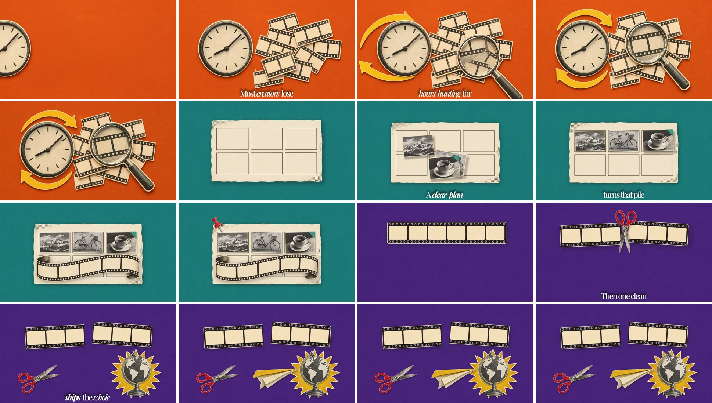

Adapted for Subclip from [pyang5166/gbro-collage-broll](https://github.com/pyang5166/gbro-collage-broll) by pyang5166, MIT.

# Collage B-roll

<!-- cli:start -->
> Install from your terminal: `npx @subclip/community-skills install gbro-collage-broll`
<!-- cli:end -->

Turn one spoken line of about 5 seconds into a halftone paper-collage B-roll clip that assembles itself from an empty color field. The creator approves the metaphor, then the still, then the animation, so credits go only to approved ideas.

Example request: "Make collage b-roll for the line 'every edit starts from scratch'. Vertical, 5 seconds, burnt orange."

[Watch the silent preview](preview.mp4). [Watch the reference with sound](examples/one-line-collage-broll.mp4): three spoken lines, three collages (a clock and film pile, a storyboard plan, one clean cut), 15 seconds, made with this skill in Subclip for 17 credits.

What changed from the original: the Python scripts, Gemini API key setup, ffmpeg steps and evals are gone. Stills and video use the creator's Codex or Grok CLI, or Subclip's own models with a credit quote first. The clip is placed on the Subclip timeline and checked with real frames. A second route builds the assembly as an editable HyperFrames layer. The Chinese-language workflow, gates, color rules and prompt templates are kept in English.

<!-- examples:start -->

## Examples

 1. Three lines, three collages: clock, plan board and clean cut, each built from an empty field. Images: gpt-image-2. Video: Wan 3 720p. <a href="examples/one-line-collage-broll.mp4">Play with sound</a>

 2. One frame per second: orange clock pile, teal storyboard, purple cut and paper plane. Images: gpt-image-2. Video: Wan 3 720p.

Test output made with this skill in Subclip for 17 credits. Cut-outs: gpt-image-2 via Codex CLI. Line 1: Wan 3 720p played in reverse; lines 2 and 3: Remotion layers. Voice: local alba. Captions: Whisper Small. Music: Lofi Hip Hop Loop by TheWandermiles (CC0).

<!-- examples:end -->
