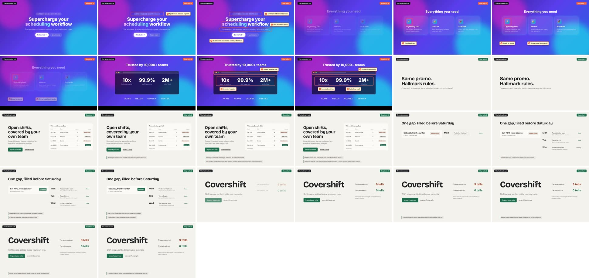

Adapted for Subclip from [Nutlope/hallmark](https://github.com/Nutlope/hallmark) by Nutlope (Hassan El Mghari) and the Hallmark contributors, MIT

# Hallmark

<!-- cli:start -->
> Install from your terminal: `npx @subclip/community-skills install hallmark`
<!-- cli:end -->

A design skill that refuses to look AI generated. Hallmark holds a hard floor against the defaults every model falls into (the eyebrow above every heading, tracked capital labels, one coloured word in a headline, purple to blue gradients, emoji icons, invented metrics, a drawn browser window), picks a theme so consecutive builds do not converge, and checks the result against a numbered list of gates before anything ships.

Creators who make SaaS explainers and product UI promos need that sense twice: in the page or app they film, and in the film. So this edition has two modes:

- **Website mode** keeps the original method for building or redesigning the page or product UI that will be filmed: the Floor, pre-flight, the four questions, shape, themes, the Picks block, hero first, the sweep and the fresh-context reviews, with all the original references (gates, layout, craft, imagery, anatomy, 21 macrostructures, 50 themes, genres, redesign and audit).
- **Video mode** applies the same rules to a Subclip timeline. The slop tells become a frame review checklist run with `get_timeline_contact_sheet` and `view_current_frame`. The design choices become the video's design system, recorded in the director brief so every scene matches. Product UI scenes are real captures or HyperFrames layers with sample data that says it is sample data.

## Try it

- "Use hallmark to make a 25 second promo for my scheduling app from these screenshots."
- "This product demo looks AI made. Review it with hallmark and fix what you find."
- "Build my landing page with hallmark, then record a walkthrough of it for a launch video."
- "Write down the design system of this video so the next scenes match."

## What is inside

- `SKILL.md`: the Floor, website mode, video mode, cost and the reference.
- `references/`: the original Hallmark references, adapted only where they named a script or an outside image service: `gates.md` (every tell with its tier and fix), `flow.md`, `layout.md`, `craft.md`, `imagery.md`, `anatomy.md`, `macrostructures.md` and its 21 shapes, `themes/` (50 theme files and `index.json`), `genres/`, `redesign.md`, the hero and finish review prompts and the rest.
- `references/video/frame-review.md`: every gate as it looks in a video frame, with its tier and fix.
- `references/video/design-system.md`: the design system block for the director brief, with a worked example.
- `references/video/ui-scenes.md`: real captures first, then product UI built as a HyperFrames layer.

No API keys. The original Node scripts (theme dealer, linter, capture tool) and the photo library are not bundled; their steps are done by hand or with Subclip tools, and the agent offers an installed original script only with your yes. Theme pictures and the original comp step (which needs a provider key) are left out; see the themes at [usehallmark.com](https://www.usehallmark.com).

## How it differs from taste-skill and impeccable

Three anti-slop design skills sit side by side in UI and SaaS. [Impeccable](https://github.com/pbakaus/impeccable) is a vocabulary of design commands (critique, audit, polish, typeset, quieter and more) you call on one screen at a time. [Taste skill](https://github.com/Leonxlnx/taste-skill) is art direction: plain copy, one system, real photographs and product UI, one hero entrance and a couple of dealt moments. Hallmark adds what neither has: a numbered gate list with tiers (Floor never ships, Reflex is waived only on the record with a reason, Finish is answered), a 50 theme catalog with a manual deal against your last builds so promos for different products do not converge, page anatomy by the job a viewer comes to do, and fresh-context hero and finish reviews. In video mode that becomes a gate-by-gate frame checklist and a design system block in the director brief.

## Reference

`examples/hallmark-reference.mp4` is a 26 second promo for a made-up product, Covershift (shift swaps for small cafes), made with this skill in Subclip. It plays the whole promo twice: first "the generated cut", with nine slop tells ringed and numbered as they appear, then "the hallmark cut", the same promo rebuilt under one design system from hero to product to close. `examples/hallmark-reference-sheet.jpg` shows it one frame per second.

<!-- examples:start -->

## Examples

 1. The same 26 s SaaS promo twice: nine AI slop tells labelled, then rebuilt with hallmark rules. Music CC0. No AI model. <a href="examples/hallmark-reference.mp4">Play with sound</a>

 2. Contact sheet: one frame per second of the reference, the frame review the agent ran. No AI model.

Made for Subclip in the AI Editor from HyperFrames code scenes, no AI model. Music: ElectronicPerk1, 3 and 4 by aikighost (Freesound, CC0); Whoosh from the Subclip SFX library.

<!-- examples:end -->

## Credits

Adapted for Subclip from [Hallmark](https://github.com/Nutlope/hallmark) by Nutlope (Hassan El Mghari) and the Hallmark contributors, MIT licensed (see `LICENSE`). The references are the original text with middle dots and ellipses replaced and script and provider-key steps rewritten for Subclip. The reference video and the silent hero were made in the Subclip AI Editor from code-rendered scenes, with no image, video or voice model. Music: [ElectronicPerk1](https://freesound.org/s/19064/), [ElectronicPerk3](https://freesound.org/s/19066/) and [ElectronicPerk4](https://freesound.org/s/19067/) by aikighost on Freesound (CC0); Whoosh from the Subclip SFX library. Fonts in the reference: Bricolage Grotesque and Instrument Sans (SIL Open Font License), loaded from Fontsource.
