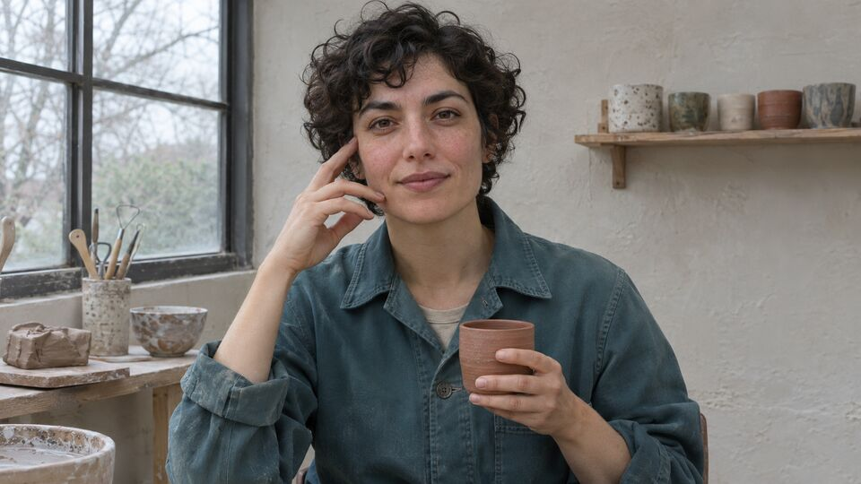
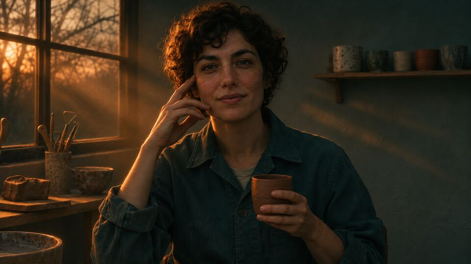

Adapted for Subclip from guides by sferro21 (https://www.instagram.com/sferro21)

# Relight and background swap (Subclip edition)

<!-- cli:start -->
> Install from your terminal: `npx @subclip/community-skills install higgsfield-to-subclip`
<!-- cli:end -->

Merges two guides that ran on an outside video service. Every step is re-expressed with Subclip tools and models: relight a still, run a clip-plus-still video pass, swap backgrounds with no green screen, check the result, edit the whole video by prompt and stack five looks into one reel.

Background swap, five relights, edit by prompt.

## Install

Add this skill from **Skills > Community** in Subclip, or point your agent at this folder. It works with Claude Code, Codex, Cursor and the in-app agent through Subclip's MCP tools.

## Files

- `SKILL.md`: the workflow the agent follows.
- `references/relight-looks.md`: five relight looks, still prompt frame and six fixes.
- `references/video-prompt-blocks.md`: the locked video prompt structure.
- `references/background-swap.md`: swap a room for a new place.
- `references/edit-prompts.md`: edit-by-prompt messages and the Subclip tool map.

## How it differs from the original guide

- Outside services, accounts and keys are replaced by Subclip's own generation tools and models. Image generation offers the creator's own Codex CLI first.
- Every model name the guide used is kept when Subclip's live catalog offers it. Where it does not, the closest model is named with the swap.
- Credits are quoted before anything is generated, and edits run one at a time on the native timeline.

<!-- examples:start -->

## Examples

 Neutral source still with soft daylight from the studio window. Image: gpt-image-2.

 Amber sunset through the same window creates a warm rim against teal shadows. Image: gpt-image-2.

 Cold blue storm light with rain confined to the window glass. Image: gpt-image-2.

 Daylight gives way to amber sunset, then cold storm light in the same ceramic studio. Clip: push-in, no video model. <a href="examples/ceramicist-lighting-study.mp4">Play with sound</a>

Test outputs made with this skill in Subclip. Images: gpt-image-2 (Codex CLI image generation). Video: no video model, the clip is an edit of the stills. Silent.

<!-- examples:end -->

## Credit and license

Adapted for Subclip from guides by sferro21 (https://www.instagram.com/sferro21). Rewritten in our own words. The creator's guides state no license, so please confirm permission with the creator before relying on this skill.
