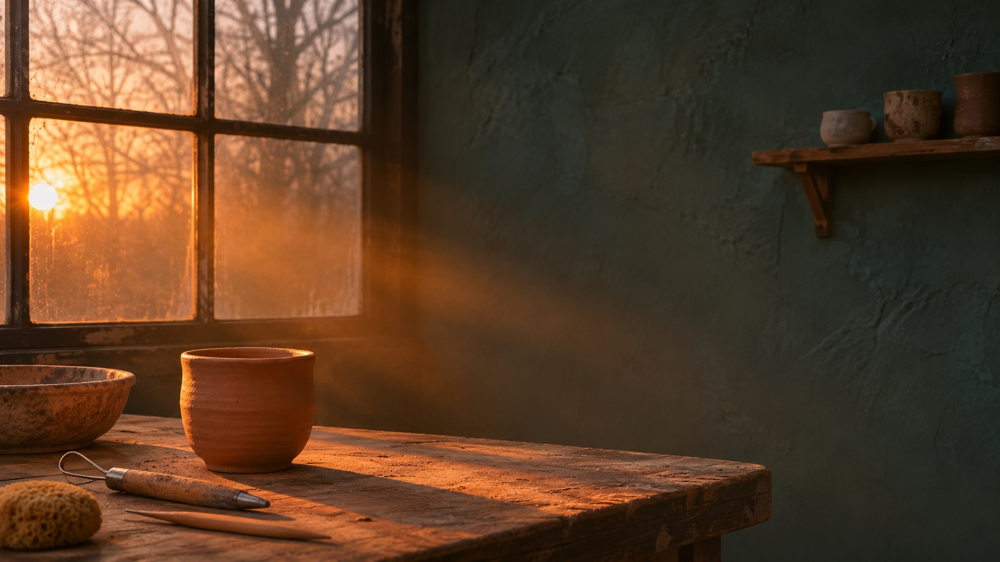
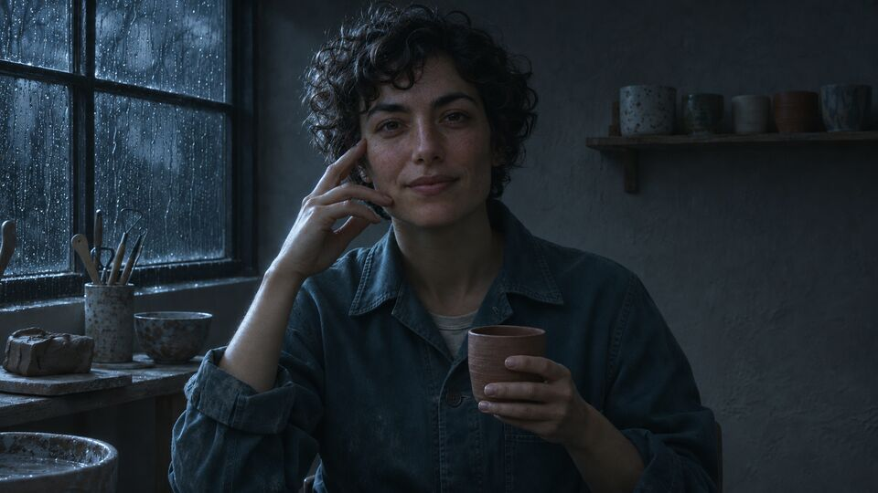

Adapted for Subclip from [the original guides](https://www.instagram.com/sferro21) by sferro21. The guides state no license.

# Relight and background swap (Subclip edition)

<!-- cli:start -->
> Install from your terminal: `npx @subclip/community-skills install higgsfield-to-subclip`
<!-- cli:end -->

Merges two guides that ran on an outside video service. Every step is re-expressed with Subclip tools and models: relight a still, run a clip-plus-still video pass, swap backgrounds with no green screen, check the result, edit the whole video by prompt and stack five looks into one reel.

Background swap, five relights, edit by prompt.

Watch the [ceramic studio lighting study with sound](examples/ceramicist-lighting-study.mp4) and the [silent hero](preview.mp4). The demo repeats one synthetic talking-head take with editable Subclip lighting effects, keeping the voice and captions in sync. Seedance 2 animates the closing pottery shot from the [window lighting plate](examples/window-light.jpg).

Ambient sound by kkenny101, CC0. [Loopable Filtered Rain Resonance Drone](https://freesound.org/people/kkenny101/sounds/864683/)

## Install

Add this skill from **Skills > Community** in Subclip, or point your agent at this folder. It works with Claude Code, Codex, Cursor and the in-app agent through Subclip's MCP tools.

## Files

- `SKILL.md`: the workflow the agent follows.
- `references/relight-looks.md`: five relight looks, still prompt frame and six fixes.
- `references/video-prompt-blocks.md`: the locked video prompt structure.
- `references/background-swap.md`: swap a room for a new place.
- `references/edit-prompts.md`: edit-by-prompt messages and the Subclip tool map.

## How it differs from the original guide

- Outside services, accounts and keys are replaced by Subclip's own generation tools and models. Image generation offers the creator's own Codex CLI first.
- Every model name the guide used is kept when Subclip's live catalog offers it. Where it does not, the closest model is named with the swap.
- Credits are quoted before anything is generated, and edits run one at a time on the native timeline.

<!-- examples:start -->

## Examples

 1. Amber relight: Studio study. Images: gpt-image-2. Video: Kling Avatar v2, Seedance 2 720p. Voice: Pocket TTS. Captions: Whisper Small. <a href="examples/ceramicist-lighting-study.mp4">Play with sound</a>

 2. Window light: Amber sunset and teal shadows across the pottery bench. Images: gpt-image-2.

 3. Daylight: Neutral ceramicist source portrait by the studio window. Images: gpt-image-2.

 4. Amber haze: A warm rim against teal shadows in the same studio. Images: gpt-image-2.

 5. Rain on glass: Cool storm light with droplets confined to the window. Images: gpt-image-2.

Original synthetic studio demo. Native Subclip effects relight the spoken take. Seedance 2 animates the pottery insert. Ambient sound by kkenny101 (CC0).

<!-- examples:end -->

## Credit and license

Adapted for Subclip from guides by sferro21 (https://www.instagram.com/sferro21). Rewritten in our own words. The creator's guides state no license, so please confirm permission with the creator before relying on this skill.
