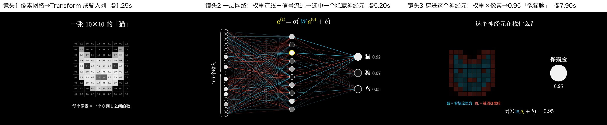
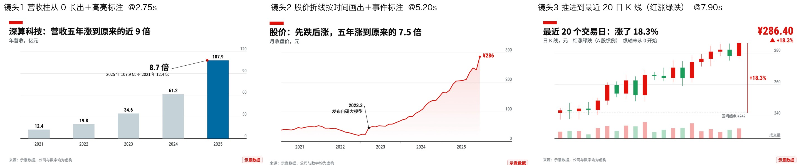

Adapted for Subclip from https://github.com/alchaincyf/huashu-art-motion by alchaincyf, MIT.

# Huashu art motion

Make paintings that move, art-history journeys, horizontal painted worlds and narration-led explainers. Design the frame first. Give the subject an action and the painting its own small movements.

[Watch the silent preview](preview.mp4).

The adaptation keeps Huashu's four production routes, 53 style recipe summaries, nine explainer grammars, material rendering methods, character checks, camera rules and musical timing ideas. Recipes are creative starting points, not installed renderers or promises of tested Subclip output. Later research recipes remain marked as research.

## Use it

Install this folder as a skill in Subclip, then use it with Claude Code, Codex, Cursor or the in-app agent. Try:

- "Make a 20 second living painting of a harbor, with visible brushwork and a boat unloading crates."
- "Use my narration to explain this mechanism on a continuous whiteboard."
- "Design a character walking through three painted worlds. Keep the ground and walking phase continuous."

The workflow reads existing media context first. Voice sets narrated timing. Native media, text, captions and audio stay editable. Short HyperFrames layers hold drawn animation; generated clips keep editable framing and timing. Choose a working creator generator or Subclip credits before generation. Subclip jobs use live model discovery and an approved quote.

## What changed

Provider-specific image, video and speech setup became Subclip generation and imports. Standalone render, analysis, cutout, audio-synthesis, assembly and delivery scripts became native timeline work and explicit review steps. There are no required scripts, provider credentials, copied demo engines or background update checks.

Detailed methods are organized in [SKILL.md](SKILL.md) and its references. The [source and verification notes](references/source-and-verification.md) explain licensing, tool checks and feature limits.

<!-- examples:start -->

## Examples

<video src="examples/showcase-mario-claude.mp4" controls muted loop playsinline width="720"></video> Huashu runs a whole Mario level: a brick asks for a membership, the cursor moves from OpenAI to Claude, a star power-up makes him big.

<video src="examples/showcase-mario-combo.mp4" controls muted loop playsinline width="720"></video> Stomp and kick combo: pixel Sam and Dario cameo as enemies, a kicked shell knocks over the character ahead, then the bricks break.

<video src="examples/showcase-mario-pipe.mp4" controls muted loop playsinline width="720"></video> Down the pipe: the camera rides a green tunnel into a coin room, then a scanline whip pan returns to the ground.

<video src="examples/showcase-clawd-vangogh.mp4" controls muted loop playsinline width="720"></video> Clawd jumps into Van Gogh's Wheat Field with Cypresses and is repainted in thick strokes that follow the original's stroke directions.

<video src="examples/showcase-clawd-trex.mp4" controls muted loop playsinline width="720"></video> Museum night: a T. rex skeleton chases the flashlight beam like a cat chasing a laser dot.

<video src="examples/showcase-clawd-dawn.mp4" controls muted loop playsinline width="720"></video> Dawn: Clawd poses as an exhibit in a picture frame, the guard puts down his coffee, and Clawd blinks once.

<video src="examples/showcase-monet.mp4" controls muted loop playsinline width="720"></video> Walking through paintings: a stone skip on Monet's Japanese Bridge sends ripples across the water, scene drawn in code.

<video src="examples/showcase-egypt.mp4" controls muted loop playsinline width="720"></video> Ancient Egypt: the hero interacts with a scarab beetle inside a code-drawn mural scene.

<video src="examples/showcase-pixel.mp4" controls muted loop playsinline width="720"></video> 8-bit world: the hero hits a block from below and a coin pops out. Same crossing film, scene drawn in code.

 A pixel grid becomes the input to a neural network diagram

 A product reveal with frosted cards and large metrics

 A sequence of bar, line and candlestick charts with highlighted values

 Bold type and color blocks introduce three stages of AI coding

Examples by alchaincyf, MIT, from the README of github.com/alchaincyf/huashu-art-motion. The showcase captions are translated to English by Subclip; the film clips are the original GIFs converted to MP4.

<!-- examples:end -->

## License and exclusions

The original [LICENSE](LICENSE) is preserved byte for byte, including its copyright notice. The upstream README excludes Huashu's character artwork, its appearances in overview images and demos, and the Clawd fan-demo media from its MIT grant. None is included here. Bundled fonts and Arphic-derived stroke data are also omitted. The cover is an original vector design for this adaptation. The bundled preview uses original artwork made for this adaptation.

Huashu credits Tak's [Art History Speedrun](https://x.com/cherry_mx_reds/status/2106095190285144331) as inspiration for the original fixed-scene art-history mechanism. This adaptation carries the method, not Tak's frames, sound, characters or compositions.

## Validation

This conversion was checked against the Subclip source tools and expanded model catalog on 2026-11-23. Repository build, schema, static scan and tests are run for the package. The silent preview was built and exported in Subclip, then reviewed at half-second intervals and around each cut.
