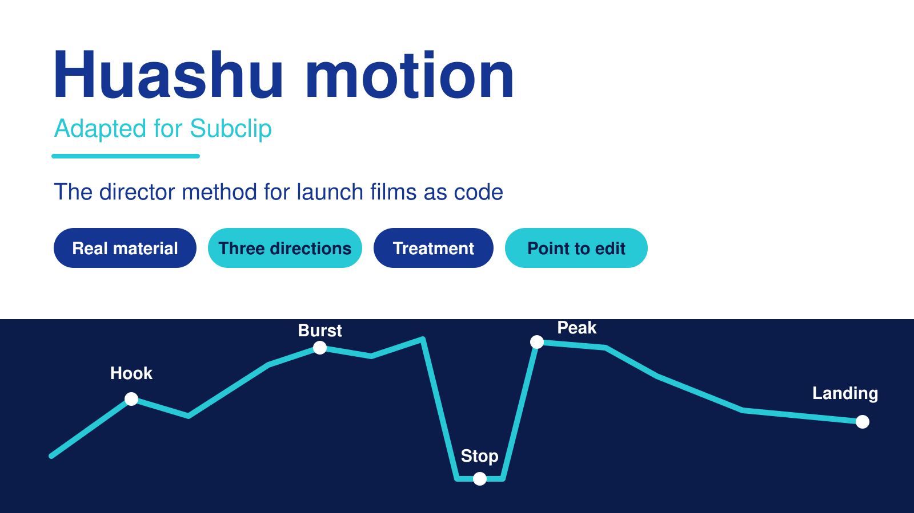
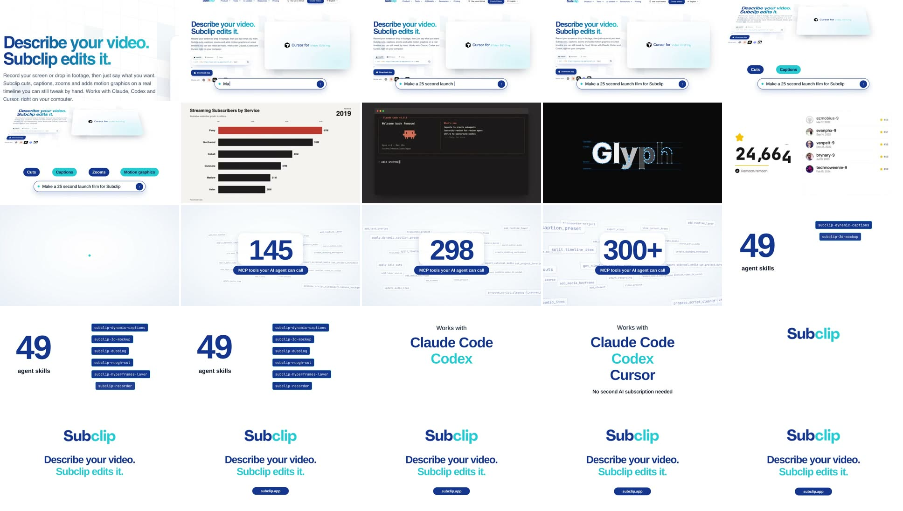

Adapted for Subclip from https://github.com/alchaincyf/huashu-motion by alchaincyf (Huashu), MIT

# Huashu motion

<!-- cli:start -->
> Install from your terminal: `npx @subclip/community-skills install huashu-motion`
<!-- cli:end -->

A director method for commercial launch films and explainers made as code. Tell your agent "make a 30 second launch film for my product". It reads the product, gathers its real material, offers three directions and waits for your pick, writes a treatment, builds the hardest shot first, scores the film, and then changes exactly the frame you point at.

[Watch the silent preview](preview.mp4).

## What it keeps from the original

- **Real material first.** The product's own screenshots, logo, colours, type and words, gathered before any design. Interface pieces that have to move are rebuilt in code, traced from a capture.
- **Three directions, then wait.** Three key frames that differ in motion language or material, exactly one of them in depth, each with a palette card that names where its colours came from.
- **A treatment before the build.** A rhythm sheet, a beat map, four stills (hook, hero, densest, end) and a continuity chain.
- **An energy shape.** A hook inside 3 s, a burst of cuts near the middle, one stop, a peak on the strongest musical point, a landing on the mark. Motion per second is read from a contact sheet: a flat line is a flat film.
- **The slide test.** Any stretch that is a thing on a ground with a caption under it gets its own shot: full bleed, macro, in space, all at once, or collision.
- **Punch-up.** A method for making an existing, correct but flat film much better: diagnose with numbers, keep the idea and the words, rebuild the shots and the score.
- **Comments on the frame.** A note about one moment changes that moment and nothing else.
- **A score from scene cues.** Music chosen before the cuts, scenes on its bars, hits on the frames where motion lands.
- The measured findings behind the defaults: cut rates and bursts of 21 launch films, colour findings, the house look to avoid, 13 formats and 20 motion languages.

## What changed for Subclip

The original runs its own command line tool, a browser studio with a comment inbox, local rendering and its own music and sound synthesis. Here:

| Original | In Subclip |
| --- | --- |
| Grabbing the product's material | `inspect_public_website` for a URL, `import_external_media` for the creator's files |
| One HTML and GSAP composition | Short HyperFrames layers (HTML and GSAP) for animated scenes, native media items for real material and cuts |
| Studio, inbox, looking at a pointed frame | The Subclip timeline and chat, `view_current_frame`, `read_layer_source`, `edit_layer_source` |
| Stills and contact sheets | `view_current_frame` and `get_timeline_contact_sheet` |
| Synthesized score and sound effects | `search_public_audio` (CC0 or CC BY) or `generate_music` after a quote, as native audio items; hits as audio items on scene cues |
| Render and share kit | `export_video` when asked; no posting |
| Local experience file | The project's director brief and session summary |

The "Made with" signature the original adds to every film is off by default here.

## How it differs from related skills

- **[huashu-art-motion](../huashu-art-motion/)** is by the same author, from a different repository: living paintings, art-history journeys and painterly explainer grammars. Use it when the film's look is an art style.
- **[product-launch-motion](../product-launch-motion/)** (AbubakrChan) is a catalogue: one shape that never cuts, 68 scene types, recipes and easings, each with its own clip. Use it when you want a ready-made scene vocabulary.
- **Huashu motion** is the director: it decides what this one film should be (material, direction, treatment, energy shape, sound) and checks it before you see it. It can use scenes from either of the others.

## Use it

Install the folder as a skill, then ask Claude Code, Codex, Cursor or the in-app agent:

- "Make a 25 second launch film for subclip.app. Use the real site."
- "Here is our finished product film. Make it much better."
- "At 0:07 the card is too small and the chip covers the logo."

The reference film below was made by following the skill for Subclip itself: real homepage capture and logo from `inspect_public_website`, three HyperFrames scenes, six real template previews cut on the beat, a CC0 loop and seven hits. No AI model, 0 credits.

<!-- examples:start -->

## Examples

 A 25 s launch film for Subclip: real homepage, prompt, six template cuts on the beat, a stop, a wall of tools, the logo. No AI model. <a href="examples/huashu-motion-reference.mp4">Play with sound</a>

 The same film at one frame per second: hook, burst, stop, peak and landing on one sheet. No AI model.

Made with this skill in Subclip from real subclip.app material, HyperFrames scenes and a CC0 loop by josefpres (freesound.org/s/621770). No AI model, 0 credits.

<!-- examples:end -->

## Files

- [SKILL.md](SKILL.md): the workflow, the gates and the tool map.
- [references/director.md](references/director.md): reading the product, message shapes, personality sliders, three directions, the treatment, film-wide taste rules.
- [references/rhythm.md](references/rhythm.md): routes, the energy curve, density, contrast, montage bursts, the rhythm sheet.
- [references/motion-library.md](references/motion-library.md): formats, languages, techniques, the house style.
- [references/colour.md](references/colour.md) and [references/depth.md](references/depth.md).
- [references/sound-and-music.md](references/sound-and-music.md): track sources, fitting the cut to the track, hits, levels.
- [references/punch-up.md](references/punch-up.md) and [references/comments-and-revisions.md](references/comments-and-revisions.md).
- [references/subclip-assembly.md](references/subclip-assembly.md) and [references/verification.md](references/verification.md).
- [references/source-and-verification.md](references/source-and-verification.md): licensing, what was left out and how this adaptation was tested.

## License

The original [LICENSE](LICENSE) (MIT) is kept byte for byte. The upstream repository also bundles GSAP under its own standard license, three.js, fonts under the SIL Open Font License, an AI-generated music library under its own dedication, and the author's cartoon likeness, which is not licensed under MIT. None of those files and none of the upstream demo media are copied here; the cover and all examples are original to this adaptation.
