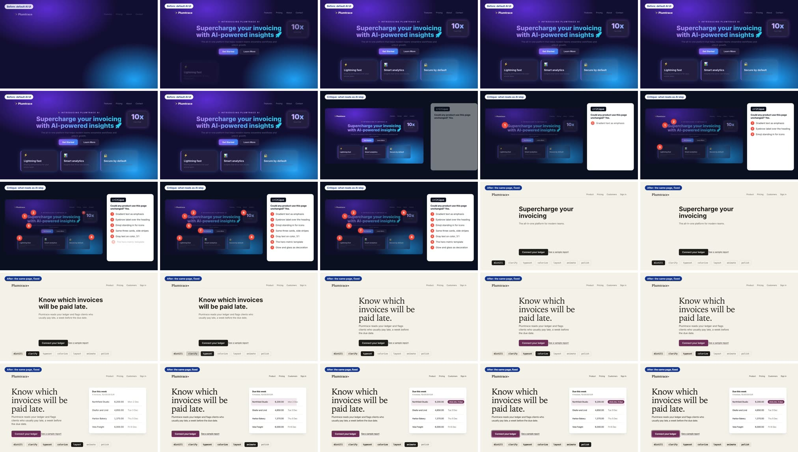

Adapted for Subclip from [pbakaus/impeccable](https://github.com/pbakaus/impeccable) by Paul Bakaus, Apache-2.0

# Impeccable

<!-- cli:start -->
> Install from your terminal: `npx @subclip/community-skills install impeccable`
<!-- cli:end -->

A design vocabulary for agents that make product UI, and for the videos that show it. Commands such as `critique`, `audit`, `polish`, `bolder`, `quieter`, `typeset`, `colorize`, `layout`, `distill`, `clarify`, `animate` and `delight` each name one kind of design work, and a craft floor catches the habits that make a screen look like generic AI output.

Creators who make SaaS explainers, product UI promos and app walkthroughs need that vocabulary twice: once for the page being filmed, and again for the film. So this edition has two modes:

- **Website mode** keeps the original method for the product's own code: shape, critique, polish and the rest, with the original playbooks in [reference/](reference/).
- **Video mode** applies the same words to a Subclip project. Critique and audit run on rendered frames and contact sheets. Polish, bolder, quieter, typeset, colorize, layout, distill, clarify, animate and delight act on text items, HyperFrames or Remotion UI scenes and motion. DESIGN.md becomes the video's design system, kept in the project brief.

See [SKILL.md](SKILL.md), [video/commands.md](video/commands.md) and [video/design-system.md](video/design-system.md).

## Reference

[examples/impeccable-reference.mp4](examples/impeccable-reference.mp4) is a 25 s before and after made with this skill in Subclip: a generic AI landing page for an invented invoicing product, a numbered critique of what reads as AI slop, then the same page fixed step by step with each command named on screen. [examples/impeccable-reference-sheet.jpg](examples/impeccable-reference-sheet.jpg) shows it one frame per second.

## Try it

> Critique the UI scenes in my promo and tell me what reads as generic.

> Typeset the title cards from 0:12 to 0:30.

> Make the pricing scene quieter, keep everything else.

> Document the design system of this video so the next scenes match.

> Polish my landing page before I record the walkthrough.

## How it differs from motion-polish

[motion-polish](../motion-polish/) (Emil Kowalski's skills) reviews motion craft: easing, springs, durations, entrances and exits. Impeccable is the whole design vocabulary for UI and SaaS videos: hierarchy, typography, color, layout, copy, the AI slop checklist and a design system, with motion as one command among many. Use Impeccable to decide what the scene should look like and say; hand deep motion work to motion-polish.

## What changed from the original

- Added video mode: [video/commands.md](video/commands.md) (commands mapped to Subclip tools, a video craft floor) and [video/design-system.md](video/design-system.md).
- Rewrote SKILL.md for two modes. Website mode always takes the original's own "launcher unavailable" path and maps each helper command to a manual step.
- Not included: the launcher binary, helper scripts, font index and browser bundles (`scripts/`), and the `live`, `generate`, `hooks`, `doctor` and `foundations` references, which only drive those scripts. Install the original skill for them.
- `harden`, `optimize` and `onboard` stay as website-only commands; video mode says why.
- In [reference/critique.md](reference/critique.md) one middle dot separator was replaced with a semicolon, and the links to `live.md` in `init.md`, `layout.md`, `typeset.md` and `colorize.md` now point to the original file on GitHub at the pinned commit. The other reference files are unchanged copies of the original's `.claude/skills/impeccable/reference/` at version 4.11.1.
- [LICENSE](LICENSE) and [NOTICE.md](NOTICE.md) are the original files, byte for byte. The iOS and Android references are distilled from ehmo's MIT licensed platform-design-skills, as NOTICE.md states. The original's fonts and consent rules are not copied.
- Examples and the cover are our own, made in Subclip with no AI model.

## Install

In Subclip: **Skills > Add skill**, paste `https://github.com/subclip-app/community-video-editing-skills/tree/main/skills/impeccable`.

<!-- examples:start -->

## Examples

 Before and after: a generic AI landing page, a numbered critique, then the same page fixed command by command. No AI model. <a href="examples/impeccable-reference.mp4">Play with sound</a>

 The same video one frame per second: before, critique, then distill, clarify, typeset, colorize, layout, animate, polish. No AI model.

Test outputs made with this skill in Subclip. Plumtrace is an invented product. Scenes rendered in code (HyperFrames), no AI model. Music: Tape No. R-S 5 (Lo-fi loop) by Dwy, CC0.

<!-- examples:end -->
