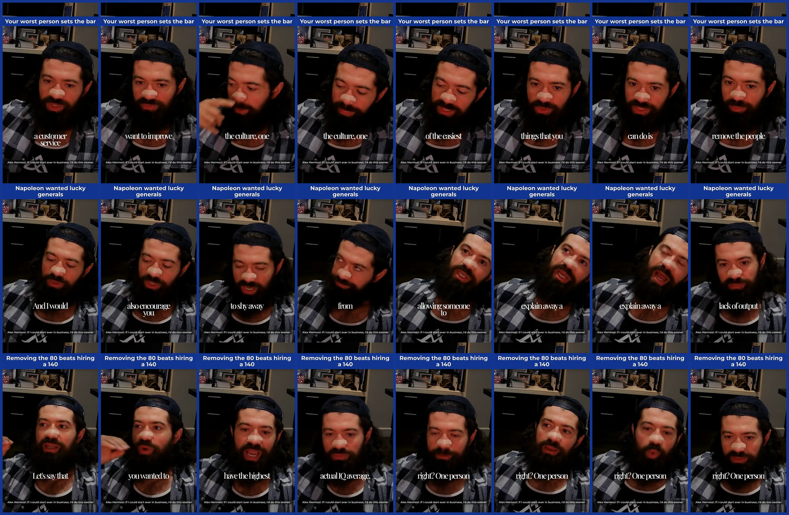

# Long video to shorts

<!-- cli:start -->
> Install from your terminal: `npx @subclip/community-skills install long-to-shorts`
<!-- cli:end -->

An original Subclip skill, written by Subclip and released under MIT. It was inspired by the idea behind [SupoClip](https://github.com/FujiwaraChoki/supoclip) (long video in, short clips out). No SupoClip code, prompts or text were used.

Give your agent a podcast, interview, lecture, stream or talk. It finds the moments most likely to hold a viewer, cuts them into vertical clips, adds captions and a hook, and exports several shorts. It can then schedule them to your connected accounts after you approve.

## Install

In Subclip: **Skills > Add skill**, paste `https://github.com/subclip-app/community-video-editing-skills/tree/main/skills/long-to-shorts`. The app can also install it by default.

## Try it

> Turn this 45 minute podcast into 5 shorts for TikTok and Reels.

> Find the best 3 clips in my webinar, 40 to 60 seconds each, with captions and a hook title.

The agent shows you its picks and scores before it cuts anything, so you can drop or swap a clip first.

## What happens

1. Read supplied timestamped captions or transcribe the video when needed.
2. Read the whole transcript and score every candidate segment: hook, self-contained story, emotion, payoff, length.
3. Show you a ranked list. You approve, drop or change.
4. Cut each clip non-destructively, reframe it to 9:16, add Dynamic Captions and a short hook.
5. Optional: quiet music under the speech.
6. Export one file per clip.
7. Optional: schedule the clips, one by one, after you confirm each account and time.

## Example

The three example shorts were cut in Subclip from [If I could start over in business, I'd do this sooner](https://www.youtube.com/watch?v=H8QfAfCbOXs) by Alex Hormozi, who allows clipping of his videos. Credit goes to him for the words and the footage. The skill picked three moments from the 16 minute talk, cut them to 9:16 with a hook bar, word-timed captions and a credit line, and kept his original audio: [Your worst person sets the bar](examples/worst-person-sets-the-bar.mp4), [Napoleon wanted lucky generals](examples/napoleon-lucky-generals.mp4) and [Removing the 80 beats hiring a 140](examples/remove-the-80.mp4). The [contact sheet](examples/shorts-contact-sheet.jpg) shows the first 8 seconds of each, one frame per second. The [worked example](references/worked-example.md) documents the scores, caption import and framing choices.

## What is inside

- `SKILL.md`: the workflow the agent follows.
- `references/scoring-rubric.md`: how to score and choose segments, with examples of good and bad cuts.
- `references/vertical-captions-hooks.md`: reframing, captions, hook title and music rules.
- `references/export-and-schedule.md`: exporting a batch and scheduling it safely.

It uses only Subclip's own tools. No outside API keys, no scripts to run.

<!-- examples:start -->

## Examples

Source video: <a href="https://www.youtube.com/watch?v=H8QfAfCbOXs">If I could start over in business, I'd do this sooner</a>, Alex Hormozi, Clipping allowed by the creator

 1. Your worst person sets the bar: Alex Hormozi, If I could start over in business, I'd do this sooner. No AI model. <a href="examples/worst-person-sets-the-bar.mp4">Play with sound</a>

 2. Napoleon wanted lucky generals: a 39 s short from the same Alex Hormozi video, pause cut, word captions. No AI model. <a href="examples/napoleon-lucky-generals.mp4">Play with sound</a>

 3. Removing the 80 beats hiring a 140: Alex Hormozi on team quality, 36 s, hook bar and word captions. No AI model. <a href="examples/remove-the-80.mp4">Play with sound</a>

 4. Contact sheet at 1 s: the first 8 s of each Alex Hormozi short with hook, captions and credit line. No AI model.

Shorts cut with this skill in Subclip from Alex Hormozi, If I could start over in business, I'd do this sooner (https://www.youtube.com/watch?v=H8QfAfCbOXs). Clipping allowed by the creator. Real footage and his own words, no image, video or audio model, zero credits.

<!-- examples:end -->
