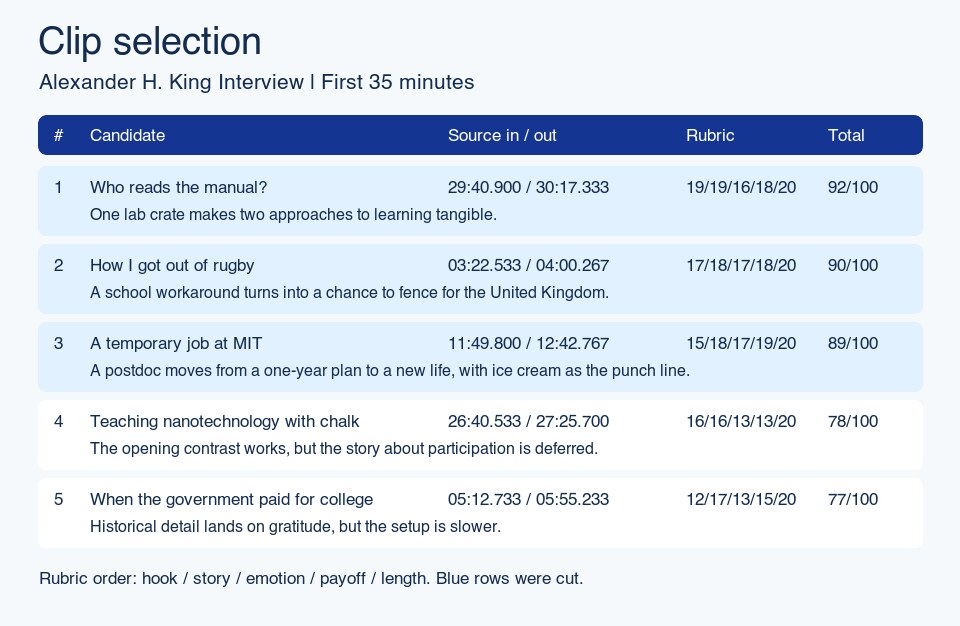
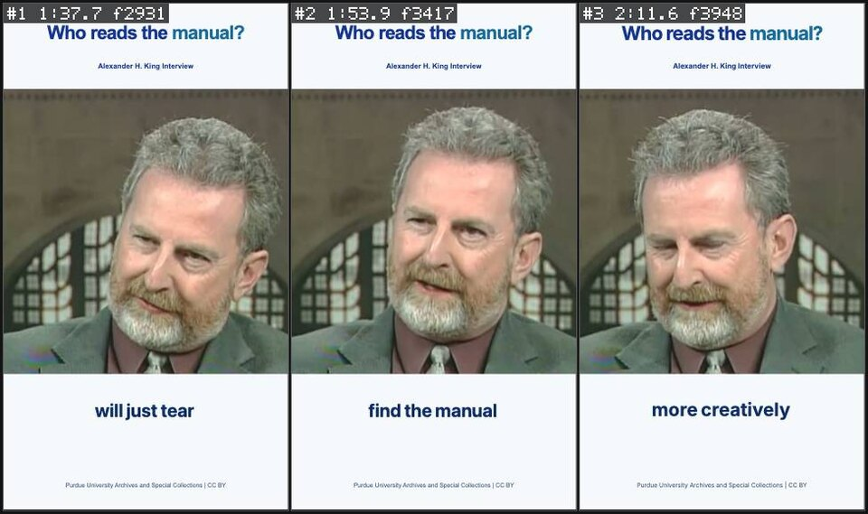

# Long video to shorts

<!-- cli:start -->
> Install from your terminal: `npx @subclip/community-skills install long-to-shorts`
<!-- cli:end -->

An original Subclip skill, written by Subclip and released under MIT. It was inspired by the idea behind [SupoClip](https://github.com/FujiwaraChoki/supoclip) (long video in, short clips out). No SupoClip code, prompts or text were used.

Give your agent a podcast, interview, lecture, stream or talk. It finds the moments most likely to hold a viewer, cuts them into vertical clips, adds captions and a hook, and exports several shorts. It can then schedule them to your connected accounts after you approve.

## Install

In Subclip: **Skills > Add skill**, paste `https://github.com/subclip-app/community-video-editing-skills/tree/main/skills/long-to-shorts`. The app can also install it by default.

## Try it

> Turn this 45 minute podcast into 5 shorts for TikTok and Reels.

> Find the best 3 clips in my webinar, 40 to 60 seconds each, with captions and a hook title.

The agent shows you its picks and scores before it cuts anything, so you can drop or swap a clip first.

## What happens

1. Read supplied timestamped captions or transcribe the video when needed.
2. Read the whole transcript and score every candidate segment: hook, self-contained story, emotion, payoff, length.
3. Show you a ranked list. You approve, drop or change.
4. Cut each clip non-destructively, reframe it to 9:16, add Dynamic Captions and a short hook.
5. Optional: quiet music under the speech.
6. Export one file per clip.
7. Optional: schedule the clips, one by one, after you confirm each account and time.

## Example

The three example shorts were cut in Subclip from the first 35 minutes of the [Alexander H. King Interview](https://www.youtube.com/watch?v=aXMPh927_fI), published under Creative Commons Attribution by Purdue University Archives and Special Collections. The [worked example](references/worked-example.md) documents the scores, caption import and framing choices.

## What is inside

- `SKILL.md`: the workflow the agent follows.
- `references/scoring-rubric.md`: how to score and choose segments, with examples of good and bad cuts.
- `references/vertical-captions-hooks.md`: reframing, captions, hook title and music rules.
- `references/export-and-schedule.md`: exporting a batch and scheduling it safely.

It uses only Subclip's own tools. No outside API keys, no scripts to run.

<!-- examples:start -->

## Examples

Source video: <a href="https://www.youtube.com/watch?v=aXMPh927_fI">Alexander H. King Interview</a>, Purdue University Archives and Special Collections, CC BY

 King takes up fencing to avoid rugby and goes on to represent the United Kingdom. <a href="examples/short-1.mp4">Play with sound</a>

 A temporary job at MIT becomes a life in the United States, with better ice cream as the punch line. <a href="examples/short-2.mp4">Play with sound</a>

 King uses a lab crate and its manual to compare how students at MIT and Purdue approach a new tool. <a href="examples/short-3.mp4">Play with sound</a>

 Five real candidates ranked by the five-part rubric, with exact source ranges and cut decisions.

 Three Subclip timeline frames from the manual story show its portrait crop, hook and dynamic captions.

Shorts cut with this skill in Subclip from Alexander H. King Interview by Purdue University Archives and Special Collections (CC BY), https://www.youtube.com/watch?v=aXMPh927_fI. Real footage, no image, video or audio generation model.

<!-- examples:end -->
