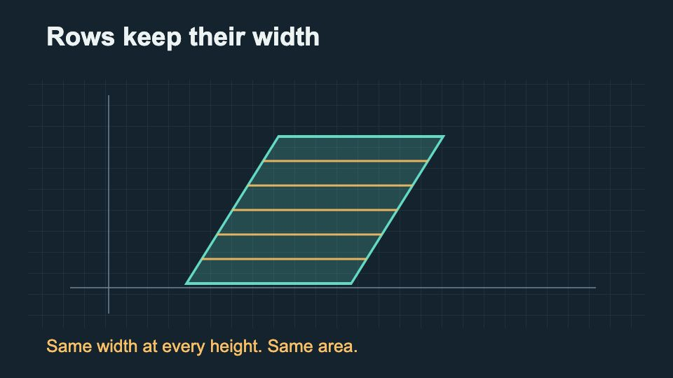

Adapted for Subclip from [OpenMontageInc/OpenMontage](https://github.com/OpenMontageInc/OpenMontage) by OpenMontageInc, AGPL-3.0

# manim-composer (Subclip edition)

Plan and build a 3Blue1Brown-style math or science explainer inside Subclip. You give a vague idea, the agent researches it, asks a few questions, writes a scene-by-scene plan, voices it, and builds each scene as an editable animated motion layer with captions and optional music.

The original skill planned scenes for Manim (a Python math animation library). Subclip has no Manim runtime, so this version keeps the planning craft and rebuilds the scenes as HyperFrames layers (SVG, HTML and GSAP). No outside API keys, no Python, no ffmpeg.

## Install

In Subclip: **Skills > Add skill**, paste `https://github.com/subclip-app/community-video-editing-skills/tree/main/skills/manim-composer`.

## Use

> Make a 2 minute 3b1b-style video that explains why the dot product works.

## What's inside

| File | What it covers |
|---|---|
| `SKILL.md` | The six phases: understand, clarify, plan, voice, build scenes, assemble |
| `references/narrative-patterns.md` | Six narrative structures and the emotional arc |
| `references/visual-techniques.md` | Visual grammar, timing, palettes, and a Manim-to-layer mapping table |
| `references/scene-examples.md` | Example scene breakdowns (dot product, Fourier series, matrices) |
| `references/scenes-template.md` | Blank scene plan template |

<!-- examples:start -->

## Examples

 A rectangle shears slowly while its highlighted horizontal rows keep the same length. <a href="examples/shear-area.mp4">Play with sound</a>

 The settled comparison explains area preservation by comparing equal-width rows.

Test outputs made with this skill in Subclip. Rendered in code (SVG animation in headless Chrome, ffmpeg): no image or video model. Timing used local text-to-speech, the clip is silent.

<!-- examples:end -->

## License

AGPL-3.0, same as the original project. See `LICENSE`. If you host a modified version as a network service, the AGPL asks you to offer its source.
