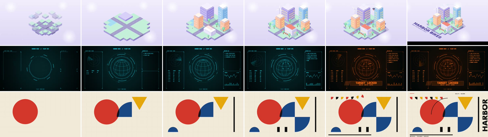

Adapted for Subclip from [Vincentwei1021/mg-styles-15](https://github.com/Vincentwei1021/mg-styles-15) by Vincentwei1021, MIT.

# 15 Motion Design Styles

<!-- cli:start -->
> Install from your terminal: `npx @subclip/community-skills install mg-styles-15`
<!-- cli:end -->

Pick one of fifteen motion design styles by name or by mood and get your own 10-second film in it, built as editable layers on your Subclip timeline: frame-by-frame line boil, isometric 2.5D, flat vector, line art, 3D render, shape morph, sticker explainer, cyberpunk HUD, collage cut-out, aurora glassmorphism, Bauhaus, 80s synthwave VHS, pixel art, liquid motion and 9:16 variety captions.

Each style comes with the full director prompt behind the original film: the output spec, a beat-by-beat creative seed, and the signature features and key techniques a jury judges it by. The agent swaps the seed for your story, keeps the signature features, builds the film, then reviews it with the original jury rubric and offers a revision round.

Try asking:

> Make a 10 second isometric film about our bike-share launch, pastel colors, title on the ground plane.

> Something tense and high tech for our security product: which two styles fit? Then build the one I pick.

## How it differs from similar skills

- [video-shotcraft](../video-shotcraft) (same author) is about product promos built from real captures and named shot recipes. This skill is about visual styles.
- [code-motion-styles](../code-motion-styles), [code-animation-styles-remotion](../code-animation-styles-remotion) and [ai-style-atlas](../ai-style-atlas) offer wide catalogs (16 to 86 looks) with a short prompt each. This skill goes deep instead: 15 styles, each with a complete film-length prompt, measurable signature techniques (curves, frame counts, layer structure) and a jury rubric with a review and revise loop.

## What changed from the original

- The upstream harness (a page rendered frame by frame, joined into an MP4) is replaced by HyperFrames layers in Subclip, which use the same seek-to-time drawing.
- The 3D render style uses native 3D layers or a Three.js layer; Blender is optional.
- Music and effects come from the Subclip library (`search_public_audio`) or `generate_music` instead of synthesis scripts, as native audio items.
- Prompts are translated to plain English where the original had Chinese.
- No upstream fonts, HDRI, textures, photos or demo media are included. The cover and examples are our own.

See [LICENSE](LICENSE) for the original MIT license.

<!-- examples:start -->

## Examples

 1. One seed in three styles: isometric, cyberpunk HUD, Bauhaus. HyperFrames layers, CC0 music, no AI model. <a href="examples/mg-styles-reference.mp4">Play with sound</a>

 2. One frame per second of the three styles, each a seekable HyperFrames layer. Rendered in code, no AI model.

Test outputs made with this skill in Subclip. Scenes rendered in code (HyperFrames Canvas2D), no image, video or audio model. Music: Happy Trance Plucked Arpeggiator by elaineaeris, Cyberpunk snippet by cabled_mess, 120 bpm ravish loop by waveplaySFX (all CC0, Freesound).

<!-- examples:end -->
