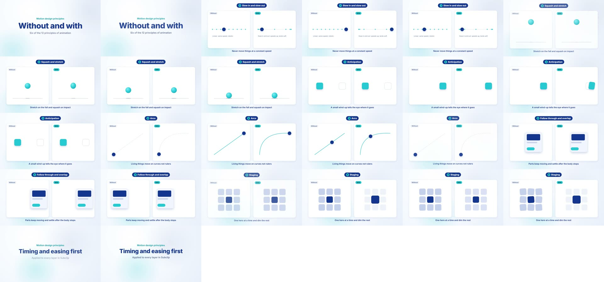

Adapted for Subclip from https://github.com/LottieFiles/motion-design-skill by LottieFiles, MIT

# Motion design principles

<!-- cli:start -->
> Install from your terminal: `npx @subclip/community-skills install motion-design-principles`
<!-- cli:end -->

The foundations of good motion for every layer in a Subclip project: timing, easing, choreography and Disney's 12 principles of animation. Your agent decides what the viewer should feel, which element leads, how long each move takes and how it eases, then builds it with editable native keyframes or HyperFrames and Remotion motion layers, and checks the key poses frame by frame.

## Reference

[examples/motion-principles-reference.mp4](examples/motion-principles-reference.mp4) shows six principles side by side, each without and with: slow in and slow out, squash and stretch, anticipation, arcs, follow-through and overlap, and staging. It was built in Subclip with three HyperFrames layers and a CC0 music bed, 0 credits.

## What is inside

- [SKILL.md](SKILL.md): the 8-step checklist, the three pillars, the 12 principles mapped to Subclip tools, personality archetypes, duration, easing, choreography, emotion and weight tables, quality rules and troubleshooting.
- [references/subclip-apply.md](references/subclip-apply.md): durations in frames, how each easing curve maps to native keyframes, GSAP and Remotion, Lottie in Subclip, choreography on the timeline.
- [references/frame-review.md](references/frame-review.md): which poses to check, with `view_current_frame` and `get_timeline_contact_sheet`.
- `references/director/`, `references/patterns/`, `references/tables/`: the original deep dives on philosophy, emotion, choreography, narrative, entrance and exit, state feedback, ambient motion, stagger recipes, timing tables, property selection and the quality checklist.

## How it differs from nearby skills

- **motion-polish** (Emil Kowalski) is a strict review and craft pack: it decides whether something should move at all and judges existing motion against a high bar. This skill is the layer underneath it: the 12 principles, timing and easing tables and choreography rules you apply to every layer before and during a build.
- **anatomy** makes one kind of artifact (isometric explainer figures). **code-motion-styles** is a catalog of visual styles. Both can use this skill for how their parts move.

## Try it

> Animate this lower third in with a Corporate personality and check the key poses.

> The title card feels robotic. Fix the timing and easing.

> Stage these five product callouts so only one moves at a time.

## What changed in the adaptation

- Interface examples stay as written, since the same rules apply to interface-like graphics in a video. Millisecond durations gained frame counts.
- The hand-off to an outside hosted animation service, with its install commands, was removed. Rendered files come from Subclip's own export, and existing Lottie JSON is placed with `import_public_lottie_json`.
- Added Subclip tool mapping, easing translation for native keyframes, GSAP and Remotion, and a frame review checklist.

## Install

In Subclip: **Skills > Add skill**, paste `https://github.com/subclip-app/community-video-editing-skills/tree/main/skills/motion-design-principles`.

## Further reading

- [Motion Design With Fable 5.2: The 12 Rules That Make Animation Look Designed](https://x.com/cryptowluha/status/2125490835286278324), an X article by wluha.

<!-- examples:start -->

## Examples

 1. Six principles without and with: slow in and out, squash and stretch, anticipation, arcs, follow-through, staging. No AI model. <a href="examples/motion-principles-reference.mp4">Play with sound</a>

 2. One frame per second of the reference: three seekable HyperFrames layers. Rendered in code, no AI model.

Test outputs made with this skill in Subclip. Scenes rendered in code (HyperFrames: HTML and GSAP): no image or video model. Music: Airport Lounge by code_box on Freesound (CC0).

<!-- examples:end -->
