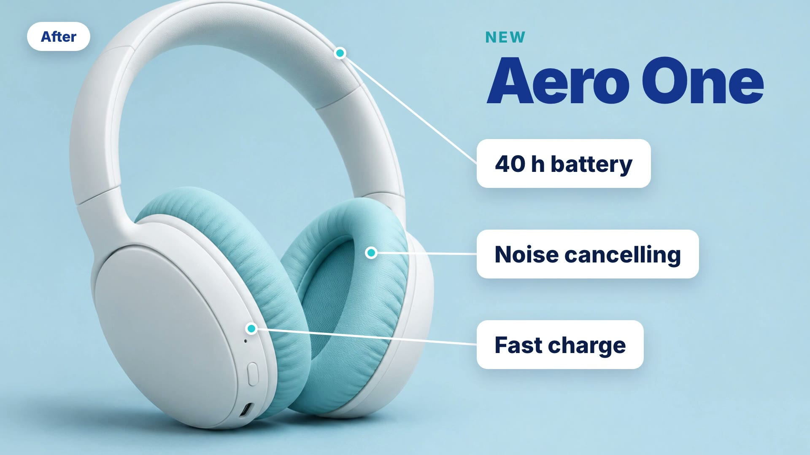
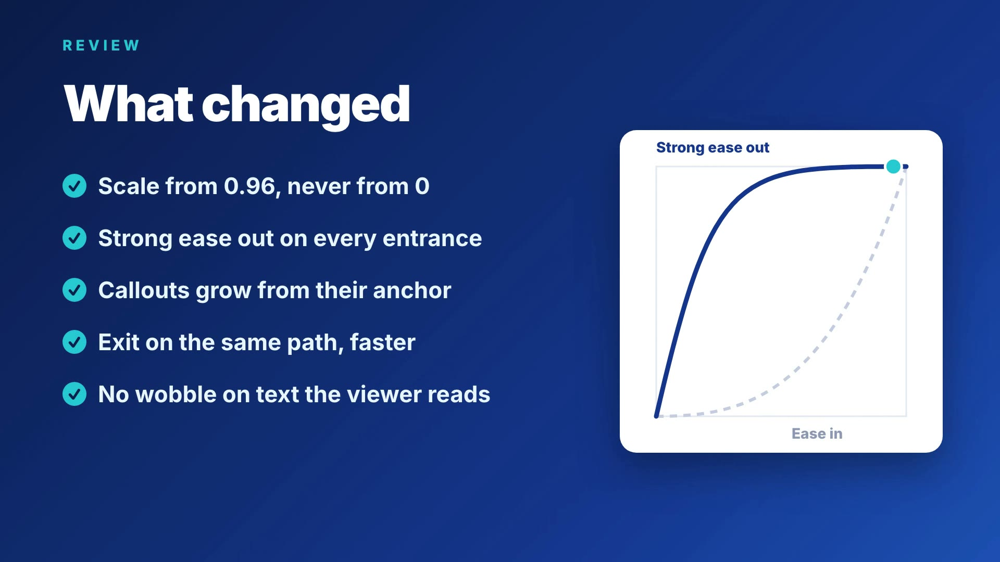
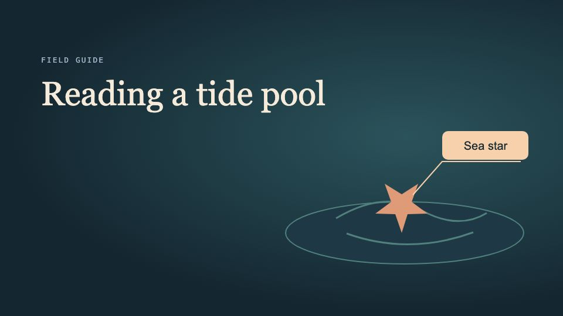

Adapted for Subclip from https://github.com/emilkowalski/skills by Emil Kowalski, MIT

# Motion polish

Eight animation skills from Emil Kowalski, re-aimed at video. The original skills judge interface motion in code. These judge motion in a Subclip project: media keyframes, text keyframes, transitions, and HyperFrames or Remotion motion layers.

The craft stays: should it animate at all, what is its purpose, which easing and duration, how it enters and exits, what is cheap to render. What changed is how things get made. Everything runs through Subclip's editing tools. No code base to scan, no npm packages to install.

## Reference

[examples/aero-one-before-after.mp4](examples/aero-one-before-after.mp4) is a before and after made with this pack: the same product callouts animated badly, then reviewed and fixed (strong ease out, growth from the anchor, same path out). SKILL.md lists each fix.

## The skills

- [animate](animate/SKILL.md): build one animation, deciding in the right order.
- [animate-expo](animate-expo/SKILL.md): spring physics and momentum for motion layers (the React Native parts were dropped).
- [animation-performance](animation-performance/SKILL.md): keep previews smooth and exports correct.
- [animation-vocabulary](animation-vocabulary/SKILL.md): turn "that bouncy thing" into the right term.
- [find-animation-opportunities](find-animation-opportunities/SKILL.md): read-only sweep for moments that deserve motion, and the many that do not.
- [improve-animations](improve-animations/SKILL.md): audit a project's motion and write precise fix plans.
- [remove-animations](remove-animations/SKILL.md): cut motion that cannot defend itself.
- [review-animations](review-animations/SKILL.md): review motion against a strict bar and give a verdict.

Shared numbers (easing curves, durations, spring settings, native keyframe mapping) live in [references/video-motion-values.md](references/video-motion-values.md).

## Install

In Subclip: **Skills > Add skill**, paste `https://github.com/subclip-app/community-video-editing-skills/tree/main/skills/motion-polish`.

## Try it

> Review the motion in my project and tell me what to fix.

> Animate this lower third in: it should feel quick and clean.

> What is it called when text pushes in and settles with a little bounce?

## What was dropped

Hover and press states, keyboard shortcut rules, `prefers-reduced-motion` code, drag and gesture handling, haptics, Reanimated, Expo Router and every React Native specific recipe. A video has no cursor and no finger. Their ideas survive where they still apply (springs, momentum, interruptions become "do not restart a move that is already in flight").

<!-- examples:start -->

## Examples

 1. Before and after: one product callout scene animated badly, then fixed by the review. Image: gpt-image-2. No video model. <a href="examples/aero-one-before-after.mp4">Play with sound</a>

 2. After, settled: callouts grown from their anchor points on the headphones. Image: gpt-image-2. Rendered in code.

 3. Review: the five fixes and the strong ease out curve against ease in. Rendered in code, no image model.

 4. Anchored callout: the leader stays anchored to the sea star in the diagram.

 5. Callout motion: a short ease out brings in the sea star callout, then it exits on the same path. <a href="examples/anchored-callout.mp4">Play with sound</a>

 6. Spring marker: the settled check marker in the tide pool guide.

 7. Spring marker motion: the check marker lands with a small overshoot before it settles. <a href="examples/spring-marker.mp4">Play with sound</a>

Test outputs made with this skill in Subclip. Product still: gpt-image-2 through the Codex CLI. Scenes rendered in code (HyperFrames): no video model. Music: Airport Lounge by code_box, CC0.

<!-- examples:end -->
