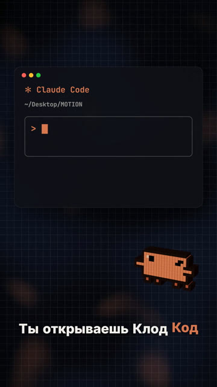
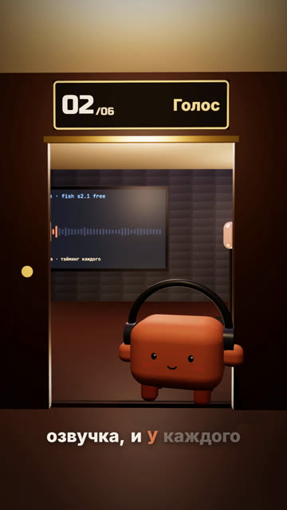
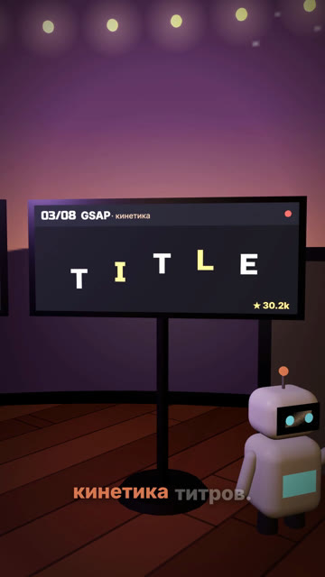
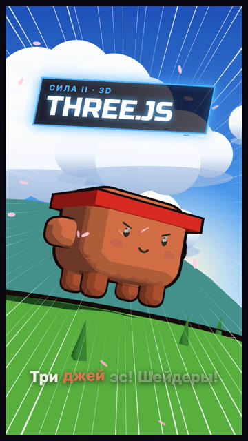
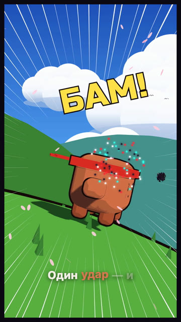
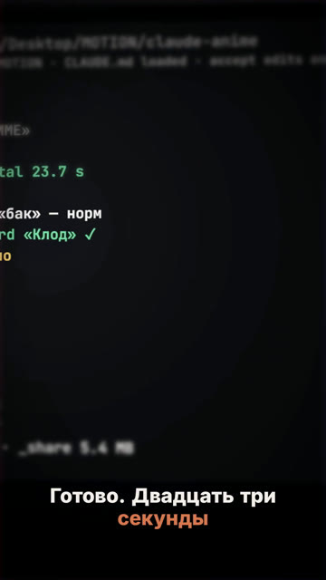

Adapted for Subclip from https://github.com/Vladic20/tvhead-studio by Vladic20, MIT

# Motion Reel Studio (Subclip edition)

This adapts the `motion-studio` sub-skill of Vladic20/tvhead-studio. The same plugin also holds `tvhead-video` (our separate TV-Head Doodle and Cartoon Stories skill), `ai-montage` and `blender-3d` (not adapted).

A skill for AI agents working in [Subclip](https://subclip.app) that makes 35 to 60 second vertical reels in five code-built styles: kinetic motion with a voxel mascot, a cozy 3D elevator tower, a cozy 3D film set with a clapperboard, an anime opening with cel shading and impact frames, and a "shot on a phone" laptop screen look. It works audio first, keys every accent to a spoken word, keeps text inside the Reels, TikTok and Shorts safe zone and delivers a -14 LUFS master.

**Topic in, vertical reel out, as editable Remotion or HyperFrames layers. Code renders cost no credits. No outside API keys, no scripts.**

[Watch the silent preview](preview.mp4). The capability reference is `examples/capability-motion-reel-studio.mp4`. Every style has its own reference in `examples/`.

```
brief -> script -> voice -> word timings -> music -> scene layers -> stills check -> seams -> delivery
```

## Install

In Subclip: **Skills > Add skill**, paste `https://github.com/subclip-app/community-video-editing-skills/tree/main/skills/motion-reel-studio`. Or ask the agent: "install the motion-reel-studio skill from github.com/subclip-app/community-video-editing-skills/tree/main/skills/motion-reel-studio".

## Use

> Make a 45 second reel about the five tools I use for video, as a cozy 3D elevator tower.

The agent picks the style, writes a short script, makes a free local voice and word timings, builds the scenes as layers keyed to the words, checks one frame per scene and every seam, and reports what it saw and measured. Anything paid shows its credit cost first and waits for your yes.

## What's inside

| File | What it covers |
| --- | --- |
| `SKILL.md` | The five styles, the rules and the 11-step workflow |
| `references/styles/01..05` | One recipe per style: scene recipe, prompt, build notes, Subclip route |
| `references/script-and-voice.md` | Script rules, plan cards, voice and timings in Subclip |
| `references/safe-zones-and-delivery.md` | Safe zones, loudness (master -14 LUFS), phone copy |
| `references/layer-rules.md` | Deterministic motion rules for HyperFrames and Remotion layers |
| `references/subclip-tools.md`, `references/qa.md`, `references/overlap.md` | Tool mapping, checks, overlap table |
| `LICENSE` | The original MIT license, unchanged |

## Cost

Layers, local speech and public audio cost nothing. Cloud voice, generated music and generated images are optional and quoted first.

<!-- examples:start -->

## Examples

<p align="center"><a href="examples/capability-motion-reel-studio.mp4"></a><br><sub>Capability reference: the five reel styles. Images: gpt-image-2. Rendered in code. <a href="examples/capability-motion-reel-studio.mp4">Play with sound</a></sub></p>

<p align="center"><a href="examples/01-kinetic-reel.mp4"></a><br><sub>1. Kinetic motion reel with a voxel mascot. Rendered in code with HyperFrames, no AI model. <a href="examples/01-kinetic-reel.mp4">Play with sound</a></sub></p>

<p align="center"><br><sub>1. Kinetic reel, a frame from the original template. By the original author.</sub></p>

<p align="center"><a href="examples/02-cozy-tower.mp4"></a><br><sub>2. Cozy 3D elevator tower. Rough reference. Images: gpt-image-2, animated in code, no video model. <a href="examples/02-cozy-tower.mp4">Play with sound</a></sub></p>

<p align="center"><br><sub>2. Elevator tower, a frame from the original. By the original author.</sub></p>

<p align="center"><a href="examples/03-film-set.mp4"></a><br><sub>3. Cozy 3D film set with a clapperboard. Rough reference. Images: gpt-image-2, animated in code, no video model. <a href="examples/03-film-set.mp4">Play with sound</a></sub></p>

<p align="center"><br><sub>3. Film set, a frame from the original. By the original author.</sub></p>

<p align="center"><a href="examples/04-anime-opening.mp4"></a><br><sub>4. Anime opening. Rough reference. Images: gpt-image-2, animated in code, no video model. <a href="examples/04-anime-opening.mp4">Play with sound</a></sub></p>

<p align="center"><br><sub>4. Anime opening, a frame from the original. By the original author.</sub></p>

<p align="center"><br><sub>4. Anime impact frame with onomatopoeia. By the original author.</sub></p>

<p align="center"><a href="examples/05-phone-shot.mp4"></a><br><sub>5. Shot on a phone. Rough reference. Images: gpt-image-2, animated in code, no video model. <a href="examples/05-phone-shot.mp4">Play with sound</a></sub></p>

<p align="center"><br><sub>5. Shot on a phone, a frame from the original. By the original author.</sub></p>

<p align="center"><sub>Files marked By the original author are frames from Vladic20's tvhead-studio (MIT, github.com/Vladic20/tvhead-studio). Others were made for this skill: 01 is a code render, the rest are gpt-image-2 stills animated in code. No Subclip credits spent.</sub></p>

<!-- examples:end -->

## Credits and license

MIT. See `LICENSE` (the upstream file, unchanged). It states that portions of the upstream derive from garazh-skill by lubluniky, used under the MIT License.

- Adapted from the motion-studio skill of tvhead-studio, https://github.com/Vladic20/tvhead-studio, by Vladic20, MIT (commit c18305f).
- Portions of the upstream derive from garazh-skill, https://github.com/lubluniky/garazh-skill, by lubluniky, MIT.
- The upstream vendors recipes from motion-graphics-skills, https://github.com/charlie947/motion-graphics-skills, and claude-motion-design, https://github.com/howseen-ai/claude-motion-design (both MIT).
- The upstream builds on Remotion, three.js, GSAP and others; the cozy 3D, anime and phone-shot looks were rebuilt from scratch after reference reels, and no assets from them are used.
- Related upstream skills not adapted here: ai-montage and blender-3d.

The upstream runs a local Remotion project with setup scripts and outside voice services; this version moves every step into Subclip's tools. Files in `examples/` marked "By the original author" are frames copied from the upstream repository; 01 is a code render and the others are gpt-image-2 stills animated in code, made for this skill.
