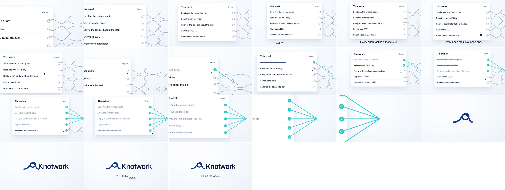

Adapted for Subclip from [Tejashmakwana/motionmaxxing](https://github.com/Tejashmakwana/motionmaxxing) by Tejas Makwana, Apache-2.0

# motionmaxxing

<!-- cli:start -->
> Install from your terminal: `npx @subclip/community-skills install motionmaxxing`
<!-- cli:end -->

Looksmaxxing for motion graphics: launch films, product promos, feature reveals and brand stings that look made by a motion designer, not like a slide deck that moves. The agent first finds an idea only this brand could own (its logo, core control, material, verb or voice), builds a world for it (ground, light, depth, texture, one hero surface), writes what each beat makes the viewer believe and how each shot becomes the next, then animates with curves measured frame by frame on 53 professional motion moments. Last, it reviews its own frames against six gates and writes down what it checked instead of calling the film good.

## What it adds next to the other UI and SaaS skills

`product-launch-motion`, `video-shotcraft`, `huashu-motion`, `taste-skill` and `impeccable` cover scene recipes, shot recipes, house styles and UI taste. motionmaxxing adds three things:

- **Measured curves from professional work.** 12 named eases (softLand, snapSettle, glide, accelExit and more) fitted to about 4,300 moves, with typical frame counts and what professionals used each for. The median move is 10 frames; landing decelerates, leaving accelerates; nothing grows from zero.
- **A brand-owned idea.** Cover the logo and the film must stop working for a competitor. The logo arrives by cause, never by default.
- **Honest review gates.** Render exists, proof readable, no empty frame, short end hold, one hero per frame, no page furniture (corner labels, counters, kickers, deck layouts, vibe-coded cards). Fails are fixed, not argued.

## How it works in Subclip

1. Give it a website (captured with `inspect_public_website`), a product name or nothing (it designs an identity on purpose).
2. It writes the brand inventory, three ideas of different kinds, and a storyboard with what each beat buys, into the project brief.
3. It builds each scene as an editable HyperFrames layer with the seek-safe Motion runtime (`assets/motion-layer.js`) and the measured eases.
4. Voice with Subclip speech (local voices are free), music and sound from the public audio search or `generate_music`.
5. It checks the frames against the six gates (`references/review-gates.md`) and records the results.

Code layers, local speech and catalog audio cost 0 credits. Paid steps are quoted first and wait for your yes. No API keys and no scripts.

## Folder

- `SKILL.md`: the judgment, the never-ship list, the craft laws and the Subclip workflow.
- `references/`: the original craft references (judgment, idea, world, director, brand, layout, motion, transitions, type, UI demo, close, sound, slop), each marked where it was changed, plus `measured-curves.md`, `review-gates.md`, `runtime.md`, `subclip-tools.md` and `overlap.md`.
- `taste/`: the original author's verdicts and before and after edits.
- `assets/motion-layer.js`: the runtime, modified so it runs inside a Subclip layer.
- `library/moments.jsonl`: 716 rule-only precedent rows.
- `LICENSE` and `NOTICE`: unchanged from the original.

## Reference

The [Knotwork reference with sound](examples/knotwork-reference.mp4) and its [one-frame-per-second sheet](examples/knotwork-contact.jpg) were made by following the skill for an invented to-do app, 0 credits: checking a task pulls its loose thread taut, and the threads become the knot logo. The [silent preview](preview.mp4) is the hero.

## Changes and what is not included

Modified for Subclip: the upstream scripts (brand capture, render, `look.py`, `lint.mjs`, voice, mix, image plates, blind review) are replaced by Subclip tools and a frame checklist; the runtime's 3D hook is a stub and its typing helper builds DOM nodes, because layers block dynamic imports and `innerHTML`. Not included: the vendored GSAP (it has its own GreenSock license; Subclip loads its own pinned copy), Three.js, opentype.js, the Inter font files, the 3D and phone UI runtimes, the calibration strips and the showcase films, which show other companies' brands.

<!-- examples:start -->

## Examples

 1. Knotwork sting: loose task threads pulled taut become the knot logo. Code layers, measured eases, no AI model. <a href="examples/knotwork-reference.mp4">Play with sound</a>

 2. One frame per second of the Knotwork sting: hook, five tasks tied off, knot lockup. No AI model.

Test output made with this skill in Subclip for 0 credits, for an invented product. Three HyperFrames layers with the Motion runtime. Music: Electronic Perk loops by aikighost (CC0). Click, whoosh and ding from the Subclip catalog.

<!-- examples:end -->
