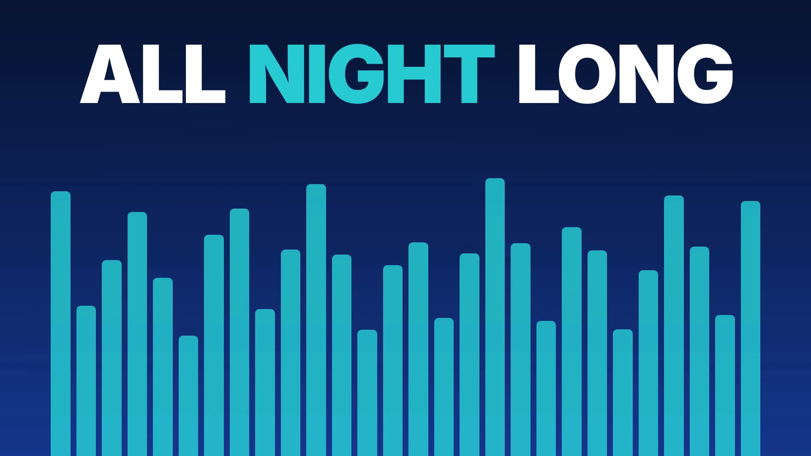
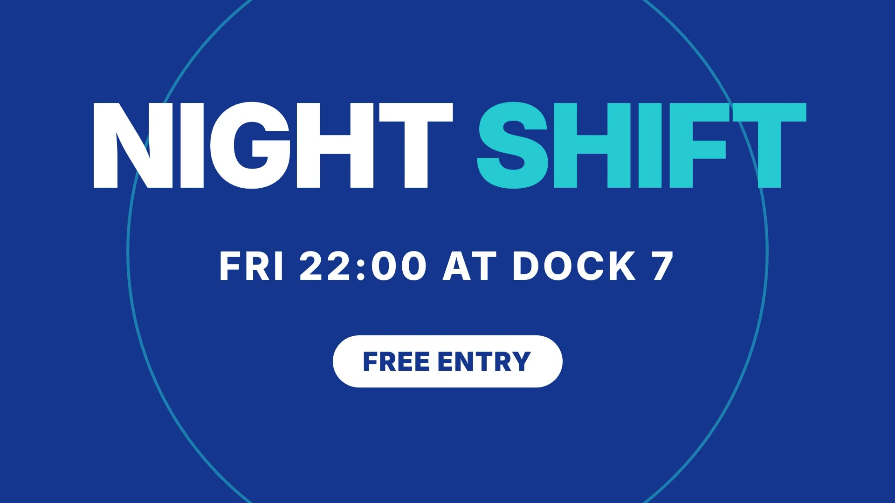

Adapted for Subclip from [OpenMontageInc/OpenMontage](https://github.com/OpenMontageInc/OpenMontage) by OpenMontageInc, AGPL-3.0

# music-to-video (Subclip edition)

Give the agent a song (or ask it to generate one) and get a beat-synced video: kinetic typography, a lyric video, a beat-cut montage of your own clips and photos, or a calm phrase-paced piece. The agent reads the track into a beat map, cuts it into frames, plans each frame with you, and builds every frame as an editable motion layer on the Subclip timeline.

The original ran a Python beat analyzer and the HyperFrames command line. This version uses Subclip's editor tools only: no Python, no ffmpeg, no outside API keys, no scripts to run.

## Install

In Subclip: **Skills > Add skill**, paste `https://github.com/subclip-app/community-video-editing-skills/tree/main/skills/music-to-video`.

## Use

> Make a 30 second kinetic typography video for this track. Hype mood, my logo at the end.

## Reference

[examples/night-shift-promo.mp4](examples/night-shift-promo.mp4) is a beat-synced kinetic type promo made with this skill: intro, build, a hard stop, the drop and a poster ending, every cut on the beat map. SKILL.md lists each frame.

## What's inside

| File | What it covers |
|---|---|
| `SKILL.md` | The six steps in Subclip |
| `references/beat-map.md` | How the beat map is built without a beat detector, trust rules, sync offset |
| `references/frame-skeleton.md` | Cutting the track into frames and setting pacing |
| `references/planning.md` | Brand spine, groups, copy, self-check |
| `references/template-catalog.md` | Nine beat-synced treatments and when to use each |
| `references/motion-primitive-catalog.md` | About 45 motion primitives with anchors, spans and timing rules |
| `references/montage.md` | Cutting your own clips and photos on the beat |

## Limits

Subclip has no beat detection tool yet, so the beat grid is measured by hand from the waveform or taken from a known tempo. Play the preview and tell the agent if cuts feel early or late; it shifts every anchor together.

<!-- examples:start -->

## Examples

 1. Night Shift promo: 20 s kinetic type cut to a 120 BPM club loop, hard stop, hit, drop. Rendered in code, no video model. <a href="examples/night-shift-promo.mp4">Play with sound</a>

 2. Equalizer frame: bars pulse on every beat under a three word line. Rendered in code, no image model.

 3. Poster frame: name, date and entry land on the downbeats. Rendered in code, no image model.

 4. Percussive cascade: each word lands on a steady onset and phrases swap on the bar line. <a href="examples/percussive-cascade.mp4">Play with sound</a>

 5. Held pad message: a still message over a drifting field for a sparse pad.

Test outputs made with this skill in Subclip. Rendered in code (HyperFrames layers): no image, video or audio model. Music: Euro Club Loop by YellowTree, CC BY 4.0.

<!-- examples:end -->

## License

AGPL-3.0, same as the original project. See `LICENSE`.
