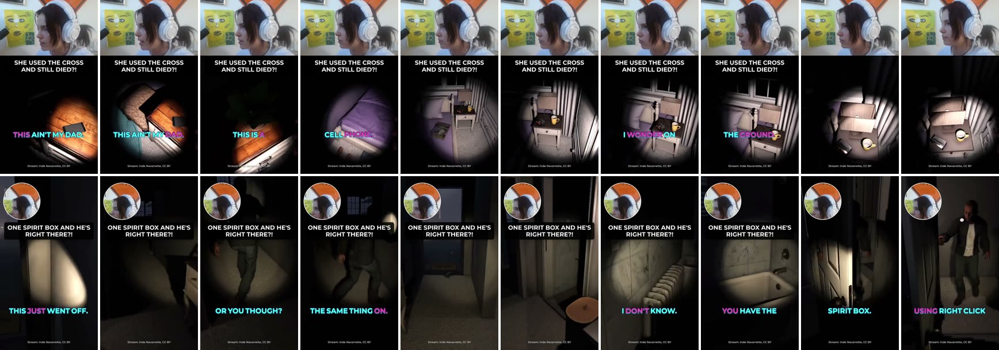

Adapted for Subclip from [iamajmeena/neonclipping](https://github.com/iamajmeena/neonclipping) by Ajay K Meena, AGPL-3.0

# NeonClipping (Subclip edition)

<!-- cli:start -->
> Install from your terminal: `npx @subclip/community-skills install neonclipping`
<!-- cli:end -->

Paste a YouTube, Twitch or Kick link, or give a gaming video. Your agent finds the highlight moments, gives each one a title and an opening heading, builds a streamer layout (facecam above gameplay by default), adds word-timed captions in a gaming style such as GTA Neon, and exports one 9:16 clip per moment. Everything stays editable in Subclip.

NeonClipping is a free, local clipping app by Ajay K Meena. This skill keeps its craft: the way it finds moments, writes headings, frames streams with eleven layouts and styles captions. It rebuilds that craft with Subclip's native tools instead of running the app. It is not the NeonClipping app, and no NeonClipping code is included: the method is described in our own words.

## Install

In Subclip: **Skills > Add skill**, paste `https://github.com/subclip-app/community-video-editing-skills/tree/main/skills/neonclipping`.

## Try it

> Clip this Twitch VOD into 3 shorts with my facecam on top and GTA Neon captions.

> Find the best 2 moments in the first hour of this stream. Circle facecam, Hormozi captions, no heading.

> Change clip 2 to blurred fill and make the heading 5 seconds. Do not find new moments.

## What happens

1. Get the source with `fetch_linked_media` (or your file), and its word-timed captions when the platform has them. Otherwise transcribe locally for free.
2. Shortlist moments from reactions, screams, laughter and loudness jumps, read each one in context, score it, and write a title and a grounded opening heading.
3. Show you the plan. You approve, drop or move edges.
4. Find the facecam and a clean gameplay area, then build the layout from native media copies: crops, positions and sizes you can change later.
5. Captions in the chosen style, at most 4 words at a time, gone during quiet parts. A heading over the first 8 seconds with a black backing on bright gameplay.
6. Check frames and sound, then export one file per clip.

Saved clips can be changed later (layout, face size, caption style, heading, trim) without downloading or finding moments again.

## Layouts and styles

- **Layouts:** Face + gameplay (camera above, the default for streams), Gameplay + face, Blurred fill, Fill screen, Gameplay only, four corner facecam overlays, Circle camera and Side by side. Automatic facecam finding, five facecam position presets, a face size setting and platform safe zones.
- **Captions:** GTA Neon, Impact, Clean, Hormozi and MrBeast, words per caption, quiet-part aware, any language the local speech model knows, Hinglish in Roman letters.
- **Opening headings:** 8 s by default (2 to 60 s), curiosity question or sharp contrast grounded in a real quote, Box, Impact, Neon or Banner look.

## How this differs from long-to-shorts

[long-to-shorts](https://github.com/subclip-app/community-video-editing-skills/tree/main/skills/long-to-shorts) is built for talking video: podcasts, interviews, talks. It reframes one speaker to fill the frame, scores moments on story and payoff, and lets the opening caption carry the hook. This skill is built for streams and gaming video:

- **Two pictures in one frame.** Streams have a webcam and gameplay. This skill finds the facecam, crops it and the gameplay separately, and stacks them (or uses corner, circle, side-by-side or blurred layouts). long-to-shorts uses one crop of one speaker.
- **Reaction-led moments.** It looks for screams, laughter, loudness jumps and reaction words in addition to the words, with a moment mix (Balanced, Action, Dialogue). long-to-shorts scores mainly spoken story.
- **Gaming caption styles and headings.** GTA Neon and friends, quiet-part aware captions for long game-sound gaps, and an 8 second opening heading with a black backing that reads on bright gameplay.
- **Stream sources.** YouTube, Twitch and Kick links, platform captions first, only the chosen part of very long streams.

Use long-to-shorts for a podcast; use this one for a stream.

## Example

Two clips made by following this skill on [Inde Navarrette, Lets Play Phasmophobia (Part 01)](https://www.youtube.com/watch?v=voQeFH0DXYk), a Twitch-style stream that Inde Navarrette published under a Creative Commons Attribution licence (reuse allowed, shown on the video page). Credit goes to Inde Navarrette for the stream, her voice and her webcam.

- [They killed me](examples/they-killed-me-face-gameplay.mp4): Face + gameplay layout, GTA Neon captions, opening heading.
- [Spirit box](examples/spirit-box-circle-cam.mp4): Circle camera layout over the gameplay.
- [Contact sheet](examples/neonclipping-contact-sheet.jpg): one frame per second from the first 10 seconds of both clips.

The [worked example](references/worked-example.md) has the moment scores, boxes and settings. No AI model, zero credits; captions from the free local speech model.

## What is inside

- `SKILL.md`: the workflow the agent follows.
- `references/moments-and-headings.md`: signals, scoring, edge snapping, heading rules and looks.
- `references/layouts.md`: facecam finding, presets and all eleven layouts with exact geometry.
- `references/captions.md`: the five caption styles, grouping, quiet parts, languages.
- `references/worked-example.md`: the example run.
- `LICENSE` and `NOTICE`: the original AGPL-3.0 licence and notice, unchanged.

It uses only Subclip's own tools. No outside API keys, no scripts to run.

## Licence

This adaptation is shared under the AGPL-3.0, like the original. The NeonClipping name and logo belong to its author; this skill is an adaptation of its method and is not presented as NeonClipping itself. See [LICENSE](LICENSE) and [NOTICE](NOTICE).

<!-- examples:start -->

## Examples

Source video: <a href="https://www.youtube.com/watch?v=voQeFH0DXYk">Inde Navarrette | Lets Play Phasmophobia [Part 01]</a>, Inde Navarrette, CC BY

 1. They killed me: facecam above gameplay, GTA Neon captions, 8 s heading. Inde Navarrette stream, CC BY. No AI model. <a href="examples/they-killed-me-face-gameplay.mp4">Play with sound</a>

 2. Spirit box: circle facecam over gameplay, GTA Neon captions, 8 s heading. Inde Navarrette stream, CC BY. No AI model. <a href="examples/spirit-box-circle-cam.mp4">Play with sound</a>

 3. Contact sheet at 1 s: the first 10 s of both clips with heading, captions and credit line. No AI model.

Clips cut with this skill in Subclip from Inde Navarrette, Lets Play Phasmophobia Part 01 (https://www.youtube.com/watch?v=voQeFH0DXYk), CC BY. Her own stream, voice and webcam; YouTube captions, no AI model, zero credits.

<!-- examples:end -->
