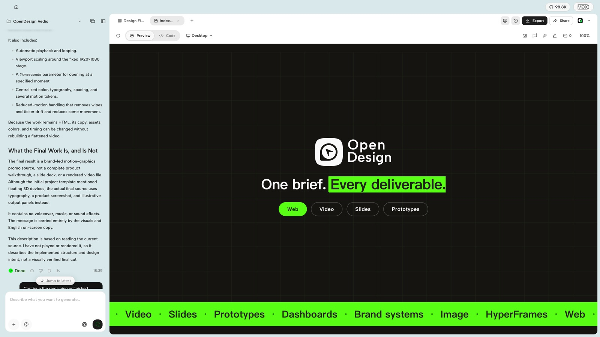
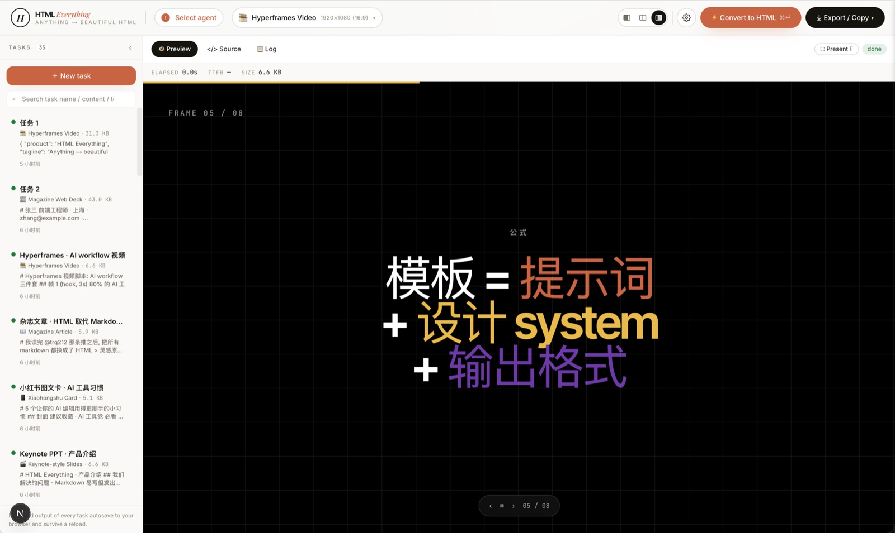

Adapted for Subclip from https://github.com/nexu-io/open-design by nexu-io, Apache-2.0.

# Open Design Motion

<!-- cli:start -->
> Install from your terminal: `npx @subclip/community-skills install open-design-motion`
<!-- cli:end -->

These six skills replace Open Design artifact pages, provider dispatch and render scripts with native Subclip tools.

- [motion-frames](motion-frames/SKILL.md) Build a looping kinetic poster, title card or animated hero with a wireframe globe, type ring or monogram.
- [video-shortform](video-shortform/SKILL.md) Plan and generate a single 3 to 10 second product reveal, teaser or ambient video shot.
- [sprite-animation](sprite-animation/SKILL.md) Create a pixel-art history or trivia beat with a hero year, looping sprite, kinetic type and timeline ribbon.
- [audio-jingle](audio-jingle/SKILL.md) Make a jingle, soundtrack bed, narration or sound effect and mix it as editable Subclip audio.
- [video-hyperframes](video-hyperframes/SKILL.md) Turn a short script into consecutive editable motion scenes with a hook, evidence and a CTA.
- [mockup-device-3d](mockup-device-3d/SKILL.md) Build a native 3D phone and optional laptop product showcase with real screen media and an optional turntable.

The cover is an original illustration of the Motion Frames recipe. Open Design provides the creative reference.

<!-- examples:start -->

## Examples

 Open Design Studio preview of an animated product headline and scrolling text. <a href="examples/studio-motion-demo.mp4">Play with sound</a>

 Studio still with a lime highlight and a line of scrolling deliverables.

 A typographic explainer about what goes into a design template.

Examples by nexu-io, Apache-2.0, from github.com/nexu-io/open-design

<!-- examples:end -->
