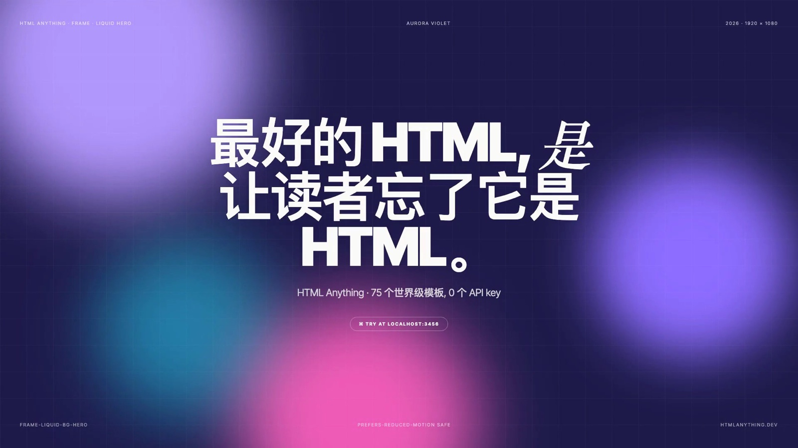

Adapted for Subclip from https://github.com/nexu-io/open-design by nexu-io, Apache-2.0.

# Open Design Video Templates

Twenty-two motion recipes for title cards, statement frames, stat and chart reveals, flowcharts, product promos and logo outros. Each one keeps the original template's palette, type, layout and timeline beats, and tells your agent how to rebuild it as an editable Subclip HyperFrames layer (or a Remotion layer for the data roll-up) with your own copy, numbers and brand.

- Start with [SKILL.md](SKILL.md), which lists every recipe and the Subclip workflow.
- Read [references/layer-rules.md](references/layer-rules.md) for how CSS-keyframe sources become seekable timelines and what is export-safe.
- Each recipe has a card in [references/](references/), named after the original template folder.

What changed from the original: the original ships rendered preview videos, bundled fonts, vendored scripts and a render pipeline. This version keeps the design knowledge and drops the rest. Rendering, sound and export use Subclip's own tools. No outside API keys or scripts are needed.

The cover is a collage of four of the original preview frames, used under the Apache-2.0 license.

<!-- examples:start -->

## Examples

 A signal-loss title with split-color lettering and digital distortion. <a href="examples/glitch-title.mp4">Play with sound</a>

 A cinematic title framed by an amber light leak. <a href="examples/light-leak-title.mp4">Play with sound</a>

 A purple monogram reveals itself against a dark background. <a href="examples/logo-outro.mp4">Play with sound</a>

 A bold headline over a soft field of blue and purple light.

Examples by nexu-io, Apache-2.0, from github.com/nexu-io/open-design

<!-- examples:end -->
