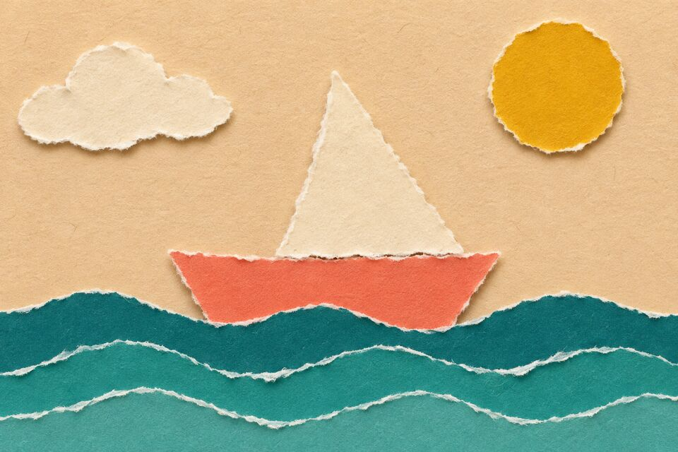
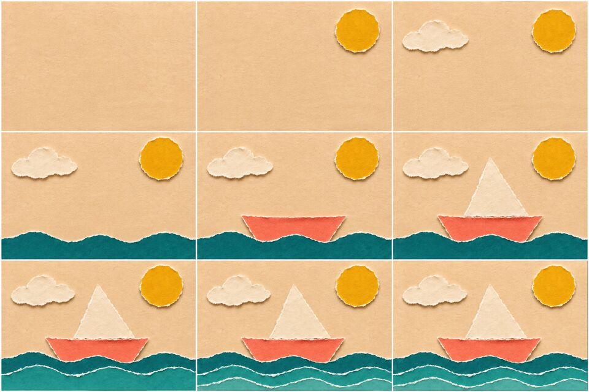

Adapted for Subclip from the Notion list Claude Creative Skill Library Vol 2 (https://app.notion.com/p/Claude-Creative-Skill-Library-Vol-2-3ffb5f1fde2d81938bb9eb76ea6c60d1) by PYNK Society

# Paper-cut motion

Takes one finished image and makes a handcrafted paper collage motion video where the scene builds itself out of torn paper. Three steps: the paper-cut still, a nine panel storyboard sheet, then the animation.

## Use it

Tell your agent: "Use paper-cut-motion on this image" and attach the image. It runs the three steps and puts the result on your timeline.

## What changed for Subclip

The original skill runs in Claude Code and hands you prompts to paste into outside generators, then cuts with ffmpeg. This version keeps the creative method and does the work in Subclip: generation through `generate_ai_media` (or your own Codex CLI for images), voice through Subclip speech tools, and assembly on the editable timeline. Nothing here needs an outside key, ffmpeg or a script.

<!-- examples:start -->

## Examples

 Finished torn paper sailboat with layered teal waves and visible torn edges. Image: gpt-image-2.

 Nine panels showing how the sailboat scene builds from an empty sheet. Image: gpt-image-2.

 Silent seven-second paper assembly, following the storyboard order before holding on the collage. Animated in canvas code, no video model. <a href="examples/sailboat-assembly.mp4">Play with sound</a>

Test outputs made with this skill in Subclip. Images: gpt-image-2 (Codex CLI image generation). Clip: canvas animation in headless Chrome encoded with ffmpeg, no video model. Silent.

<!-- examples:end -->

## Source and license

The skill's own page on the list: https://app.notion.com/p/38db5f1fde2d80b4a7a0ecb96e5f6770

The list shows no license for this skill. The skill's page and its download pack were read, and this folder describes the method in new words; no upstream text, code or images are copied. See LICENSE for the notice.

## Credits: Claude Creative Skill Library Vol 2

This skill comes from the Notion list Claude Creative Skill Library Vol 2: https://app.notion.com/p/Claude-Creative-Skill-Library-Vol-2-3ffb5f1fde2d81938bb9eb76ea6c60d1

Author shown on the list: PYNK Society (PYNK Society - AI Creative Lab, https://www.skool.com/pynk-society/about).
