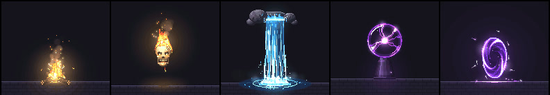

Adapted for Subclip from https://github.com/patch-gg/pixelfx by patch-gg, MIT

# Pixelfx

<!-- cli:start -->
> Install from your terminal: `npx @subclip/community-skills install pixelfx`
<!-- cli:end -->

244 pixel art effects, as recipes for Subclip motion layers: fire, explosions, water, ice, lightning, sci-fi, melee, impacts, projectiles, spawn and death, arcane, holy, shadow, status, nature, weather, UI rewards, pickups, transitions and critters.

Ask your agent for "a frost nova over this clip", "a coin pickup sparkle in the corner" or "a pixel dissolve between these two shots". It picks the closest recipe, builds it as an editable canvas layer, looks at real frames, and refines.

## Install

In Subclip: **Skills > Add skill**, paste `https://github.com/subclip-app/community-video-editing-skills/tree/main/skills/pixelfx`.

## What is inside

- `SKILL.md`: the workflow.
- `references/catalog.md`: all 244 effects as text, by category.
- `references/engine.md`: a small deterministic two-buffer pixel engine, two worked examples and layer templates.
- `references/techniques.md`: the quality bar and the look-judge-fix loop.
- `references/recipes.md`: nine effects as shot lists.
- `references/palettes.md`: 24 color ramps.
- `NOTICE.md` and `LICENSE`: the original notices, kept as they were.

## What changed from the original

The original is a Node library with render tools, a gallery, sprite sheet export and game engine integration. Those were dropped. The effect catalog is kept as text, the method and quality bar are kept, and the engine is a short original rewrite of the same design so it runs inside a Subclip layer. The demo GIFs and the Patch Pixel font were not included. The example code was checked headlessly for loop seams and seek stability, and was not judged visually.

<!-- examples:start -->

## Examples

 Looping pixel effects include fire, waterfalls and portals <a href="examples/pixel-effects.mp4">Play with sound</a>

 A pixel dummy winds up and strikes as sparks and impacts play <a href="examples/character-effects.mp4">Play with sound</a>

 A close look at five effects from the original gallery grid

Examples by patch-gg, MIT, from github.com/patch-gg/pixelfx

<!-- examples:end -->
