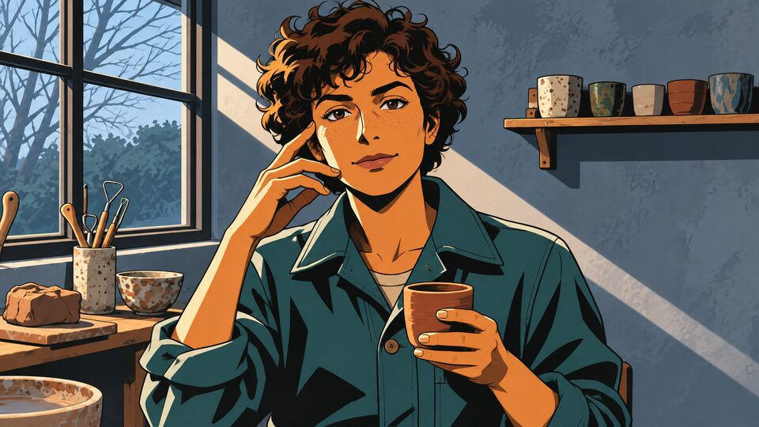
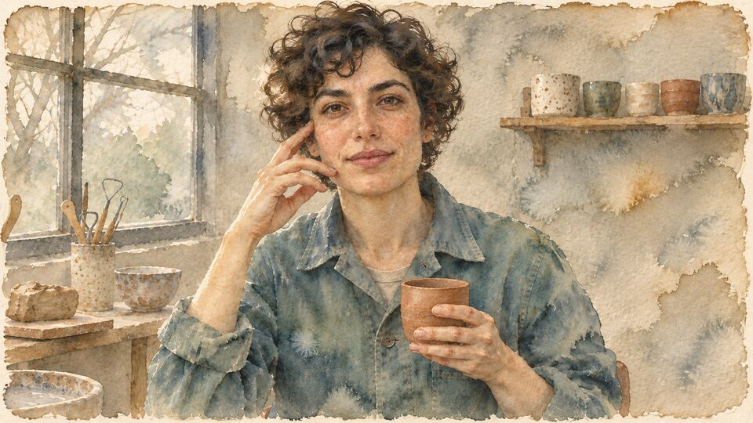

Adapted for Subclip from guides by sferro21 (https://www.instagram.com/sferro21)

# Portrait style prompts (Subclip edition)

A seven-slot portrait style prompt and a frame-to-style workflow. Export a frame from your video, restyle it with an image model, then use the styled image as a start frame or as the look reference for a generated video.

Seven slots, five looks, a start-frame workflow.

## Install

Add this skill from **Skills > Community** in Subclip, or point your agent at this folder. It works with Claude Code, Codex, Cursor and the in-app agent through Subclip's MCP tools.

## Files

- `SKILL.md`: the workflow the agent follows.
- `references/five-styles.md`: slot sheets for five looks and how to write your own.

## How it differs from the original guide

- Outside services, accounts and keys are replaced by Subclip's own generation tools and models. Image generation offers the creator's own Codex CLI first.
- Every model name the guide used is kept when Subclip's live catalog offers it. Where it does not, the closest model is named with the swap.
- Credits are quoted before anything is generated, and edits run one at a time on the native timeline.

<!-- examples:start -->

## Examples

 Fictional ceramicist source still with a clear gaze and both hands visible. Image: gpt-image-2.

 Cel-shaded restyle with a hard window beam and bold shadows. Image: gpt-image-2.

 Watercolour restyle with soft light, bleeding pigment, and visible paper grain. Image: gpt-image-2.

<video src="examples/ceramicist-style-study.mp4" controls muted loop playsinline width="720"></video> The same ceramicist portrait shifts from the source still to cel shading and watercolour. Clip: ffmpeg push-in, no video model.

Test outputs made with this skill in Subclip. Images: gpt-image-2 (Codex CLI image generation). Video: no video model, the clip is an ffmpeg edit of the stills. Silent.

<!-- examples:end -->

## Credit and license

Adapted for Subclip from guides by sferro21 (https://www.instagram.com/sferro21). Rewritten in our own words. The creator's guides state no license, so please confirm permission with the creator before relying on this skill.
