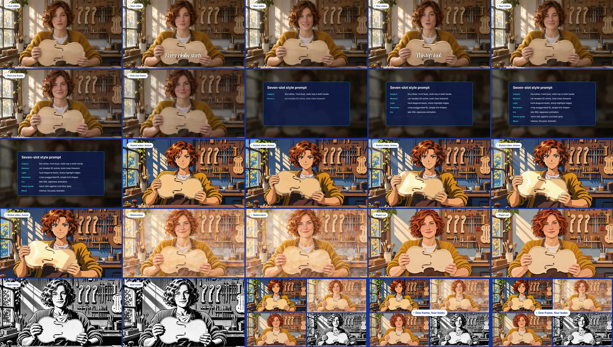
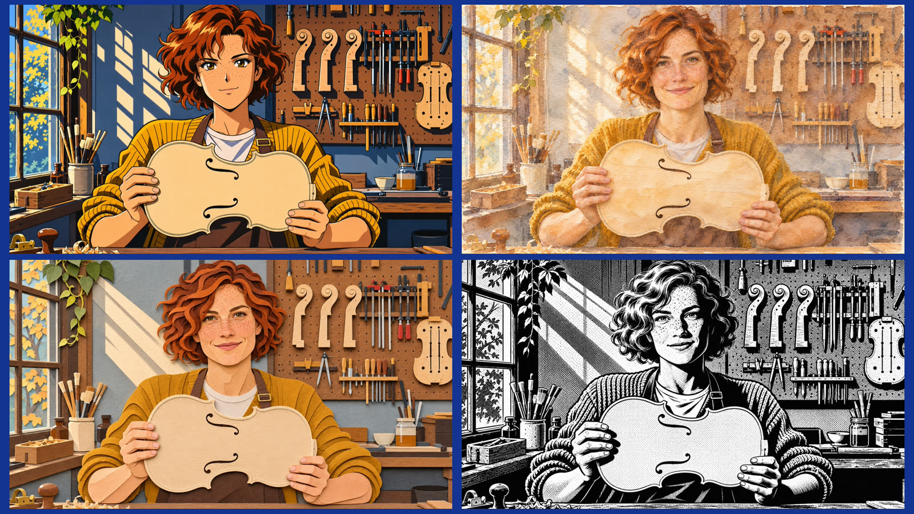

Adapted for Subclip from guides by sferro21 (https://www.instagram.com/sferro21)

# Portrait style prompts (Subclip edition)

<!-- cli:start -->
> Install from your terminal: `npx @subclip/community-skills install portrait-style-prompts`
<!-- cli:end -->

A seven-slot portrait style prompt and a frame-to-style workflow. Export a frame from your video, restyle it with an image model, then use the styled image as a start frame or as the look reference for a generated video.

Seven slots, five looks, a start-frame workflow.

For a finished example, see the [luthier reference](examples/luthier-style-reference.mp4): a talking source clip, one picked frame, the seven-slot prompt, an anime clip made from the styled frame, and the same frame as watercolour, paper cut and noir comic.

## Install

Add this skill from **Skills > Community** in Subclip, or point your agent at this folder. It works with Claude Code, Codex, Cursor and the in-app agent through Subclip's MCP tools.

## Files

- `SKILL.md`: the workflow the agent follows.
- `references/five-styles.md`: slot sheets for five looks and how to write your own.

## How it differs from the original guide

- Outside services, accounts and keys are replaced by Subclip's own generation tools and models. Image generation offers the creator's own Codex CLI first.
- Every model name the guide used is kept when Subclip's live catalog offers it. Where it does not, the closest model is named with the swap.
- Credits are quoted before anything is generated, and edits run one at a time on the native timeline.

<!-- examples:start -->

## Examples

 1. One frame, four looks. Images: gpt-image-2. Video: Kling Avatar v2, Seedance 2 720p. Voice: Subclip local TTS. <a href="examples/luthier-style-reference.mp4">Play with sound</a>

 2. One frame per second of the reference. Images: gpt-image-2. Video: Kling Avatar v2, Seedance 2 720p.

 3. The same frame as anime, watercolour, paper cut and noir comic. Images: gpt-image-2.

Test outputs made with this skill in Subclip. The luthier is fictional. Images: gpt-image-2 (Codex CLI image generation). Video: Kling Avatar v2 (talking source), Seedance 2 at 720p (anime clip). Voice: Subclip local TTS. Music: Nylon Guitar Strumming by Alex_hears_things on Freesound (CC0).

<!-- examples:end -->

## Credit and license

Adapted for Subclip from guides by sferro21 (https://www.instagram.com/sferro21). Rewritten in our own words. The creator's guides state no license, so please confirm permission with the creator before relying on this skill.
