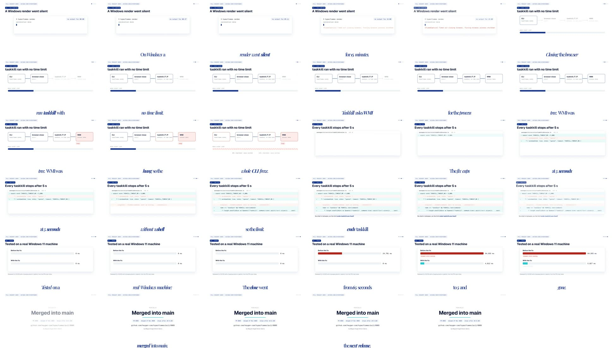

Adapted for Subclip from [heygen-com/hyperframes](https://github.com/heygen-com/hyperframes) (guide `docs/guides/pr-to-video.mdx`) by HeyGen, Apache-2.0

# PR to video

<!-- cli:start -->
> Install from your terminal: `npx @subclip/community-skills install pr-to-video`
<!-- cli:end -->

Paste a public pull request link and get a short video of what changed and why it matters, for users, reviewers or social. The agent reads the real PR (diff, commits, who worked on it), checks whether it has shipped, picks an angle (feature reveal, fix explainer, refactor walkthrough or changelog), and explains the change instead of reading the diff aloud: impact first, then at most a few small, legible code hunks, then proof and an end card with the version or "ships in the next release" and the repository link.

This skill was written from HeyGen's HyperFrames docs guide "Turn a GitHub PR into a video". The HyperFrames repository has no skill file for this workflow, so the guide is the source; it is kept unchanged in `upstream/`.

## How it works in Subclip

1. `fetch_public_github_pull_request` reads the PR: metadata, files, commit authors and the exact diff.
2. The agent writes an evidence ledger in the project brief: every fact it may show or say, with its source.
3. It picks the angle and audience, writes one short line per scene, and runs "verify the proof": every claim traced to the diff or the PR's own notes; merged, released and proposed never confused.
4. It voices each scene with a local voice (free) or a Subclip voice after a quote, and reads word times with local transcription.
5. It builds one editable HyperFrames layer per scene on a white ground (symptom, root cause, a code-diff beat, proof, end card), adds dark captions and a quiet CC0 music bed, and checks frames on every beat.

Code layers, local voice and CC0 music cost 0 credits. No API keys and no scripts.

## Folder

- `SKILL.md`: the rules from the guide, the Subclip workflow, verify the proof and the gates.
- `references/scene-kit.md`: the white scene kit, the code-diff block, the evidence ledger template and the reference timing.
- `upstream/pr-to-video.mdx`: the original guide, unchanged (it keeps its own punctuation and video links).
- `LICENSE`: Apache-2.0 from the HyperFrames repository, unchanged.

## Reference

The [fix explainer for heygen-com/hyperframes PR 8965](examples/pr-8965-reference.mp4) and its [one-frame-per-second sheet](examples/pr-8965-contact.jpg) were made by following the skill in Subclip for 0 credits. The [silent preview](preview.mp4) is the hero.

## Changes

Written for Subclip: the guide's "Make something" app flow and `/hyperframes` prompts became a Subclip tool workflow; the guide's registry blocks (`code-diff`, `code-morph`, `code-typing`) are described as a white code-diff block built in the scene layer; the evidence ledger, the scene kit and the frame gates are new. The guide's example videos are linked from the original file, not copied.

Backup fork of the source: [subclip-app/hyperframes](https://github.com/subclip-app/hyperframes).

<!-- examples:start -->

## Examples

 1. Fix explainer for hyperframes PR 8965: symptom, cause, diff, proof. Edited by Claude Opus 5.5 over MCP. <a href="examples/pr-8965-reference.mp4">Play with sound</a>

 2. One frame per second of the PR 8965 explainer. Edited by Claude Opus 5.5 (claude-opus-5-5), voice: local Pocket TTS.

Made with this skill in Subclip for 0 credits. Edited by Claude Opus 5.5 (claude-opus-5-5) driving Subclip over MCP. Five HyperFrames layers, voice: Subclip local Pocket TTS (Alba), captions: local Whisper. Music: Chill Lofi Melody Loop by holizna (CC0).

<!-- examples:end -->
