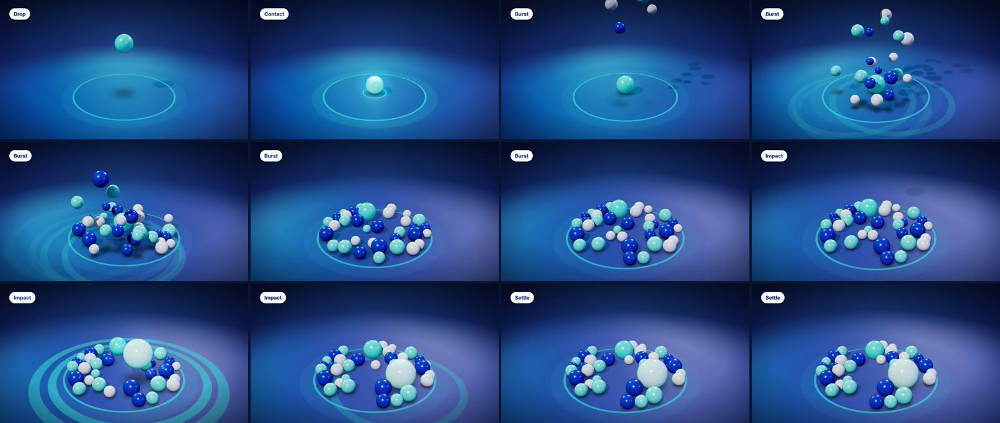
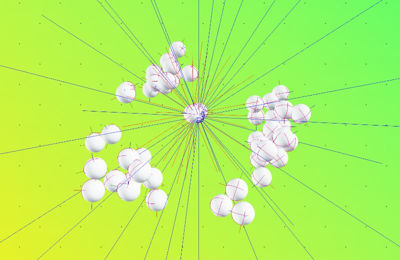

Adapted for Subclip from [pmndrs/react-three-rapier](https://github.com/pmndrs/react-three-rapier) by Poimandres, MIT.

Adapted for Subclip from [pmndrs/react-postprocessing](https://github.com/pmndrs/react-postprocessing) by Poimandres, MIT.

# R3F Physics and Effects

<!-- cli:start -->
> Install from your terminal: `npx @subclip/community-skills install r3f-physics-and-effects`
<!-- cli:end -->

Build editable 3D shots around one visible event, such as a ball hitting the floor, a stack settling, or an impact lighting up a ring. The skill carries forward Rapier's collider and contact techniques and react-postprocessing's selective bloom, glitch, and depth-of-field recipes.

For a finished example, see the [physics impact reference](examples/physics-impact-reference.mp4): a drop, a burst and a heavy hit, simulated in code and lit in Three.js, with impact sounds on the contacts.

**Runtime status.** Subclip does not expose either wrapper to authored layers. The current fallback uses seekable Three.js motion and material-based glow. See the [skill](SKILL.md) and [runtime notes](references/runtime-and-recipes.md).

The registry accepts one upstream, so it lists Rapier. Both MIT notices are preserved unchanged in [LICENSE](LICENSE) and [LICENSE.react-postprocessing](references/LICENSE.react-postprocessing). The latter credits react-spring as copyright holder. The postprocessing reference was checked at [e07ef9a](https://github.com/pmndrs/react-postprocessing/tree/e07ef9a890c8a202a3b20eac0249032cff4e7805). The cover is original artwork.

<!-- examples:start -->

## Examples

 1. Physics impact: a drop, a burst of 34 spheres and a heavy hit, simulated and lit in Three.js. Sound: CC0 clips. No AI model. <a href="examples/physics-impact-reference.mp4">Play with sound</a>

 2. One frame per second of the impact shot: one seekable Remotion Three.js layer. No AI model.

 Small rigid bodies gather around a central attractor.

 Wireframes show automatic colliders around different meshes.

 Several collider shapes surround a single rigid body.

 A jointed chain of spheres hangs between supports.

 A ball approaches a goal that demonstrates a physics sensor.

Examples 3 to 7 by Poimandres, MIT, from github.com/pmndrs/react-three-rapier. Examples 1 and 2 made with this skill in Subclip, rendered in code with Three.js: no image or video model. Sound: CC0 clips from Freesound and a Subclip whoosh.

<!-- examples:end -->
