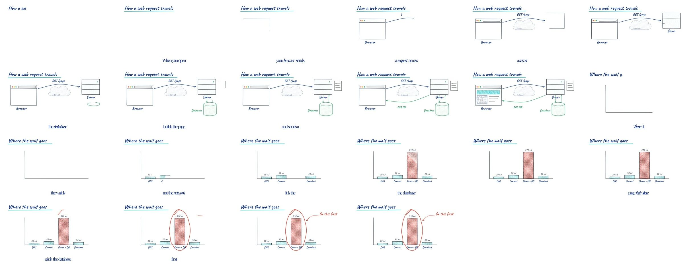

Adapted for Subclip from [rough-stuff/rough](https://github.com/rough-stuff/rough) (Rough.js) by Preet Shihn, MIT

# Rough sketch

<!-- cli:start -->
> Install from your terminal: `npx @subclip/community-skills install rough-sketch`
<!-- cli:end -->

Hand-drawn whiteboard explainers in Subclip. Your agent draws sketchy boxes, arrows, flowcharts, bar charts, maps, annotated screenshots and circled callouts with Rough.js, and reveals them stroke by stroke in time with the narration. Each scene is an editable HyperFrames layer on your timeline. Drawing uses zero Subclip AI credits.

Rough.js is a small MIT library, not an agent skill. This skill is an original Subclip workflow built around it: it ships the unchanged Rough.js browser build (with its MIT notice) for the agent to inline, because Subclip layers do not load outside libraries from a CDN, plus a small kit that turns each shape into strokes and draws them on along their length.

Every shape gets a fixed seed, so the drawing looks the same on every frame, every seek and every export. The board only "boils" when you ask for that look.

## How it differs

- **claude-drawing-skill** paints pictures with code: ink washes, paper collage, continuous line art. Rough sketch draws diagrams and callouts that explain something.
- **anatomy** builds precise isometric objects with shading. Rough sketch is flat, quick and hand-drawn on purpose.
- **vox-director** directs a whole documentary film. A rough sketch scene can be one of its beats.

## Try asking

- "Make a 25 second whiteboard explainer of how a web request travels, with my voice and the slow part circled."
- "Draw a hand-drawn flowchart of our signup steps and write yes and no on the arrows."
- "Circle the export button in this screenshot and add a marker note that says start here."
- "Turn these four numbers into a sketchy bar chart in chalk on a dark board."

- [Workflow](SKILL.md)
- [Layer template and kit calls](references/layer-template.md)
- [Pen presets, fills and hand-written fonts](references/presets.md)
- [Sketch kit source](references/sketch-kit.js)
- [Rough.js 4.6.6 browser build](assets/rough.min.js)

<!-- examples:start -->

## Examples

 1. Whiteboard explainer: a web request drawn on stroke by stroke, then a bar chart with the slow part circled. No AI model. <a href="examples/rough-sketch-reference.mp4">Play with sound</a>

 2. One frame per second: two HyperFrames layers drawn with Rough.js and fixed seeds. Local voice, no AI model.

Test outputs made with this skill in Subclip. Drawn in code with Rough.js in HyperFrames layers: no image or video model. Voice: Subclip local speech. Music: Zimbalom by BuytheField on Freesound (CC0).

<!-- examples:end -->
