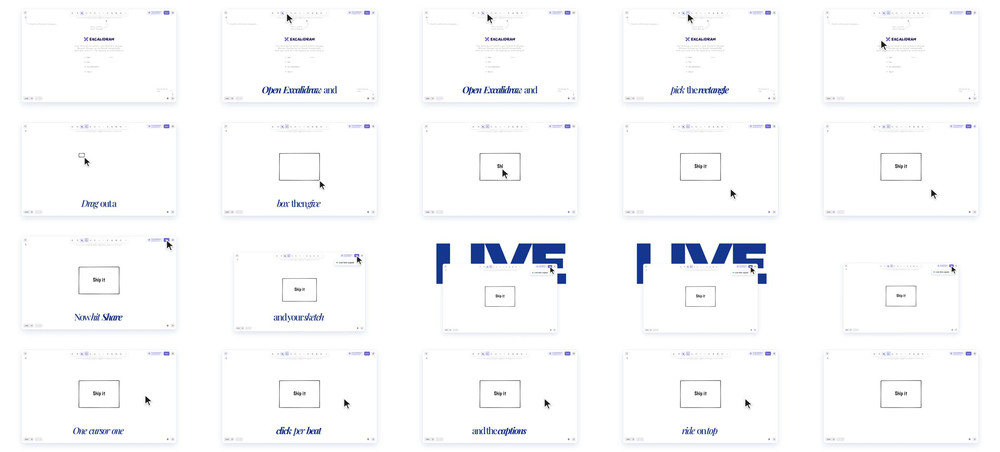

Adapted for Subclip from [heygen-com/hyperframes](https://github.com/heygen-com/hyperframes) by HeyGen, Apache-2.0

# Screen recording polish

<!-- cli:start -->
> Install from your terminal: `npx @subclip/community-skills install screen-recording-polish`
<!-- cli:end -->

Two house rules from HyperFrames launch films, merged into one skill for screen demos. An oversized cursor carries the eye: it enters from off-screen, lands with its tip, and each click causes the next beat. Captions ride on top of the full frame: every phrase is dropped (filler), shown on the rail (most words) or, rarely, embedded as one big word behind the subject.

## What it adds

- Next to `subclip-recorder`: the recorder can make the cursor bigger and zoom on clicks; this skill says how big, how it enters and leaves, and that every click must cause something.
- Next to `motionmaxxing` (UI demo cursor grammar): a short rule set you can apply to any recording, not a full launch-film method.
- Next to `subclip-dynamic-captions` and `subclip-text-behind-subject`: the drop, rail and embed choice per phrase, at most one embed per beat, and the overlay law (no reserved caption band, centre on the true centre).

## How it works in Subclip

1. A Recorder take is polished with the Recorder tools (cursor size, pointer track, click zooms). A website or app with no recording is captured with `inspect_public_website` and built as a HyperFrames layer with a code cursor.
2. Voice first with free local speech, so clicks land on the words.
3. Captions from local transcription, the default preset, a dark colour on light UI, product names corrected, filler dropped, one embed at the peak.
4. Click sounds and CC0 music from the public audio search. 0 credits.

## Folder

- `SKILL.md`: the merged workflow.
- `references/cursor-layer.md`: the cursor timeline and beat table from the reference video.
- `upstream/oversized-cursor/` and `upstream/captions-overlay/`: the originals, unchanged.
- `LICENSE`: Apache-2.0, unchanged.

Backup fork: [subclip-app/hyperframes](https://github.com/subclip-app/hyperframes).

## Reference

The [reference with sound](examples/screen-recording-polish-reference.mp4) and its [one-frame-per-second sheet](examples/screen-recording-polish-contact.jpg): a capture of the public excalidraw.com page, an oversized cursor that selects a tool, draws a box, types a label and shares, rail captions and one LIVE embed behind the window. Edited by Claude Opus 5.5 (claude-opus-5-5) driving Subclip over MCP, voice: Subclip local TTS (Alba). The [silent preview](preview.mp4) is the hero.

<!-- examples:start -->

## Examples

 1. excalidraw.com demo: oversized cursor, a click per beat, rail captions, one LIVE embed. Edited by Claude Opus 5.5 over MCP. <a href="examples/screen-recording-polish-reference.mp4">Play with sound</a>

 2. One frame per second of the demo. Edited by Claude Opus 5.5 (claude-opus-5-5), voice: Subclip local TTS, no cloud model.

Made with this skill in Subclip for 0 credits from a capture of excalidraw.com. Edited by Claude Opus 5.5 (claude-opus-5-5) over MCP. Voice: Subclip local TTS (Alba), captions: local Whisper, no cloud model. Music: Upbeat Piano Loop by deadrobotmusic (CC0). Click and whoosh: Subclip catalog.

<!-- examples:end -->
