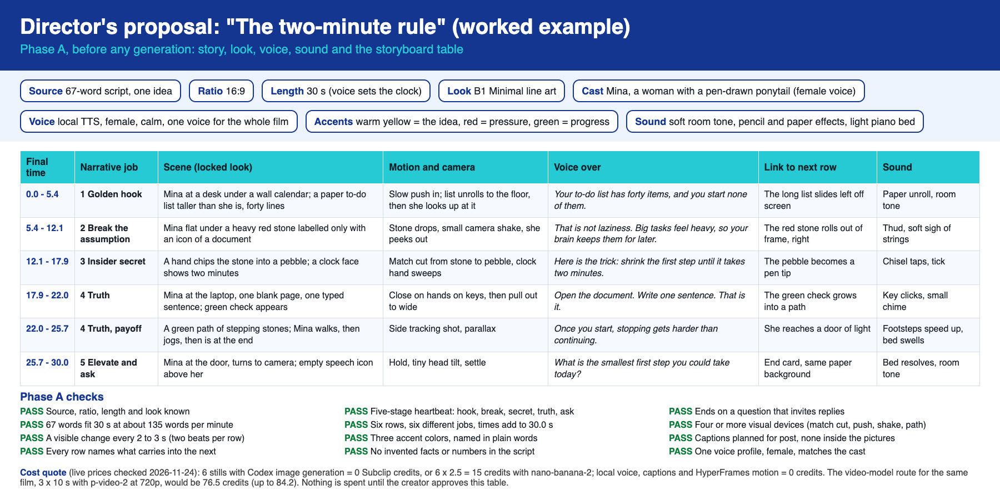

Adapted for Subclip from https://github.com/kaomei/stickman-video-director by kaomei and the Stickman Video Director contributors, MIT

# Stickman video director for Subclip

Give your agent a script, a topic or an article and it directs a stick figure film inside Subclip. It writes a director's proposal with a storyboard table and a checks list, locks the character and the look, voices it with a local voice that matches the character's gender, makes the scenes, adds captions and sound, and exports when you ask.

Fifteen looks, each with its own prompt file and a 10 second reference clip: classic black and white (light and dark), modern pop, prehistoric cave, cozy storytelling, historical cartoon, amber noir, rubber hose, hand-painted adventure, minimal line art, colorful hand-drawn, retro TV, survival thriller, avatar explainer, meme story animation and pixel theater.

## What you get

- `SKILL.md`: the workflow from script to export on Subclip tools, with a credit quote before every paid step.
- `references/style-index.md`: the look index and a guide to choosing one.
- `references/looks/`: 15 prompt files. Each has the style lock, the prompt recipe, the Subclip route, the credit note, the checks and a link to its reference clip.
- `references/directors-proposal.md`: the proposal and storyboard method with a worked example (`examples/director-storyboard-table.jpg`).
- `references/locks.md`, `voice-and-sound.md`, `subclip-assembly.md`: character locks, voice and sound rules, tools and credits.
- `references/overlap.md`: where this skill meets `cartoon-episodes`, `cartoon-animation`, `svg-character-animation` and others, and what it leaves to them.

## Two routes

Looks 01 to 08 use a video model (clips cost credits, motion is fluid). Looks 09 to 15 use stills plus editable motion layers (almost no credits, the cheap way). A 10 second video clip on `p-video-2` is about 25.5 credits at 720p; images from your own Codex CLI cost no Subclip credits. The agent quotes the live price and waits for your yes.

## What was changed from the original

The original project drives Google Flow, a local renderer, paid voice services and a large audio library through scripts. This version uses only Subclip tools and your credits, local speech first, public licensed audio search, and describes steps instead of running installers or scripts. The reference clips are the original author's samples cut to 10 seconds with the sound removed. Nothing in this skill makes a new film with those samples.

This test did not spend credits on generation. The worked proposal and the montage were made in code. Quality of a new film depends on the model and on how many retakes you approve.

<!-- examples:start -->

## Examples

 Capability montage of all 15 looks, labeled. Cut from the author's clips with ffmpeg and Chrome labels, no AI model. <a href="examples/capability-stickman-video-director.mp4">Play with sound</a>

 Worked director's proposal: storyboard table, checks and cost line for a 30 s film. Rendered in code from HTML, no AI model.

 01 A1.1 Classic black on white: hollow-head figure, flat canvas, red accent. Original author, Google Flow video model. <a href="examples/01-classic-black-on-white.mp4">Play with sound</a>

 02 A1.2 Classic white on black: the dramatic variant of the same figure. Original author, Google Flow video model. <a href="examples/02-classic-white-on-black.mp4">Play with sound</a>

 03 A2.1 Modern pop, minimal tech: red beanie, white studio, cyan glass UI. Original author, Google Flow video model. <a href="examples/03-modern-pop-minimal-tech.mp4">Play with sound</a>

 04 A2.2 Modern pop, colorful story: the beanie figure in cinematic light. Original author, Google Flow video model. <a href="examples/04-modern-pop-colorful-story.mp4">Play with sound</a>

 05 A3 Prehistoric cave: caveman satire with a twist. Original author, Google Flow video model. Burned-in subtitles are the sample's. <a href="examples/05-prehistoric-cave.mp4">Play with sound</a>

 06 A4 Cozy storytelling: a quiet cafe break, warm light. Original author, Google Flow video model. <a href="examples/06-cozy-storytelling.mp4">Play with sound</a>

 07 A5 Historical cartoon: an Edo samurai and street life. Original author, Google Flow video model. <a href="examples/07-historical-cartoon.mp4">Play with sound</a>

 08 A6 Amber noir: orange hoodie in a warm-lit city, 8 s original. Original author, Veo 3.1 Fast in Google Flow. <a href="examples/08-amber-noir.mp4">Play with sound</a>

 09 A7 Rubber hose: elastic acting chased by a cloud, 1930s scenery. Original author, Omni 1.2 Flash in Google Flow. <a href="examples/09-rubber-hose.mp4">Play with sound</a>

 10 A8 Hand-painted adventure: gouache mountain workshop. Original author, Google Flow video model. <a href="examples/10-hand-painted-adventure.mp4">Play with sound</a>

 11 B1 Minimal line art: handwritten hook on paper. Original author, gpt-image-2 stills animated and rendered in code. <a href="examples/11-minimal-line-art.mp4">Play with sound</a>

More example videos

<ul><li><a href="examples/12-colorful-hand-drawn.mp4">12 B2 Colorful hand-drawn: why trying to sleep keeps you awake. Original author, gpt-image-2 stills and code.</a></li><li><a href="examples/13-retro-tv.mp4">13 B3 Retro TV: a 3 AM broadcast mystery, white figures on dark. Original author, gpt-image-2 stills and code.</a></li><li><a href="examples/14-survival-thriller.mp4">14 B4 Survival thriller: night dispatcher rules and a rule 01 hook. Original author, gpt-image-2 stills and code.</a></li><li><a href="examples/15-avatar-explainer.mp4">15 B5 Avatar explainer: presenter bottom right, metaphors on the left stage. Original author, gpt-image-2 and code.</a></li><li><a href="examples/16-meme-story-animation.mp4">16 B6 Meme story animation: 1990s Hong Kong breakfast, painted layers. Original author, gpt-image-2 and code.</a></li><li><a href="examples/17-pixel-theater.mp4">17 B7 Pixel theater: a choice story drawn fully in code. Original author, no image model, rendered in code.</a></li></ul>

Clips 01 to 17 are the original author's samples from github.com/kaomei/stickman-video-director (MIT), trimmed to about 10 s, sound removed. The montage and the proposal table were made for this skill in code. No Subclip credits were spent.

<!-- examples:end -->

## Credit

This skill adapts kaomei/stickman-video-director (MIT), including its look descriptions, prompt contracts, the five-stage story method, the director's proposal contract, the voice continuity rules and the sample films used as reference clips. The upstream states that third-party music, sound effects and other assets keep their own licenses, so the sample sound is not included.

Original project: https://github.com/kaomei/stickman-video-director

Some looks name a YouTube channel as visual inspiration in the upstream. The upstream credits its style contributors; the A5 historical cartoon style and Roman era pack came from the GitHub user leksautomate. The sample films carry the original author's own presenter and channel marks.

Adapted for Subclip from https://github.com/kaomei/stickman-video-director by kaomei and the Stickman Video Director contributors, MIT
