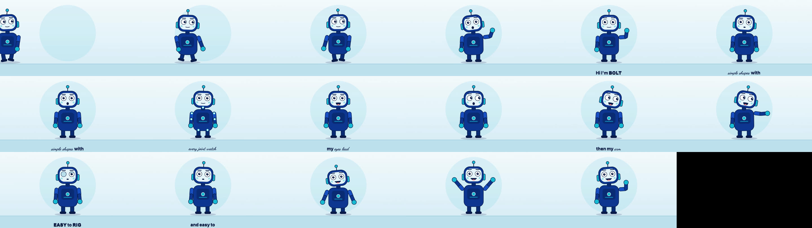

Adapted for Subclip from [OpenMontageInc/OpenMontage](https://github.com/OpenMontageInc/OpenMontage) by OpenMontageInc, AGPL-3.0

# svg-character-animation (Subclip edition)

<!-- cli:start -->
> Install from your terminal: `npx @subclip/community-skills install svg-character-animation`
<!-- cli:end -->

Rig a character from SVG parts and animate it in an editable Subclip motion layer. The agent builds the parts with stable pivots, then animates with a paused GSAP timeline: anticipation, follow-through, blinks, gaze, mouth shapes timed to your narration, and pose holds long enough to read.

No outside API keys, no Python, no ffmpeg. Narration, music and sound effects stay in native Subclip audio lanes.

## Install

In Subclip: **Skills > Add skill**, paste `https://github.com/subclip-app/community-video-editing-skills/tree/main/skills/svg-character-animation`.

## Use

> Make a round mascot walk in, wave at the camera and say my intro line. Lip-sync it to the narration.

## What's inside

| File | What it covers |
|---|---|
| `SKILL.md` | Rig structure, pivots, acting rules, placing the layer, Remotion pattern, quality checklist |

Pair it with the `character-animation-qa` skill to review the result. For a finished example, see the [Bolt reference](examples/bolt-reference.mp4): a robot that walks in, waves, speaks with lip-flap, shows its pivots and hops, all in three editable layers.

<!-- examples:start -->

## Examples

 1. Bolt, an SVG robot rig: walk in, wave, lip-flap, pivots, hop. Voice: Pocket TTS. Music: CC0 loop. No image or video model. <a href="examples/bolt-reference.mp4">Play with sound</a>

 2. One frame per second: each beat is a seekable HyperFrames layer. Rendered in code, no AI model.

Test outputs made with this skill in Subclip. Character rendered in code (HyperFrames: SVG and GSAP): no image or video model. Voice: Pocket TTS, local. Music: Upbeat loop by mistermender on Freesound (CC0). Sound effects from the Subclip catalog.

<!-- examples:end -->

## License

AGPL-3.0, same as the original project. The upstream skill file also carried an MIT license line; the repository license (AGPL-3.0) is the one kept here. See `LICENSE`.
