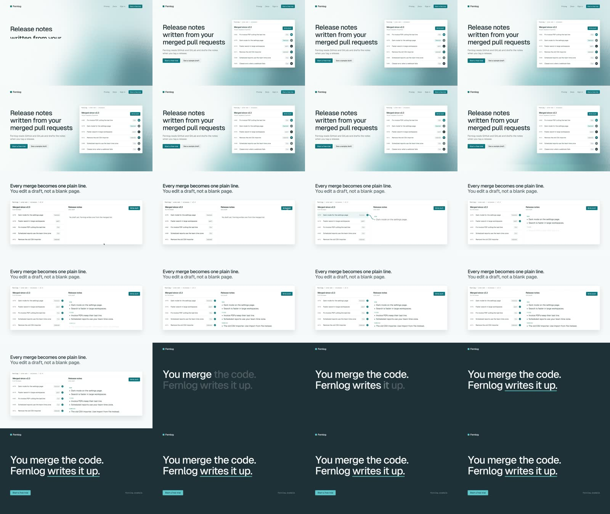

Adapted for Subclip from https://github.com/Leonxlnx/taste-skill by Leon Lin, MIT

# Taste skill

<!-- cli:start -->
> Install from your terminal: `npx @subclip/community-skills install taste-skill`
<!-- cli:end -->

Anti-slop art direction for websites and for the product videos made from them. The original tasteskill (2.5.1) makes coding agents build company websites at the figma.com and x.ai level instead of a generic landing page: plain copy with its own voice, one design system, one section per screen, equal edges, real photographs and real product UI, a hero entrance and one or two dealt moments, shader effects only on tech, gaming and software pages, and a check in a real browser.

This Subclip edition keeps that website method and adds a video mode, because SaaS explainers, product UI promos, website walkthroughs and launch videos need the same taste.

## Two modes

- **Website mode.** Build or redesign the page or product UI that will be filmed. The original method and all its references, with the trade palettes and type pairings. The original kit's scripts (dealers, checker, finish gate) stay upstream: the agent offers them, shows the exact command and runs nothing without your yes.
- **Video mode.** The same rules on video frames in Subclip: art direction written before building, one system for type, colour and spacing across every scene, real product UI (HyperFrames layers or real recordings and captures) and real photographs over generic AI art, one hero entrance and one or two dealt moments instead of motion everywhere, shaders only for tech subjects, plain on-screen copy and safe edges. The browser checker becomes a frame review with `get_timeline_contact_sheet` and `view_current_frame`.

## Try it

- "Use taste-skill to make a 25 second explainer for our invoicing app from these screenshots."
- "This launch video looks AI-made. Review it with taste-skill and fix it."
- "Build our landing page with taste-skill, then record a walkthrough of it."

## What is inside

- `SKILL.md`: house rules, the kind table, copy rules, website mode, video mode, the never list.
- `references/website/`: the 22 original references (system, layout, sections, sections library, cards, copy and voice, photos, icons, diagrams, backgrounds, effects, objects, scenes, moments, motion, perf, gate) and `library/` with the trade palettes and type pairings.
- `references/video-recipes.md`: the system block, the app frame, the hero entrance, a seekable port of the kit's grain gradient shader ground, and the moments ported to video time.
- `references/frame-review.md`: the checker and finish gate as a frame review checklist.
- `examples/taste-skill-reference.mp4`: a 24 second explainer for a made-up product, Fernlog, with its one frame per second contact sheet.

No API keys, no outside AI services and no credits: the reference used no AI model.

## What changed for Subclip

- The original's scripts, assets (UI fragments, effects, moments, scenes, objects, icons) and photographs are not copied. The photographs and icons carry their own licences and trademarks; the scripts need a local browser and Node. The text references point to them in the original repo.
- Video mode is new: it maps each website rule to Subclip tools and frames.
- The browser checker and finish gate become a frame review for video, and an optional upstream run (asked first) or a screenshot review for websites.

<!-- examples:start -->

## Examples

 1. SaaS explainer for a made-up product: one system, product UI as layers, one hero entrance, two dealt moments. No AI model. <a href="examples/taste-skill-reference.mp4">Play with sound</a>

 2. Contact sheet: one frame per second of the explainer, the frame review the agent reads. No AI model.

Made with this skill in Subclip from code-rendered HyperFrames scenes, no AI model. Fonts Geist and Geist Mono (OFL). Sounds: ElectronicPerk1 and ElectronicPerk2 by aikighost (CC0, Freesound), Remotion mouse-click and page-turn, Subclip Short whoosh.

<!-- examples:end -->

## Credits

Adapted for Subclip from [taste-skill](https://github.com/Leonxlnx/taste-skill) by Leon Lin (Leonxlnx), MIT licensed (see `LICENSE`). The references are the original's, lightly edited. The reference video and the silent hero were made for Subclip in the Subclip AI Editor from code-rendered HyperFrames scenes, with no image, video or voice model. Fonts: Geist and Geist Mono (SIL Open Font License) loaded from fontsource. Sounds: [ElectronicPerk1](https://freesound.org/s/19064/) and [ElectronicPerk2](https://freesound.org/s/19065/) by aikighost on Freesound (CC0), mouse-click and page-turn from the Remotion sound library, Short whoosh from the Subclip SFX library.
