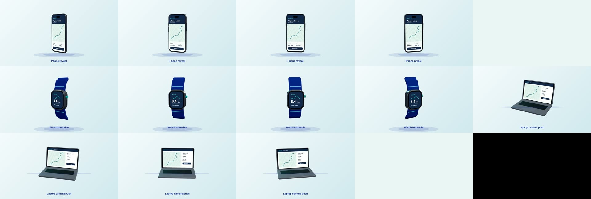
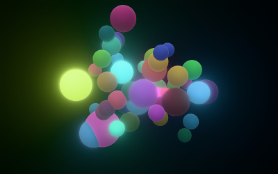

Adapted for Subclip from [mrdoob/three.js](https://github.com/mrdoob/three.js) by mrdoob and the three.js contributors, MIT.

# Three.js 3D scenes

<!-- cli:start -->
> Install from your terminal: `npx @subclip/community-skills install threejs-3d-scenes`
<!-- cli:end -->

Build an editable 3D shot with a bundled model, a readable camera angle, and timed motion. Use it for a phone reveal, a laptop walkthrough, or a turntable of an available product model. Screen media, model transforms, camera movement, and timing can be revised in Subclip.

Try asking: “Put my checkout recording on the screen of a bundled phone. Start at a shallow angle, turn toward the viewer, then hold so the checkout is readable.”

The [shot recipes](references/shot-recipes.md) translate Three.js scene, camera, mesh, lighting, and animation concepts into native editor controls. The native track uses Subclip's approved model registry. An explicit custom Three.js Remotion request uses the separate Remotion runtime.

For a finished example, see the [three-shot reference](examples/ridge-3d-shots-reference.mp4): a phone, a watch and a laptop, each a code-rendered Three.js scene with a slow camera move.

The cover is an original illustration. The package includes the upstream MIT notice and links to the library's documentation.

<!-- examples:start -->

## Examples

 1. Phone, watch and laptop shots, each a Three.js scene with a slow camera orbit. Music: CC BY loop. No AI model. <a href="examples/ridge-3d-shots-reference.mp4">Play with sound</a>

 2. One frame per second: three seekable Remotion layers rendered in code. No AI model.

 A split view shows the scene and the position of its active camera.

 Flat outlines become solid shapes with depth and curved paths.

 Colored spotlights cross above a dark stage.

 Selected spheres glow among neighboring objects with the bloom effect switched off.

Examples 3 to 6 by mrdoob and the three.js contributors, MIT, from github.com/mrdoob/three.js. Examples 1 and 2 made with this skill in Subclip, scenes rendered in code with Three.js: no image or video model. Music: Synth Loop Polaris by orangefreesounds on Freesound (CC BY 3.0).

<!-- examples:end -->
