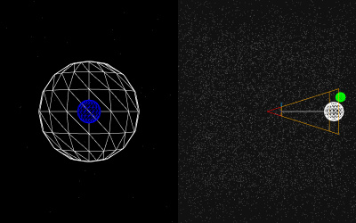
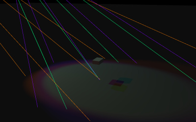

Adapted for Subclip from [mrdoob/three.js](https://github.com/mrdoob/three.js) by mrdoob and the three.js contributors, MIT.

# Three.js 3D scenes

<!-- cli:start -->
> Install from your terminal: `npx @subclip/community-skills install threejs-3d-scenes`
<!-- cli:end -->

Build an editable 3D shot with a bundled model, a readable camera angle, and timed motion. Use it for a phone reveal, a laptop walkthrough, or a turntable of an available product model. Screen media, model transforms, camera movement, and timing can be revised in Subclip.

Try asking: “Put my checkout recording on the screen of a bundled phone. Start at a shallow angle, turn toward the viewer, then hold so the checkout is readable.”

The [shot recipes](references/shot-recipes.md) translate Three.js scene, camera, mesh, lighting, and animation concepts into native editor controls. The native track uses Subclip's approved model registry. An explicit custom Three.js Remotion request uses the separate Remotion runtime.

The cover is an original illustration. The package includes the upstream MIT notice and links to the library's documentation.

<!-- examples:start -->

## Examples

 A split view shows the scene and the position of its active camera.

 Flat outlines become solid shapes with depth and curved paths.

 Colored spotlights cross above a dark stage.

 Selected spheres glow among neighboring objects with the bloom effect switched off.

Examples by mrdoob and the three.js contributors, MIT, from github.com/mrdoob/three.js

<!-- examples:end -->
