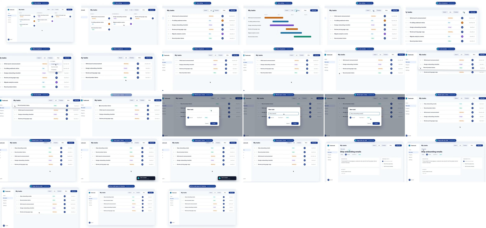

Adapted for Subclip from [Jakubantalik/transitions.dev](https://github.com/Jakubantalik/transitions.dev) by Jakub Antalik, Transitions.dev License (transitions and skills) and MIT (tooling).

# transitions-dev for video

<!-- cli:start -->
> Install from your terminal: `npx @subclip/community-skills install transitions-dev`
<!-- cli:end -->

Real UI transitions for SaaS explainers and product promos. For every UI state change in your video (a modal opens, a tab switches, a row is dragged, a toast appears, a page changes) the agent picks the fitting transition from [transitions.dev](https://transitions.dev), builds the product screen as an editable HyperFrames layer on the transitions.dev motion tokens, and polishes the motion on rendered frames.

Try asking:

> Make a 30 second walkthrough of our task app: switch to the list view, filter to my tasks, drag a task to the top, create a new one in a modal and show the confirmation toast.

> The modal in this explainer feels slow. Polish the UI motion.

## How it works in Subclip

1. Picks one named transition per state change and writes a beat plan.
2. Builds the app screen once as static HTML and drives every state from time, so each frame can be scrubbed and exported (one parametric source, a few short segments).
3. Applies the motion tokens: closes quicker than opens, smooth out easing, small distances, no blur on text.
4. Checks a contact sheet at 1 second intervals and around every transition, then exports when you ask.

Code layers cost 0 credits. No API keys and no upstream scripts.

## Folder

- `SKILL.md`: the workflow.
- `references/transition-picker.md`: state change to transition name, linked to transitions.dev.
- `references/motion-tokens.md`: durations, easings, distances and scales by usage.
- `references/hyperframes-recipes.md`: our own seekable code for open and close pairs, tabs, page slide, reorder, cursor and camera.
- `references/polish-checklist.md`: the frame checks.
- `references/ui-generation-flow.md`: the "agent is building this UI" moment.

## License

The transitions.dev transitions and skills are free to use in your own projects and videos, but the library may not be redistributed as a competing transitions library, motion pack or kit. This folder therefore does not contain the transitions collection: it names transitions and links to them, and its code is our own. The original [LICENSE](LICENSE) is kept unchanged. The tooling of the original repository is MIT.

<!-- examples:start -->

## Examples

 Tasknook, a made-up task app: six labelled transitions from tabs to page slide, built as HyperFrames layers. No AI model. <a href="examples/transitions-dev-reference.mp4">Play with sound</a>

 The reference walkthrough at one frame per second. No AI model.

Our own test renders of a fictional product, made in code with no AI model. Music: joyful bells by solarpsychedelic, CC0. No transitions.dev media or code is reused.

<!-- examples:end -->
