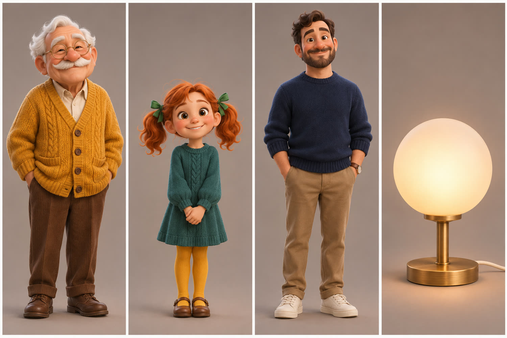
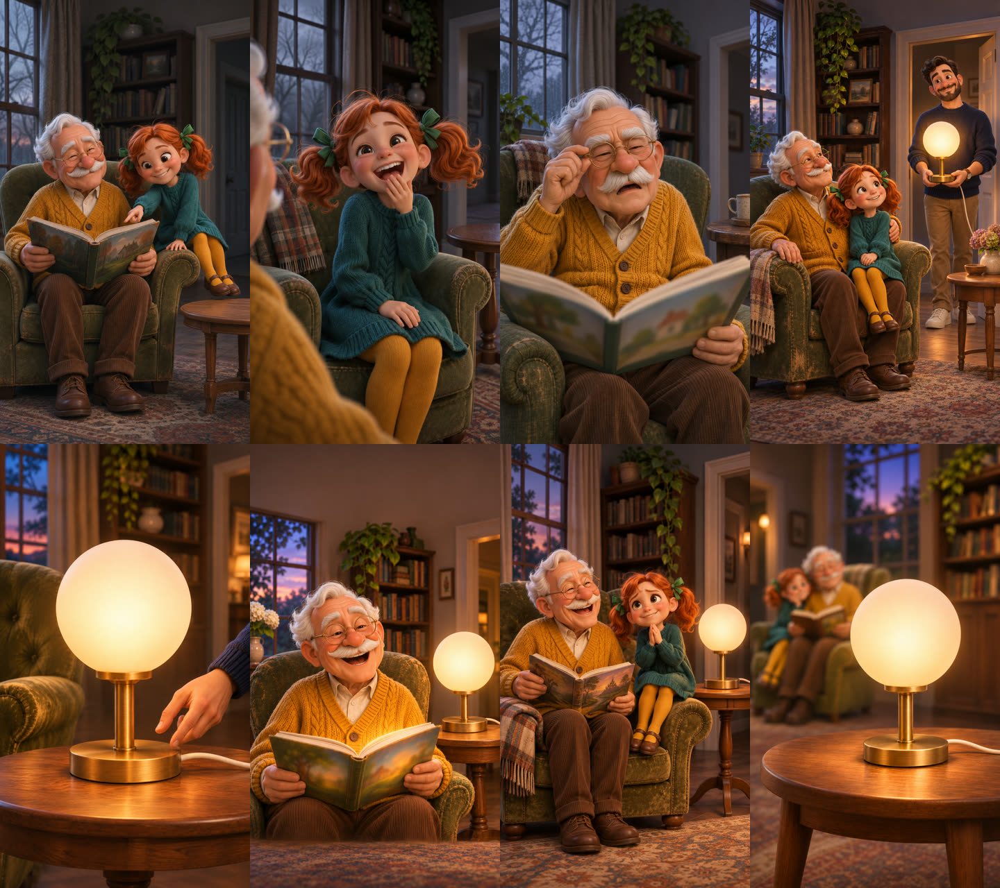
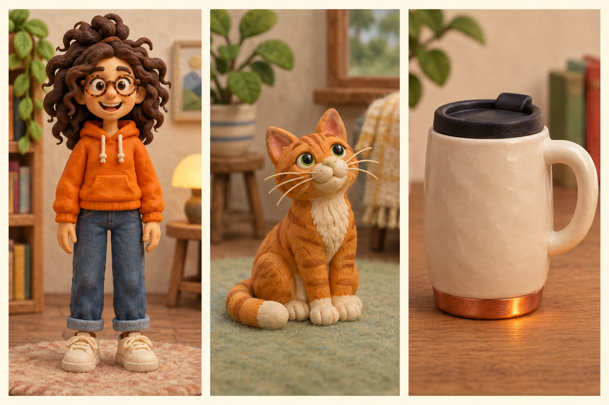
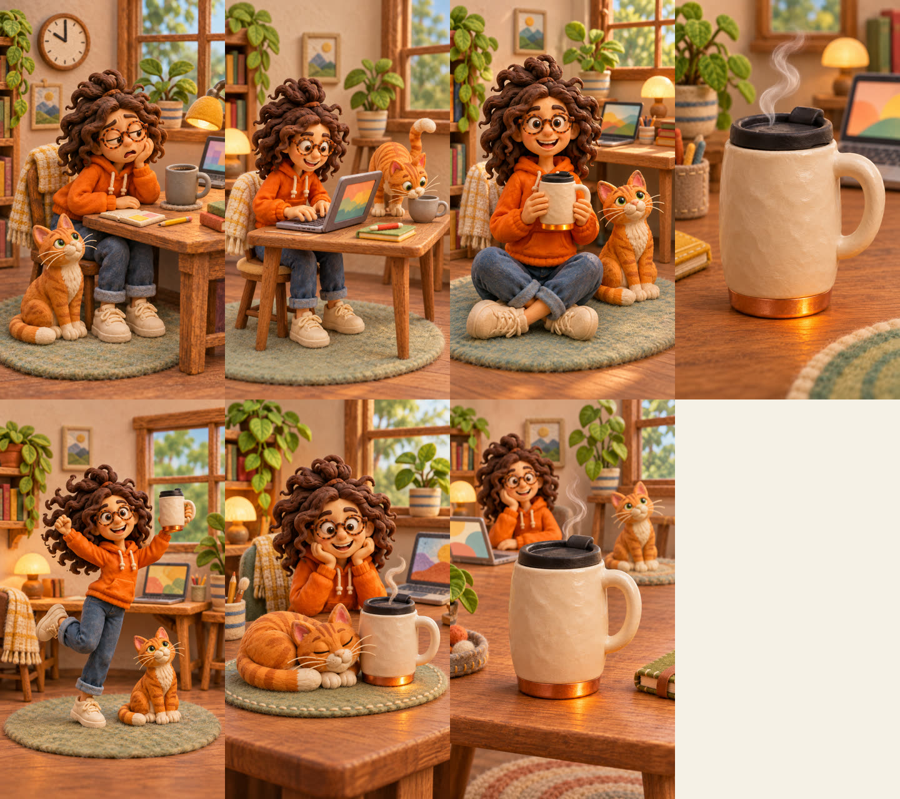
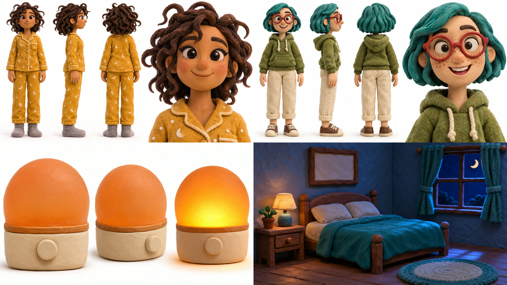
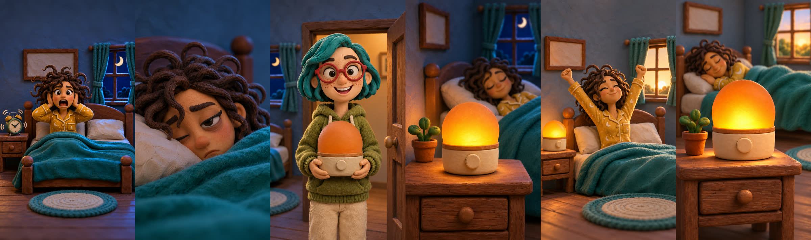
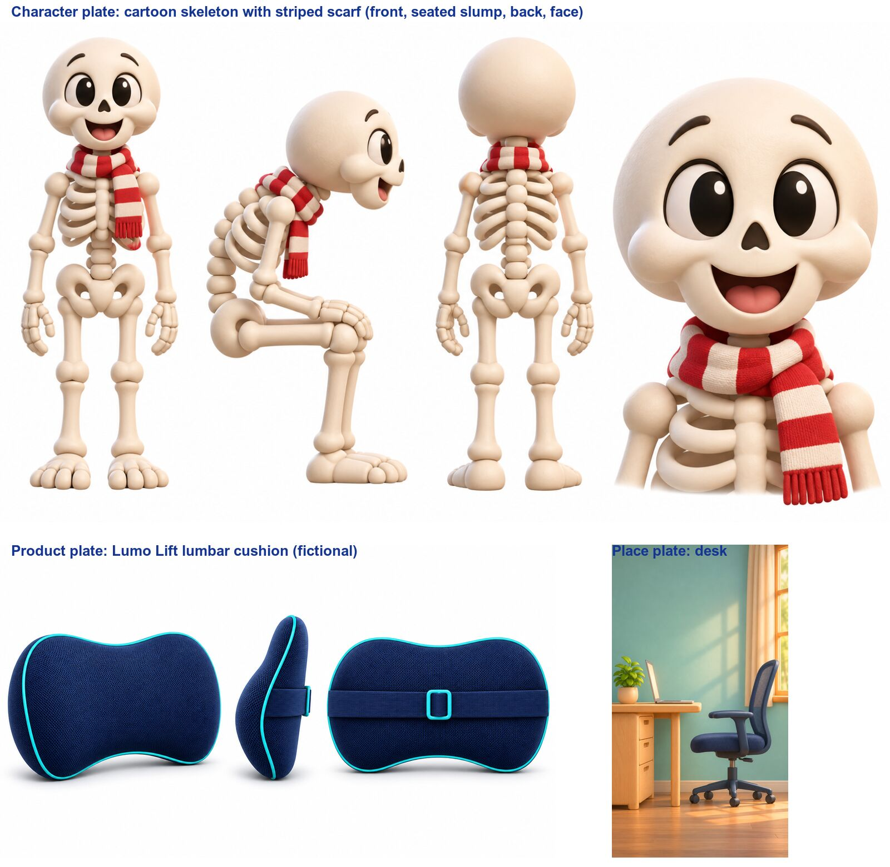
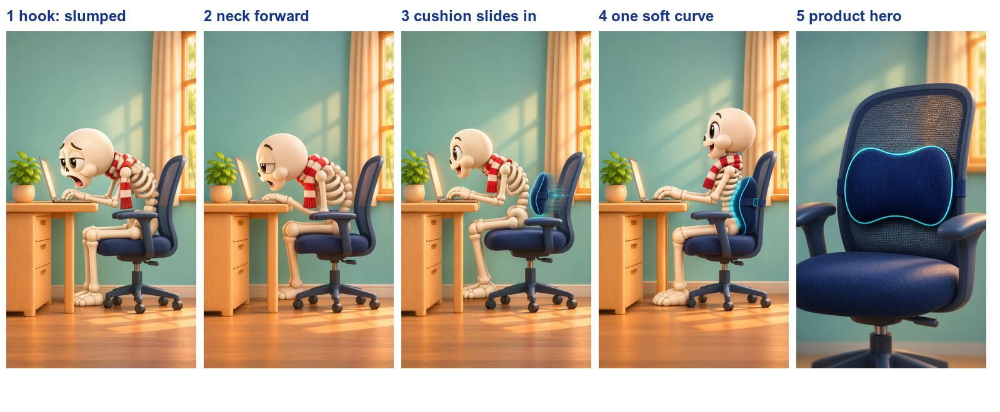
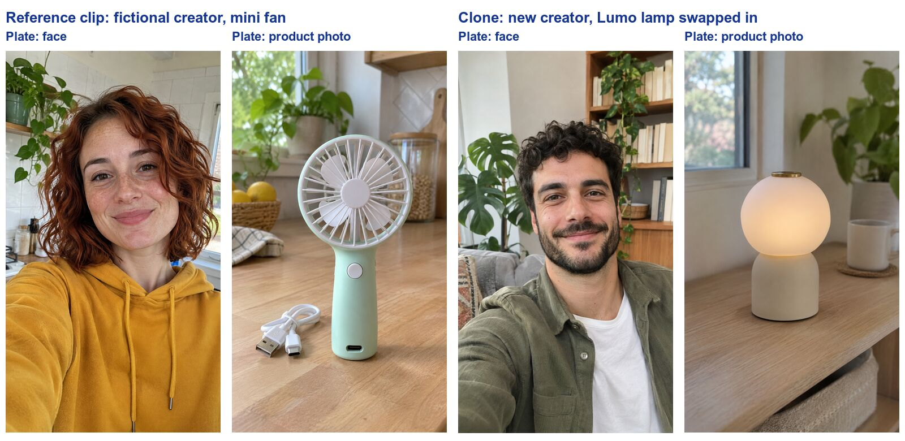
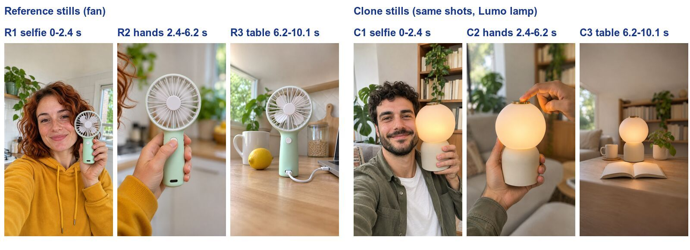

Adapted for Subclip from the "trendjack-animator" skill by Agent Chad (https://agentchad.io/), itself adapted from drama-song-ad by Maxfusion AI s.r.o, MIT

# Trending animated ads (Subclip edition)

A skill for AI agents working in [Subclip](https://subclip.app) that makes the animated ad formats that are trending now: drama song ad, product song, narrated cartoon story, 3D how-it-works explainer, skeleton or X-ray demo and photoreal phone-footage clone. It works audio first: the song or one continuous voiceover is made and measured, then every shot is cut to a line of it.

**Product in, vertical 9:16 ad out, as an editable Subclip timeline. No outside API keys, no scripts.**

[Watch the silent preview](preview.mp4). The full capability reference video is `examples/capability-trending-animated-ad.mp4`.

```
brief -> script -> audio first -> word timings -> shot plan -> plates -> stills -> clips -> captions -> QA
```

## Install

In Subclip: **Skills > Add skill**, paste `https://github.com/subclip-app/community-video-editing-skills/tree/main/skills/trendjack-animator`. Or ask the agent: "install the trendjack-animator skill from github.com/subclip-app/community-video-editing-skills/tree/main/skills/trendjack-animator".

## Use

> Make a 20-second drama song ad for my reading lamp, 3D animated film look.

The agent asks for the product photo, real size and offer, pitches three scripts, makes the song or voice first, locks characters and product with approved plates, makes one still per line, animates clips, adds captions inside the Reels and Shorts safe zone and assembles everything on the timeline. Every paid step shows its credit cost first and waits for your yes.

## What's inside

| File | What it covers |
| --- | --- |
| `SKILL.md` | The mechanism, rules and the nine-step workflow |
| `references/formats.md` | The six formats with beats, lyric and voice rules |
| `references/looks.md` | Eleven looks with exact look lines |
| `references/workflow.md` | Every stage: gates, cut grid, plates, stills, clips, long ads |
| `references/subclip-tools.md` | Tool and model mapping, assembly steps, budget |
| `references/qa.md` | Fourteen manual checks and the fixes table |
| `LICENSE`, `NOTICE` | The original MIT license and notice, unchanged |

## Cost

A 9-shot 15 second ad is roughly 3 plates, 9 stills and 7 clips plus one song or voice take. Quote your own with the live catalog before spending. Pairs of shots, still-only inserts, free local speech and your own Codex CLI for images bring it down.

<!-- examples:start -->

## Examples

<p align="center"><video src="examples/capability-trending-animated-ad.mp4" controls muted loop playsinline width="720"></video><br><sub>Capability reference: the drama song ad. Images: gpt-image-2. Video: p-video-2. Song: elevenlabs-music.</sub></p>

<p align="center"><video src="examples/format-product-song.mp4" controls muted loop playsinline width="720"></video><br><sub>Format 2, product song ad. Images: gpt-image-2. Video: p-video-2. Song: lyria-3-pro.</sub></p>

<p align="center"><video src="examples/format-narrated-story.mp4" controls muted loop playsinline width="720"></video><br><sub>Format 3, narrated story ad. Images: gpt-image-2. Video: p-video-2. Music: lyria-3-pro, local voice.</sub></p>

<p align="center"><video src="examples/format-3d-explainer.mp4" controls muted loop playsinline width="720"></video><br><sub>Format 4, 3D explainer ad. Images: gpt-image-2. Video: p-video-2. Music: lyria-3-pro, local voice.</sub></p>

<p align="center"><video src="examples/format-skeleton-xray.mp4" controls muted loop playsinline width="720"></video><br><sub>Format 5, skeleton demo ad. Images: gpt-image-2. Video: p-video-2. Local voice, stock effects.</sub></p>

<p align="center"><video src="examples/format-photoreal-clone.mp4" controls muted loop playsinline width="720"></video><br><sub>Format 6, photoreal clone ad. Images: gpt-image-2. Video: p-video-2. Reference and clone, local voice.</sub></p>

<p align="center"><br><sub>Format 1 plates, made before any scene still. Image: gpt-image-2.</sub></p>

<p align="center"><br><sub>Format 1 stills, one per line. Image: gpt-image-2. Video: p-video-2.</sub></p>

<p align="center"><br><sub>Format 2 plates, made before any scene still. Image: gpt-image-2.</sub></p>

<p align="center"><br><sub>Format 2 stills, one per line. Image: gpt-image-2. Video: p-video-2.</sub></p>

<p align="center"><br><sub>Format 3 plates, made before any scene still. Image: gpt-image-2.</sub></p>

<p align="center"><br><sub>Format 3 stills, one per line. Image: gpt-image-2. Video: p-video-2.</sub></p>

<p align="center"><br><sub>Format 4 plates, made before any scene still. Image: gpt-image-2.</sub></p>

<p align="center"><br><sub>Format 4 stills, one per line. Image: gpt-image-2. Video: p-video-2.</sub></p>

<p align="center"><br><sub>Format 5 plates, made before any scene still. Image: gpt-image-2.</sub></p>

<p align="center"><br><sub>Format 5 stills, one per line. Image: gpt-image-2. Video: p-video-2.</sub></p>

<p align="center"><br><sub>Format 6 plates: reference creator and fan next to the new creator and lamp. Image: gpt-image-2.</sub></p>

<p align="center"><br><sub>Format 6 stills: reference shots next to clone shots. Image: gpt-image-2. Video: p-video-2.</sub></p>

<p align="center"><sub>Made with this skill in Subclip for fictional products. Images: gpt-image-2 (Codex CLI). Video: p-video-2 and songs by Subclip models. Voices: local TTS.</sub></p>

<!-- examples:end -->

## Credits and license

MIT. See `LICENSE` and `NOTICE`.

- Adapted from the "trendjack-animator" skill from the Agent Chad pack, https://agentchad.io/. That skill adapts the story method of the open-source drama-song-ad skill.
- drama-song-ad, https://github.com/holy-templar/drama-song-ad, by Maxfusion AI s.r.o, MIT.

The original runs on outside image, video, voice and song services and local scripts; this version moves every step into Subclip's tools and credits. The example film and images were made for this repository with a fictional product.
