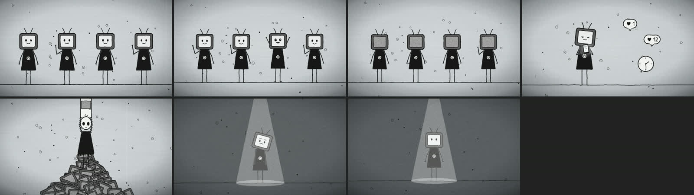
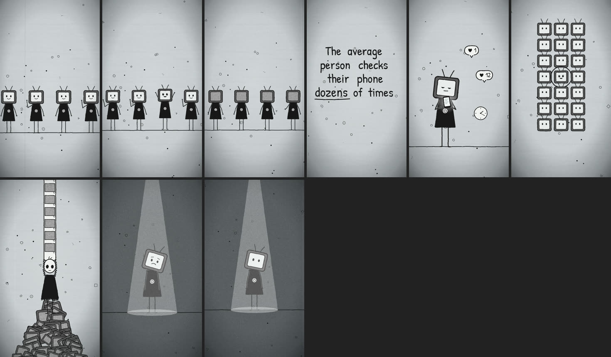
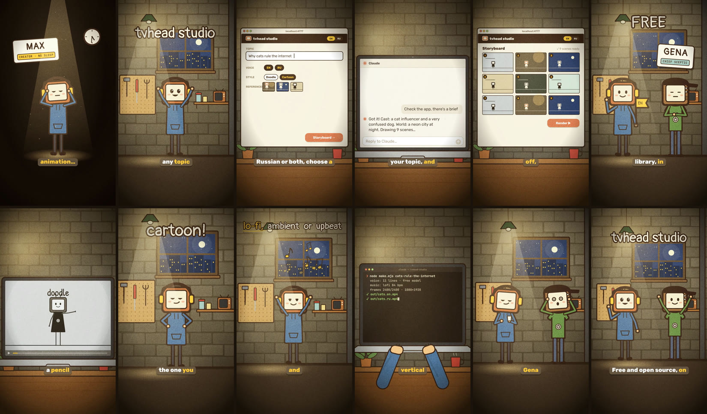
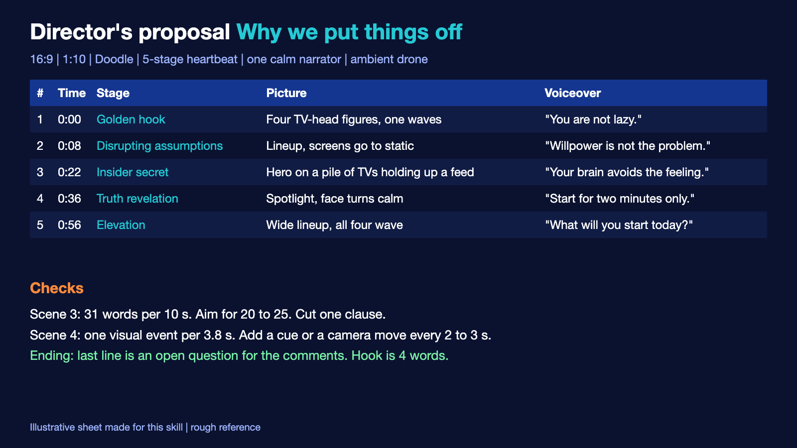
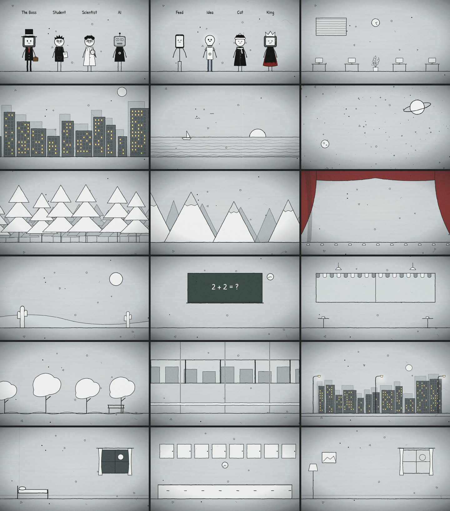
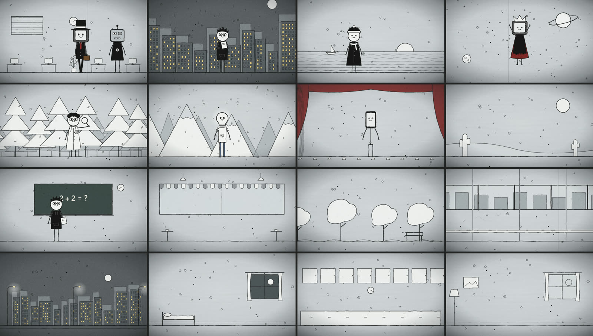

Adapted for Subclip from https://github.com/Vladic20/tvhead-studio by Vladic20, MIT

# TV-Head Doodle and Cartoon Stories (Subclip edition)

<!-- cli:start -->
> Install from your terminal: `npx @subclip/community-skills install tvhead-story-looks`
<!-- cli:end -->

A skill for AI agents working in [Subclip](https://subclip.app) that turns one topic into a narrated story video in a named look: doodle, warm cartoon, 3D desk, neon noir, dark fantasy, toy-block game, 8-bit, comic, five stickman styles, an underground engineering sim and a marker sketch. It writes a director's proposal with checks first, locks the style, cast and voice, then builds the video as an editable timeline, or writes standalone 10 second prompts for a video model.

**Topic in, narrated story video out. No outside API keys, no scripts, no local studio app.**

This adapts the `tvhead-video` sub-skill of Vladic20/tvhead-studio. The same plugin also holds `motion-studio` (our separate Motion Reel Studio skill), `ai-montage` and `blender-3d` (not adapted).

[Watch the silent preview](preview.mp4). The capability reference is `examples/capability-tvhead-story-looks.mp4`. Every look has its own reference in `examples/`.

```
brief -> story table -> director's proposal and checks -> voice -> word timings -> plates -> pictures -> captions -> QA
```

## Install

In Subclip: **Skills > Add skill**, paste `https://github.com/subclip-app/community-video-editing-skills/tree/main/skills/tvhead-story-looks`. Or ask the agent: "install the tvhead-story-looks skill from github.com/subclip-app/community-video-editing-skills/tree/main/skills/tvhead-story-looks".

## Use

> Make a 60 second doodle explainer about why we put things off, then show me the director's proposal first.

The agent writes the story and the proposal, fixes the flagged checks, shows you the table, makes a free local voice, locks the look and the characters with approved plates, makes one picture per line, adds captions and assembles the timeline. Every paid step shows its credit cost first and waits for your yes. Local speech, code layers and your own Codex CLI images cost no Subclip credits.

## What's inside

| File | What it covers |
| --- | --- |
| `SKILL.md` | The index of 15 looks, the rules and the 11-step workflow |
| `references/looks/01..15` | One recipe per look: signature, palette, places, cast, props, captions, sound, style anchor, prompt template, Subclip route |
| `references/directors-proposal.md` | The 5-stage heartbeat proposal template and the checks |
| `references/ai-video-prompt-package.md` | Standalone 10 second prompts with frozen style, cast, voice and music locks |
| `references/story-writing.md` | Script and picture rules, arcs, the engineering formats |
| `references/subclip-tools.md` | Tool and model mapping, quote template, assembly steps |
| `references/qa.md`, `references/overlap.md` | Checks and the overlap table with other community skills |
| `LICENSE` | The original MIT license, unchanged |

## Cost

A 60 second story is 14 to 18 scenes. Route B (code-drawn layers) and local speech are free. Route A (stills) is free with your own Codex CLI images, or quoted with a Subclip image model. A whole story through a video model costs about 2 to 5 credits a second: the one test clip here cost 24 credits for 10 seconds. Always quote with `estimate_ai_generation` first.

<!-- examples:start -->

## Examples

<p align="center"><a href="examples/00-doodle-reference-episode.mp4"></a><br><sub>Reference episode: a 33 s doodle story. Voice: Gemini 3.1 Flash TTS. Images: gpt-image-2. Scene 3 clip: p-video from a still. <a href="examples/00-doodle-reference-episode.mp4">Play with sound</a></sub></p>

<p align="center"><a href="examples/capability-tvhead-story-looks.mp4"></a><br><sub>Capability reference: doodle and cartoon first, then 11 more looks and the proposal. Images: gpt-image-2. Rendered in code. <a href="examples/capability-tvhead-story-looks.mp4">Play with sound</a></sub></p>

<p align="center"><br><sub>1. Doodle: one frame per scene of the demo episode. By the original author.</sub></p>

<p align="center"><br><sub>1. Doodle, vertical 9:16 sheet of the same story. By the original author.</sub></p>

<p align="center"><br><sub>2. Cartoon, warm garage: one frame per scene of the promo. By the original author.</sub></p>

<p align="center"><a href="examples/03-desk-3d.mp4"></a><br><sub>3. 3D desk: a UI slab and a clay mascot. Rough reference. Images: gpt-image-2, animated in code, no video model. <a href="examples/03-desk-3d.mp4">Play with sound</a></sub></p>

<p align="center"><a href="examples/04-neon-noir.mp4"></a><br><sub>4. Neon noir: painted scene and a clean card. Rough reference. Images: gpt-image-2, animated in code, no video model. <a href="examples/04-neon-noir.mp4">Play with sound</a></sub></p>

<p align="center"><a href="examples/05-dark-fantasy.mp4"></a><br><sub>5. Dark fantasy: heroes face off, LANE PUSH, game HUD. Rough reference. Images: gpt-image-2, animated in code, no video model. <a href="examples/05-dark-fantasy.mp4">Play with sound</a></sub></p>

<p align="center"><a href="examples/06-brick-game.mp4"></a><br><sub>6. Toy-block game: rounded blocks, coin pickup, leaderboard. Rough reference. Images: gpt-image-2, animated in code, no video model. <a href="examples/06-brick-game.mp4">Play with sound</a></sub></p>

<p align="center"><a href="examples/07-8-bit.mp4"></a><br><sub>7. 8-bit pixel: dungeon and overworld with dialog boxes. Rough reference. Images: gpt-image-2, animated in code, no video model. <a href="examples/07-8-bit.mp4">Play with sound</a></sub></p>

<p align="center"><a href="examples/08-comic.mp4"></a><br><sub>8. Comic book: halftone panels, POW and caption boxes. Rough reference. Images: gpt-image-2, animated in code, no video model. <a href="examples/08-comic.mp4">Play with sound</a></sub></p>

<p align="center"><a href="examples/09-stickman-classic.mp4"></a><br><sub>9. Stickman 1, classic: white canvas, then black canvas. Rough reference. Images: gpt-image-2, animated in code, no video model. <a href="examples/09-stickman-classic.mp4">Play with sound</a></sub></p>

<p align="center"><a href="examples/10-stickman-zeke.mp4"></a><br><sub>10. Stickman 2: Zeke in a red beanie, studio and summit. Rough reference. Images: gpt-image-2, animated in code, no video model. <a href="examples/10-stickman-zeke.mp4">Play with sound</a></sub></p>

<p align="center"><a href="examples/11-stickman-prehistoric.mp4"></a><br><sub>11. Stickman 3, prehistoric: cave and a sign gag. Rough reference. Images: gpt-image-2, animated in code, no video model. <a href="examples/11-stickman-prehistoric.mp4">Play with sound</a></sub></p>

<p align="center"><a href="examples/12-stickman-cozy.mp4"></a><br><sub>12. Stickman 4, cozy: a platform and a lamp-lit desk. Rough reference. Images: gpt-image-2, animated in code, no video model. <a href="examples/12-stickman-cozy.mp4">Play with sound</a></sub></p>

<p align="center"><br><sub>16. Director's proposal: 5-stage storyboard with checks. Rendered in code, no AI model.</sub></p>

<p align="center"><br><sub>18. Cast parts sheet: heads, bodies, hats and props. By the original author.</sub></p>

<p align="center"><br><sub>19. Sets sheet: the environments. By the original author.</sub></p>

<details><summary>More example videos</summary>

<ul><li><a href="examples/13-stickman-history.mp4">13. Stickman 5, historical: Edo, then Egypt and Rome. Rough reference. Images: gpt-image-2, animated in code, no video model.</a></li><li><a href="examples/14-underground.mp4">14. Underground sim: cutaway diorama, HUD, stamps. Rough reference. Images: gpt-image-2, animated in code, no video model.</a></li><li><a href="examples/15-marker.mp4">15. Marker sketch: problem in red, fixes in green. Rough reference. Images: gpt-image-2, animated in code, no video model.</a></li><li><a href="examples/17-ai-video-package.mp4">17. AI-video prompt package: one 10 s clip from the locked prompt. Video and audio: p-video (24 credits).</a></li></ul>

</details>

<p align="center"><sub>Files marked By the original author are by Vladic20 (MIT). The rest: images gpt-image-2 animated in code; episode voice Gemini 3.1 Flash TTS (1.32 credits); episode scene 3 and the AI-video package clip p-video (10 and 24 credits).</sub></p>

<!-- examples:end -->

## Credits and license

MIT. See `LICENSE` (the upstream file, unchanged). It states that portions of the upstream derive from garazh-skill by lubluniky, used under the MIT License.

- Adapted from tvhead-studio, https://github.com/Vladic20/tvhead-studio, by Vladic20, MIT (commit c18305f).
- Portions of the upstream (frame capture and voice analysis approach, the cartoon look) derive from garazh-skill, https://github.com/lubluniky/garazh-skill, by lubluniky, MIT.
- The five stickman looks and the director's proposal in the upstream adapt stickman-video-director, https://github.com/kaomei/stickman-video-director, by kaomei, MIT.
- Related upstream skills not adapted here: ai-montage and blender-3d (they need real source material or Blender).
- The "Dota-like" and "Roblox-like" looks are original drawings inspired by those games' visual language; no game assets or logos are used.

The upstream runs a local studio app with paid voice and image services and setup scripts; this version moves every step into Subclip's tools and credits. Files in `examples/` marked "By the original author" are copied from the upstream repository; the others were made for this skill (stills by gpt-image-2 through the Codex CLI, animated in code; one clip by p-video).
