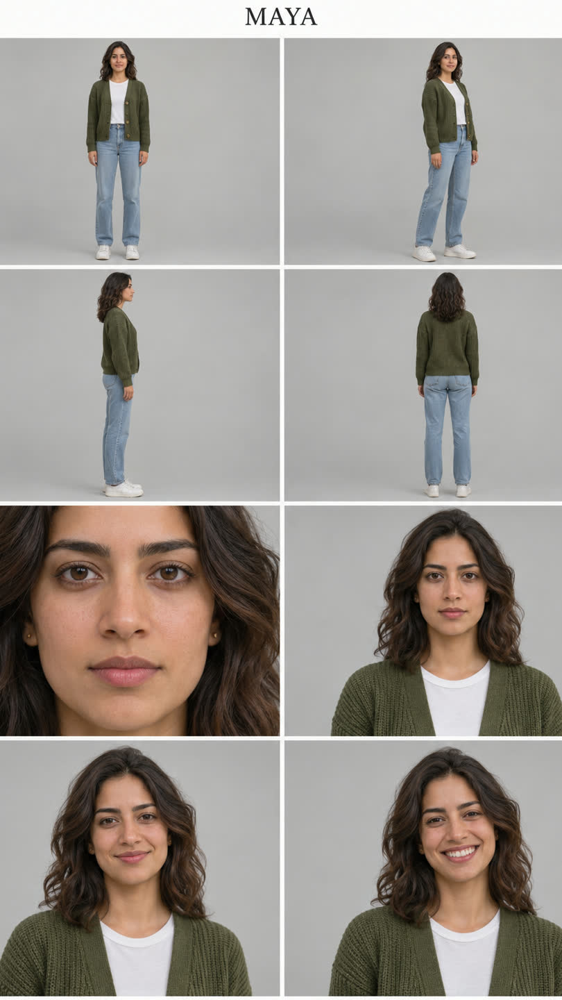
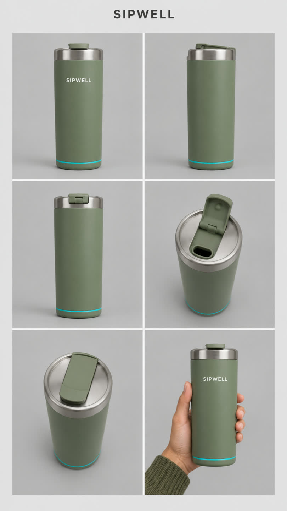
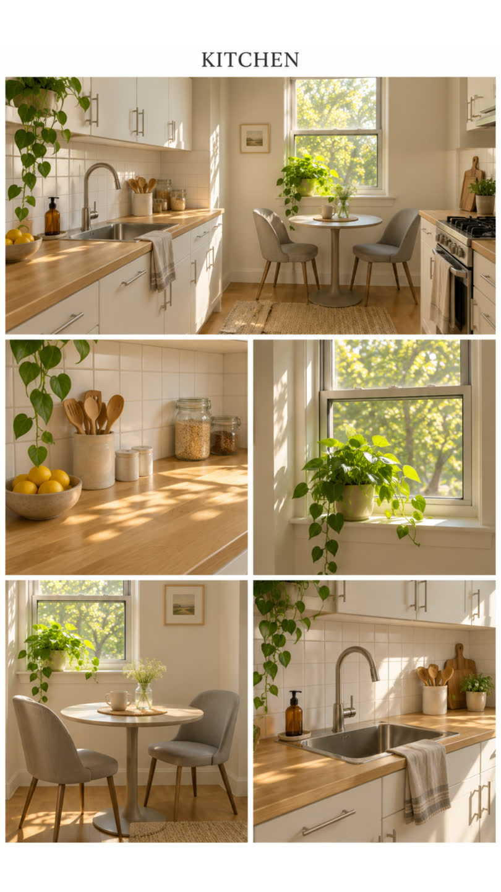
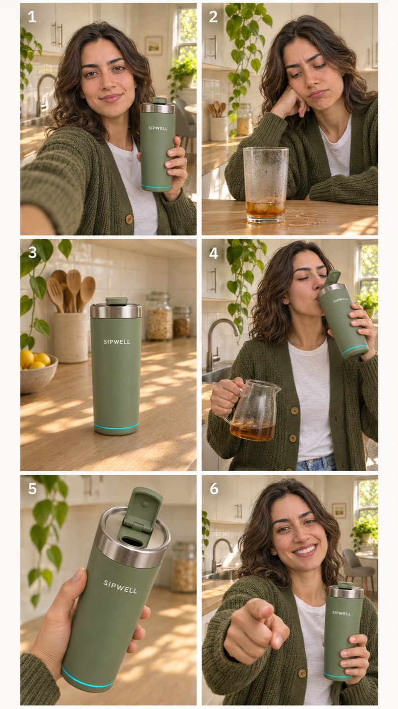

# UGC ad director for Subclip

A strict, stage-gated way to direct a 9:16 UGC style ad in Subclip. The agent builds three reference sheets first (character in 8 panels, product, location), then writes 10 concepts, a script and a storyboard plan, makes one storyboard image, runs a consistency check and only then makes clips, voice, captions and the timeline.

## Use it

Tell your agent: "Use ugc-ad-director to make a UGC ad for my product." It asks one question per reply and waits for your confirmation at every stage. For a faster route without the sheet stages, use the sibling skill `ugc-ad-engine`.

## What is in it

- `SKILL.md`: the rules and the stage table.
- `references/stages.md`: how each gate works and what fails it.
- `references/sheets.md`: character form, character, product and location sheets.
- `references/concepts-and-script.md`: 10 concepts, duration, script rules.
- `references/storyboard.md`: shot table and the storyboard image.
- `references/consistency-check.md`: the checklist before any clip.
- `references/subclip-tools.md`: tools, credit quotes and the build steps.

## What changed for Subclip

The method came from a master prompt written for another video generator, with Hindi and Hinglish prompts. Here everything is English and rebuilt on Subclip: sheets and storyboard images through the creator's Codex CLI image generation first (else Subclip image models), clips with Subclip image-to-video and avatar models, local or Subclip speech, assembly on the Subclip timeline with captions. The stage table replaces a very long prompt. Added: a credit quote before every paid step, a consent rule (fictional characters or your own consented likeness only), no health or income claims, and a reminder to add AI disclosure where a platform requires it.

<!-- examples:start -->

## Examples

Source video: <a href="https://www.youtube.com/watch?v=nqRugrnnKmc">How to Create AI UGC Ads with ChatGPT + Google Flow Agent Mode (Full Course)</a>, Lyra Ai, Standard YouTube License

 The four separate 9:16 sheets this skill builds before any clip is made: character, product, location, storyboard. <a href="examples/capability-ugc-ad-director.mp4">Play with sound</a>

 Character sheet: one fictional creator in 8 panels (front, three-quarter, side, back, face, three expressions).

 Product sheet: a fictional tumbler in every view, so the product never changes between shots.

 Location sheet: one fictional kitchen from five angles, with no person and no story.

 Storyboard image: six 9:16 phone-style panels using the locked character, product and location.

Our own test output for a fictional creator, product and kitchen. Images: gpt-image-2 (Codex CLI image generation). No video model used. Workflow idea from the Lyra Ai course video.

<!-- examples:end -->

## Source and license

The idea source is a Google Doc master prompt with no stated license and no named author. Permission has not been confirmed. Nothing is copied; the wording is our own. See LICENSE. Examples are our own test output for a fictional creator, product and kitchen.

## Credits

- Google Doc "AI UGC Ad Creative Director master prompt" (author unknown, link only): https://docs.google.com/document/d/1Fl1YmUx7ODrjNEjzBcFIZbW3x6wTN2uhee5SMgSFX6s/edit
- Course video "How to Create AI UGC Ads with ChatGPT + Google Flow Agent Mode (Full Course)" by Lyra Ai (Standard YouTube License): https://www.youtube.com/watch?v=nqRugrnnKmc
