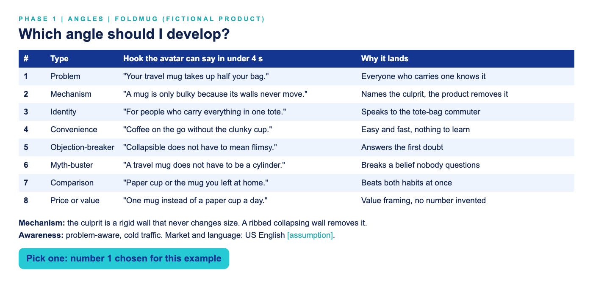
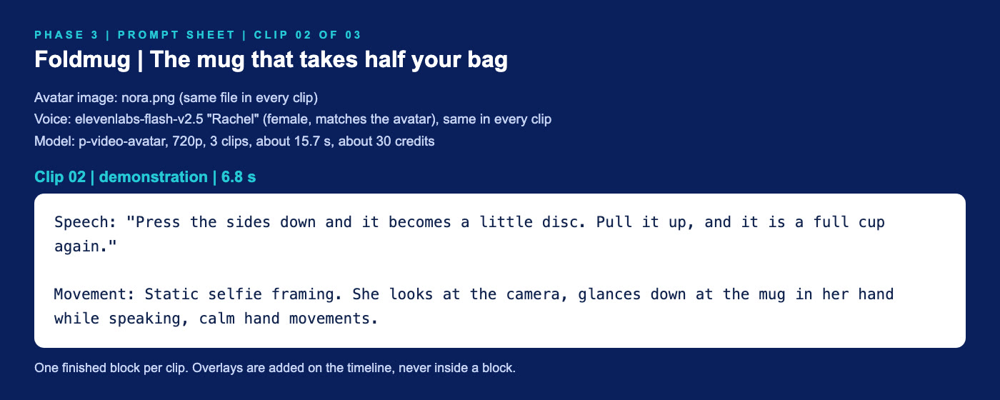
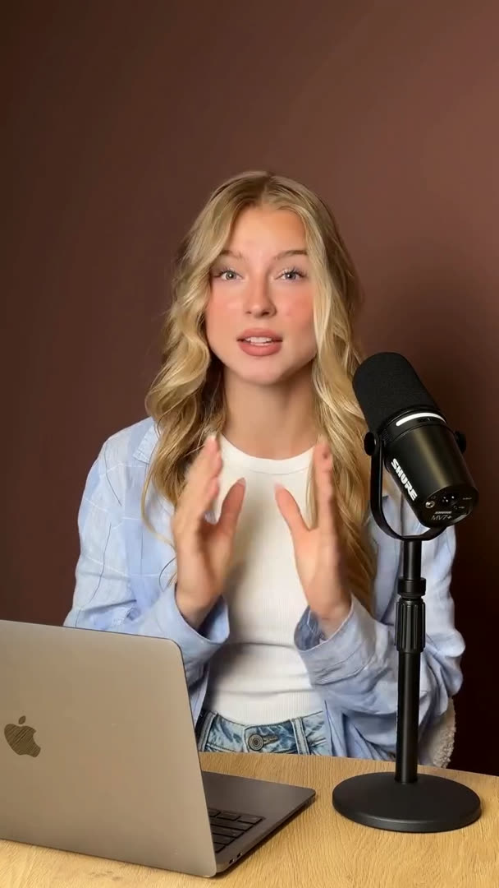
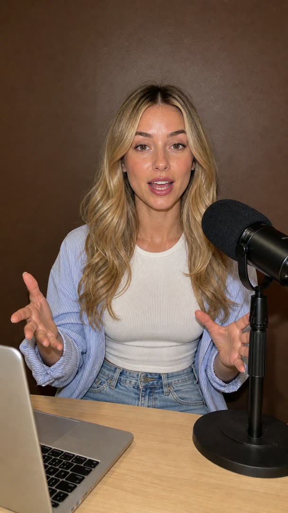

Adapted for Subclip from the UGC ad pipeline and the 6C avatar method taught by Website Learners (see Credits), license not stated

# UGC ad engine (Subclip edition)

A skill for AI agents working in [Subclip](https://subclip.app) that turns a product and an avatar into a finished vertical UGC ad. It finds sales angles, waits for you to pick one (the only gate), writes a direct-response script, writes a prompt sheet with one block per talking clip, then makes the speech, the avatar clips and the timeline: captions, a hook in the first second, an AI label and one call to action.

**Product in, 9:16 ad out, as an editable Subclip timeline. No outside API keys, no scripts.**

[Watch the silent preview](preview.mp4). The full capability reference video is `examples/capability-ugc-ad.mp4`.

```
product + avatar -> angles -> YOU PICK -> script -> prompt sheet -> quote -> speech -> avatar image -> clips -> captions -> QA
```

## Install

In Subclip: **Skills > Add skill**, paste `https://github.com/subclip-app/community-video-editing-skills/tree/main/skills/ugc-ad-engine`. Or ask the agent: "install the ugc-ad-engine skill from github.com/subclip-app/community-video-editing-skills/tree/main/skills/ugc-ad-engine".

## Use

> Make a UGC ad for my collapsible travel mug. Here is the product page and a photo.

The agent writes an angle table and stops. You answer with a number. It then writes the script and the prompt sheet, shows the credit quote and waits for your yes before any paid step. Avatar images come from your Codex CLI first, then Subclip image models. Clips come from a Subclip avatar model, with speech made first so each clip matches its audio.

## Safety

Fictional avatars or your own likeness with your consent only. No health, medical or income claims and no invented numbers or reviews. The ad carries an AI label where a platform requires one.

## What's inside

| File | What it covers |
| --- | --- |
| `SKILL.md` | The pipeline, the single gate, rules and the workflow |
| `references/angles.md` | Voice of customer, the angle table, mechanism, awareness level |
| `references/script.md` | Spoken script rules, clip lengths by voice pace, output format, self-review |
| `references/clip-prompts.md` | Camera, gestures, voice and the prompt sheet format |
| `references/avatar-6c.md` | The 6C method for avatar image prompts, with change-only mode |
| `references/subclip-tools.md` | Subclip tools, models, quote table and the assembly steps |
| `references/qa.md` | Checks before hand-over and a fixes table |

## About the examples

`examples/capability-ugc-ad.mp4` is a real run for an invented product (the Foldmug) with an invented avatar: three avatar clips with a female cloud speech voice, captions, a hook, an AI label and a call to action. It used about 38 credits (the first take with a free local voice sounded male, so it was redone with a female voice). The two `reference` images show the kind of reference avatar a run can start from and an image generated from it. They are test material and were supplied by the Subclip owner.

<!-- examples:start -->

## Examples

<p align="center"><sub>Source video: <a href="https://www.youtube.com/watch?v=UplOo693FMg">How To Create Ultra Real AI Avatar</a>, Website Learners, Standard YouTube License</sub></p>

<p align="center"><a href="examples/capability-ugc-ad.mp4"></a><br><sub>Capability reference: a 16 s UGC ad for a fictional mug, three avatar clips, captions, hook, AI label, call to action <a href="examples/capability-ugc-ad.mp4">Play with sound</a></sub></p>

<p align="center"><br><sub>Phase 1 output: the angle table the creator picks from (the single gate)</sub></p>

<p align="center"><br><sub>Phase 3 output: one finished block for one clip</sub></p>

<p align="center"><br><sub>Fictional avatar image made with the 6C method for the example run. Image: gpt-image-2.</sub></p>

<p align="center"><br><sub>Reference avatar image the run starts from</sub></p>

<p align="center"><br><sub>Image generated from that reference</sub></p>

<p align="center"><sub>Example ad made for this repository with a fictional product and avatar. Avatar image: gpt-image-2 (Codex CLI image generation). Avatar clips: p-video-avatar. Voice: elevenlabs-flash-v2.5. Reference images supplied by the Subclip owner (generation model not recorded).</sub></p>

<!-- examples:end -->

## Credits

- Reference video: "How To Create Ultra Real AI Avatar" by Website Learners, https://youtu.be/UplOo693FMg
- Adaptation inspiration: the Skool post "How to create AI UGC ad full tutorial" in the Learn AI with Website Learners community, https://www.skool.com/learn-ai-with-websitelearners-5339/new-video-how-to-create-ai-ugc-ad-full-tutorial?p=5220d4a0 (login required, only the link is given).

The source states no license. This skill keeps the ideas and the structure and is written entirely in Subclip's own words. The creator's permission has not been confirmed. See LICENSE. If you are the creator and want a change or removal, open an issue.
