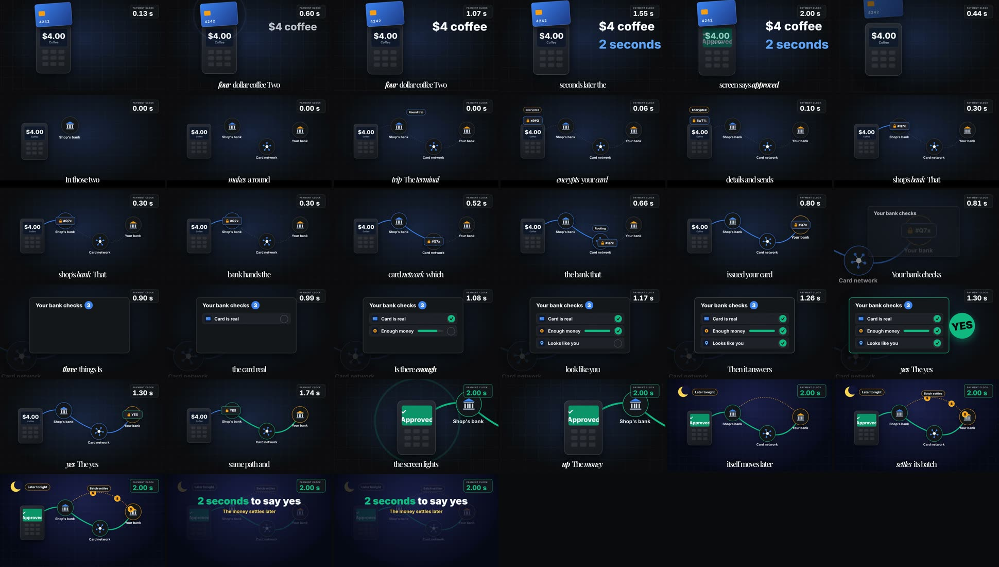

Adapted for Subclip from [petergyang/video-explainer](https://github.com/petergyang/video-explainer) by Peter Yang, MIT

# video-explainer (Subclip edition)

<!-- cli:start -->
> Install from your terminal: `npx @subclip/community-skills install video-explainer`
<!-- cli:end -->

A skill for AI agents working in [Subclip](https://subclip.app) that turns any topic, doc, codebase or URL into a tight 60 to 75 second explainer. Pick one of three looks and the agent writes the script, voices it, builds the scenes as editable HyperFrames layers timed to the spoken words, adds sound cues, music and captions, and reviews the frames before you see a draft.

**Three modes:**

1. **Motion (default):** full-frame 2D kinetic graphics, live SVG routes and charts, CSS 3D cards, press clippings.
2. **Illustrated:** a gouache and pastel picture book with 10 fps line boil and characters that talk with the narration.
3. **3D:** single-take Three.js camera flythroughs with studio lighting and camera-facing labels.

[Watch the silent preview](preview.mp4). [Watch the reference film with sound](examples/card-payment-2-seconds.mp4): "How a card payment travels in 2 seconds", 32.5 seconds, Motion mode, made with this skill at zero credits.

## How it differs from the other explainer skills

- **video-explainer (this one)** is the fast general explainer. Graphics are drawn in code, so a full film costs 0 credits with a local voice, and you choose Motion, Illustrated or 3D.
- **[vox-explainer](../vox-explainer)** makes the Vox documentary look (paper collage, archival cutouts) from AI keyframes and AI animation, on Subclip credits.
- **[website-to-video](../website-to-video)** turns one website or product page into a promo that shows that site.

## Install

In Subclip: **Skills > Add skill**, paste `https://github.com/subclip-app/community-video-editing-skills/tree/main/skills/video-explainer`. Or ask the agent: "install the video-explainer skill from github.com/subclip-app/community-video-editing-skills/tree/main/skills/video-explainer".

## Use

> Make a video explainer about how HTTPS keeps my password safe on public Wi-Fi.

> Explain this repo to a non-engineer in Illustrated mode, about a minute, no captions.

The agent asks for a mode and captions unless you already said, verifies the facts, writes 135 to 185 words over 5 to 8 scenes with a 3 second hook and one example traced end to end, voices it first, and times every animation and sound to the words.

## What's inside

| File | What it covers |
|---|---|
| `SKILL.md` | The seven-step workflow in Subclip |
| `references/script.md` | Plan format, word budgets, audience levels, spoken copy rules, the three color styles |
| `references/modes.md` | Build rules and starter patterns for Motion, Illustrated and 3D |
| `references/sound.md` | Word-anchored sound cues, music bed, captions |
| `references/review-checklist.md` | The source's checks and its ten automated QA checks, done with Subclip tools |
| `references/subclip-mapping.md` | What each upstream script became |

## Cost

0 credits with a local voice, a CC0 music loop and code-drawn scenes. A cloud voice (Gemini TTS in the source) or a generated Lyria score adds a few credits; the agent quotes them first.

<!-- examples:start -->

## Examples

 1. How a card payment travels in 2 seconds: 32.5 s Motion mode, three HyperFrames scenes. Voice: local jean. No AI model. <a href="examples/card-payment-2-seconds.mp4">Play with sound</a>

 2. One frame per second: card tap hook, encrypted packet, card network, three checks, YES returns, money settles at night. No AI model.

Test output made with this skill in Subclip at zero credits. Scenes drawn in code (HyperFrames HTML and SVG), no image or video model. Voice: local jean voice. Captions: local Whisper Small. Music: ElectronicPerk1 by aikighost on Freesound (CC0). Whoosh, whip and ding from the Remotion library.

<!-- examples:end -->

## Credits

Based on [video-explainer](https://github.com/petergyang/video-explainer) by Peter Yang (MIT). The original runs a local pipeline with Python scripts, local speech and alignment models and the HyperFrames renderer; this edition keeps its craft (modes, hook, word budgets, audience levels, word-anchored cues, QA checks) and moves every step into Subclip. The bundled Inter font and the README demo images were not copied.

## License

MIT. See `LICENSE`.
