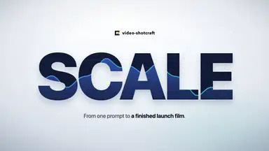
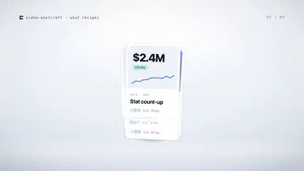

Adapted for Subclip from [Vincentwei1021/video-shotcraft](https://github.com/Vincentwei1021/video-shotcraft) by Vincentwei1021, Apache-2.0.

# Video Shotcraft

Turn real product screenshots and recordings into an editable launch film. Plan a rise from a quiet brand opening to a feature payoff. Build shots from recipes like Spotlight Hero Card, Deck Deal Fly-In and Row Embed, then time the cuts and sound to the score.

Try asking for a full promo, an Ink Press-inspired sequence for your product, one named shot, or sound effects for an existing edit. For example:

> Give my search demo a human-paced type-and-filter shot. Place a soft keyboard sound under the typing and a short click at the result selection.

- [Shot recipes and Ink Press sequence](references/shot-recipes.md)
- [Beat sync and sound design](references/beat-and-sound.md)
- [Original Gallery with named variants](https://vincentwei1021.github.io/video-shotcraft/)
- [Upstream recipe research credits](references/ATTRIBUTION.md)

This edition rewrites the production workflow for native Subclip layers, timeline audio and export. It includes an original cover and uses the creator's product assets. Upstream demo media, audio and applications are omitted. See [LICENSE](LICENSE) for the original Apache-2.0 license.

<!-- examples:start -->

## Examples

<video src="examples/exploded-view.mp4" controls muted loop playsinline width="720"></video> A camera tilts around an interface as its panels separate

<video src="examples/chart-rescale.mp4" controls muted loop playsinline width="720"></video> A spike in monthly renders forces the chart axis to rescale

<video src="examples/spotlight-title.mp4" controls muted loop playsinline width="720"></video> A moving spotlight reveals a title against a dark stage

 A dashboard shows through oversized title letters

 A product showcase card pairs a large metric with a small line chart

Examples by Vincentwei1021, Apache-2.0, from github.com/Vincentwei1021/video-shotcraft

<!-- examples:end -->
