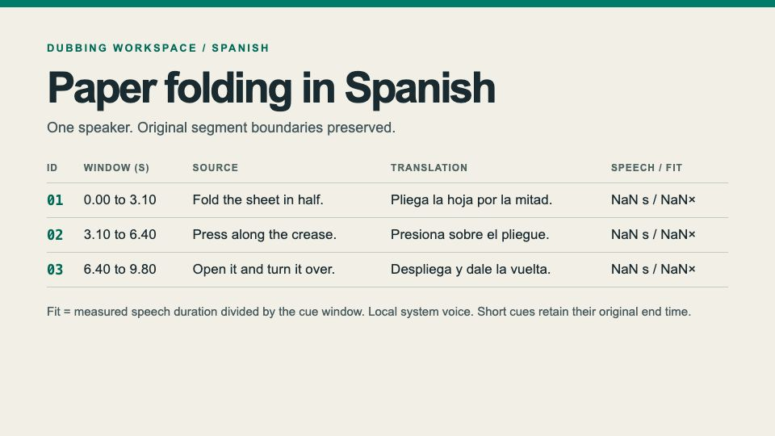

Adapted for Subclip from [OpenMontageInc/OpenMontage](https://github.com/OpenMontageInc/OpenMontage) by OpenMontageInc, AGPL-3.0

# video-translate (Subclip edition)

<!-- cli:start -->
> Install from your terminal: `npx @subclip/community-skills install video-translate`
<!-- cli:end -->

Translate and dub a video into another language, or several, inside Subclip. The agent writes the translation, Subclip voices each speaker, checks every line against the original timing, places the dub on your timeline and, if you want, translates the captions and runs lip-sync.

The original called the HeyGen video translation API with a key. This version uses Subclip's own dubbing workflow and voice models, so there is no outside account, key or script.

## Install

In Subclip: **Skills > Add skill**, paste `https://github.com/subclip-app/community-video-editing-skills/tree/main/skills/video-translate`.

## Use

> Dub this product demo into Spanish and German. Keep the product name as it is.

## Reference

[examples/coffee-spanish-dub.mp4](examples/coffee-spanish-dub.mp4) and [examples/coffee-french-dub.mp4](examples/coffee-french-dub.mp4) are dubs of [examples/coffee-english-source.mp4](examples/coffee-english-source.mp4) made with this skill: translated lines on the original timing, a new voice and translated captions. SKILL.md explains how.

## What's inside

| File | What it covers |
|---|---|
| `SKILL.md` | Workflow, translation craft, lip-sync, multi-language versions, original options mapped to Subclip |

## Needs

Subclip's `subclip-dubbing` skill and tools (dubbing workspace, voices, transcription). Lip-sync needs a lip-sync capable model in the live catalog.

<!-- examples:start -->

## Examples

 1. Spanish dub: the coffee tutorial voiced in Spanish on the original timing, Spanish captions. Images: gpt-image-2. No video model. <a href="examples/coffee-spanish-dub.mp4">Play with sound</a>

 2. French dub: same video and timing, French voice and captions. Images: gpt-image-2. Rendered in code, no video model. <a href="examples/coffee-french-dub.mp4">Play with sound</a>

 3. English source: the original video both dubs follow. Images: gpt-image-2. Rendered in code, no video model. <a href="examples/coffee-english-source.mp4">Play with sound</a>

 4. French cue fit: paper-folding cues with original timing windows and measured speech fit.

 5. Spanish cue fit: paper-folding cues with original timing windows and measured speech fit.

 6. Cue fit check: French and Spanish cues appear with their original time windows and measured speech fit. <a href="examples/dubbing-cue-fit.mp4">Play with sound</a>

Test outputs made with this skill in Subclip. Stills: gpt-image-2 through the Codex CLI. Voices: the free local Supertonic model. Captions: local transcription. Scenes rendered in code (HyperFrames): no video model.

<!-- examples:end -->

## License

AGPL-3.0, same as the original project. See `LICENSE`.
