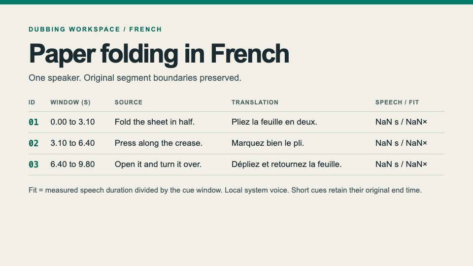

Adapted for Subclip from [OpenMontageInc/OpenMontage](https://github.com/OpenMontageInc/OpenMontage) by OpenMontageInc, AGPL-3.0

# video-translate (Subclip edition)

Translate and dub a video into another language, or several, inside Subclip. The agent writes the translation, Subclip voices each speaker, checks every line against the original timing, places the dub on your timeline and, if you want, translates the captions and runs lip-sync.

The original called the HeyGen video translation API with a key. This version uses Subclip's own dubbing workflow and voice models, so there is no outside account, key or script.

## Install

In Subclip: **Skills > Add skill**, paste `https://github.com/subclip-app/community-video-editing-skills/tree/main/skills/video-translate`.

## Use

> Dub this product demo into Spanish and German. Keep the product name as it is.

## What's inside

| File | What it covers |
|---|---|
| `SKILL.md` | Workflow, translation craft, lip-sync, multi-language versions, original options mapped to Subclip |

## Needs

Subclip's `subclip-dubbing` skill and tools (dubbing workspace, voices, transcription). Lip-sync needs a lip-sync capable model in the live catalog.

<!-- examples:start -->

## Examples

 French paper-folding cues with original timing windows and measured speech fit.

 Spanish paper-folding cues with original timing windows and measured speech fit.

 French and Spanish paper-folding cues appear with their original time windows and measured speech fit. <a href="examples/dubbing-cue-fit.mp4">Play with sound</a>

Test outputs made with this skill in Subclip. Rendered in code (HTML cards and HyperFrames): no image or video model. Speech fit measured with the local Supertonic speech model, the clip is silent.

<!-- examples:end -->

## License

AGPL-3.0, same as the original project. See `LICENSE`.
