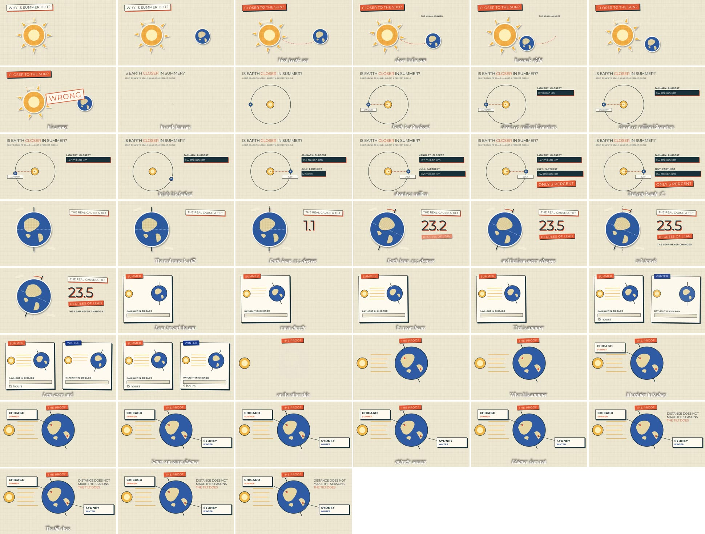

Adapted for Subclip from [CK42BB/vox-explainer-skill](https://github.com/CK42BB/vox-explainer-skill) by Kingsley, MIT

# vox-explainer (Subclip edition)

<!-- cli:start -->
> Install from your terminal: `npx @subclip/community-skills install vox-explainer`
<!-- cli:end -->

A skill for AI agents working in [Subclip](https://subclip.app) that turns one topic into a finished Vox-style explainer: script, voiceover, art-directed paper-collage keyframes, subtle animation, music, captions and export, all inside the Subclip editor.

**One topic in, finished film out. No outside API keys, no ffmpeg.**

[Watch the silent preview](preview.mp4). [Watch the reference film with sound](examples/why-summer-is-hot.mp4): "Why is summer hot", 44 seconds, made with this skill at zero credits, with collage scenes drawn in code, a local voice, captions and music.

```
TOPIC → Script → Voiceover → Keyframes → Animation → Music → Assembly
        (agent)  (Gemini TTS  (Seedream 5  (P-Video 2)  (Lyria 3,   (Subclip
                  or local)    Lite)                     MiniMax)    timeline)
```

Generation runs through Subclip's MCP tools on the creator's Subclip AI credits. If the creator has the Codex CLI or the Grok CLI signed in, the agent offers those first for images (and Grok for video), so they cost no Subclip credits.

## Install

In Subclip: **Skills > Add skill**, paste `https://github.com/subclip-app/community-video-editing-skills/tree/main/skills/vox-explainer`. Or ask the agent: "install the vox-explainer skill from github.com/subclip-app/community-video-editing-skills/tree/main/skills/vox-explainer".

## Use

> Make me a 60-second Vox-style explainer about how the shipping container shrank the world.

The agent writes the script in beats, voices it first (narration length drives all timing), locks the look with one anchor keyframe, makes the other frames from it, animates the hook, the key idea and the ending, scores it with Lyria (MiniMax if Lyria misses), captions it and assembles everything on an editable Subclip timeline.

## What's inside

| File | What it covers |
|---|---|
| `SKILL.md` | The six-stage pipeline in Subclip |
| `references/vox-style-guide.md` | Writing arc, collage visual grammar, prompt templates |
| `references/subclip-models.md` | Which Subclip model per stage, settings, prices, budget formula, Codex and Grok |
| `references/subclip-assembly.md` | Timeline, titles, captions, music mix, review and export calls |

## Cost

A 7-beat, 60-second film with 3 animated beats is about 100 Subclip credits (frames about 21, animation about 69, music about 7, cloud voice about 4 or free with local voice). Animating every beat is about 150.

<!-- examples:start -->

## Examples

<p align="center"><a href="examples/why-summer-is-hot.mp4"></a><br><sub>1. Why is summer hot: a 44 s Vox-style explainer, collage scenes drawn in code. Voice: local jean. Captions: Whisper Small. No AI model. <a href="examples/why-summer-is-hot.mp4">Play with sound</a></sub></p>

<p align="center"><br><sub>2. One frame per second: myth, orbit gap, 23.5 degree tilt, daylight cards and the Chicago and Sydney proof. No AI model.</sub></p>

<p align="center"><sub>Test output made with this skill in Subclip at zero credits. Scenes rendered in code (HTML and SVG): no image or video model. Voice: local jean voice. Captions: local Whisper Small. Music: Evening Sunset by Muyo5438 on Freesound (CC BY 4.0). Page-turn sound from the Remotion library.</sub></p>

<!-- examples:end -->

## Credits

Based on [vox-explainer](https://github.com/CK42BB/vox-explainer-skill) by Kingsley (MIT). The original runs on the Atlas Cloud API with local ffmpeg; this fork moves every step into Subclip.

## License

MIT. See `LICENSE`.
