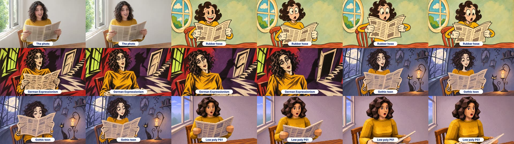
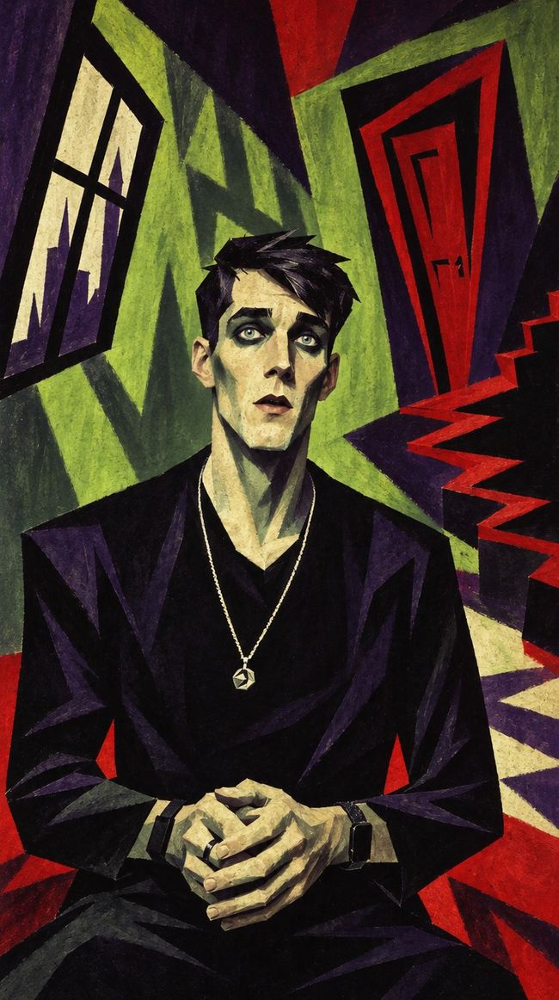
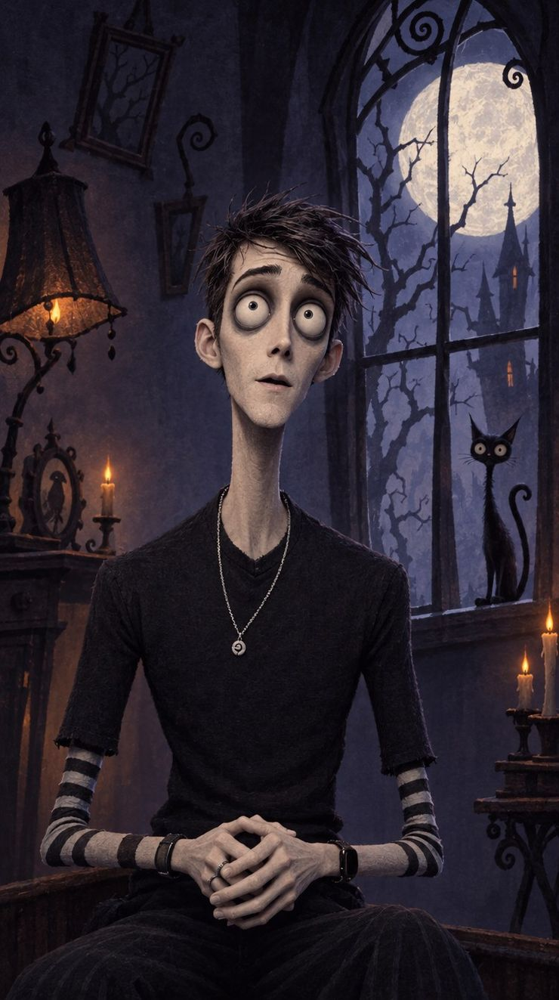
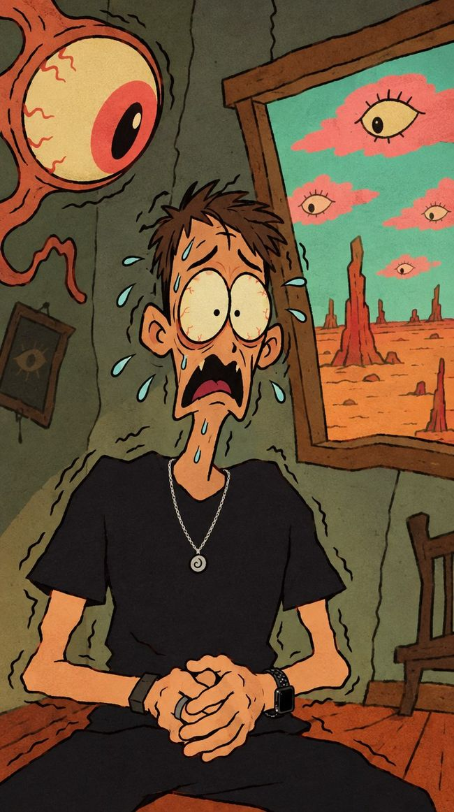

Adapted for Subclip from guides by sferro21 (https://www.instagram.com/sferro21)

# Wan animation styles (Subclip edition)

<!-- cli:start -->
> Install from your terminal: `npx @subclip/community-skills install wan-animation-styles`
<!-- cli:end -->

Restyle a photo or video frame into one of five animation looks with an image model, then animate it with Wan 3 on Subclip. Includes a template for a full multi-shot scene from one style frame.

Five looks and a ten second scene recipe.

The [reference video](examples/wan-styles-reference.mp4) shows the skill run in Subclip: one photo turned into four style frames with gpt-image-2, each animated with Wan 3 at 720p, with sound from ElevenLabs Sound Effects ([contact sheet](examples/wan-styles-reference-sheet.jpg)).

## Install

Add this skill from **Skills > Community** in Subclip, or point your agent at this folder. It works with Claude Code, Codex, Cursor and the in-app agent through Subclip's MCP tools.

## Files

- `SKILL.md`: the workflow the agent follows.
- `references/five-styles.md`: recipes, animation paragraphs, motion and sound for the five looks.
- `references/multi-shot-recipe.md`: a five shot, ten second scene template.

## How it differs from the original guide

- Outside services, accounts and keys are replaced by Subclip's own generation tools and models. Image generation offers the creator's own Codex CLI first.
- Every model name the guide used is kept when Subclip's live catalog offers it. Where it does not, the closest model is named with the swap.
- Credits are quoted before anything is generated, and edits run one at a time on the native timeline.

<!-- examples:start -->

## Examples

 1. One photo, four looks: rubber hose, Expressionism, gothic toon, PS1. Images: gpt-image-2. Video: Wan 3 720p. Sound: ElevenLabs SFX. <a href="examples/wan-styles-reference.mp4">Play with sound</a>

 2. Contact sheet: one frame per second of the reference. Images: gpt-image-2. Video: Wan 3 720p.

 3. By the original author: German Expressionism style frame. Image: GPT Image.

 4. By the original author: rubber hose style frame. Image: GPT Image.

 5. By the original author: gothic toon style frame. Image: GPT Image.

 6. By the original author: surreal spooky style frame. Image: GPT Image.

 7. By the original author: low poly PS1 style frame. Image: GPT Image.

Items 1 and 2 made for Subclip: photo and style frames with gpt-image-2 (Codex CLI), clips with Wan 3 720p, sound with ElevenLabs Sound Effects, Remotion page-turn and the Subclip whoosh. Items 3 to 7 from the guides by sferro21 (instagram.com/sferro21).

<!-- examples:end -->

## Credit and license

Adapted for Subclip from guides by sferro21 (https://www.instagram.com/sferro21). Rewritten in our own words. The creator's guides state no license, so please confirm permission with the creator before relying on this skill.
