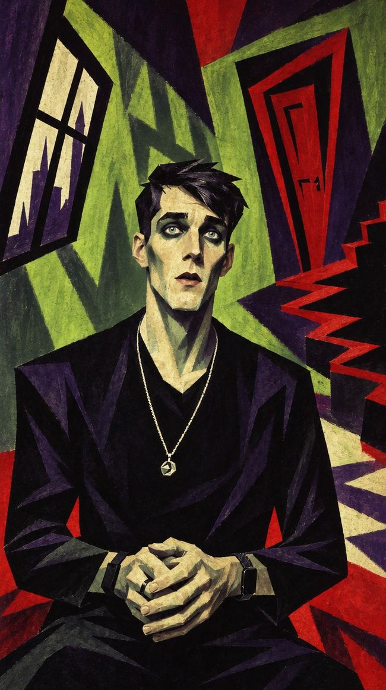
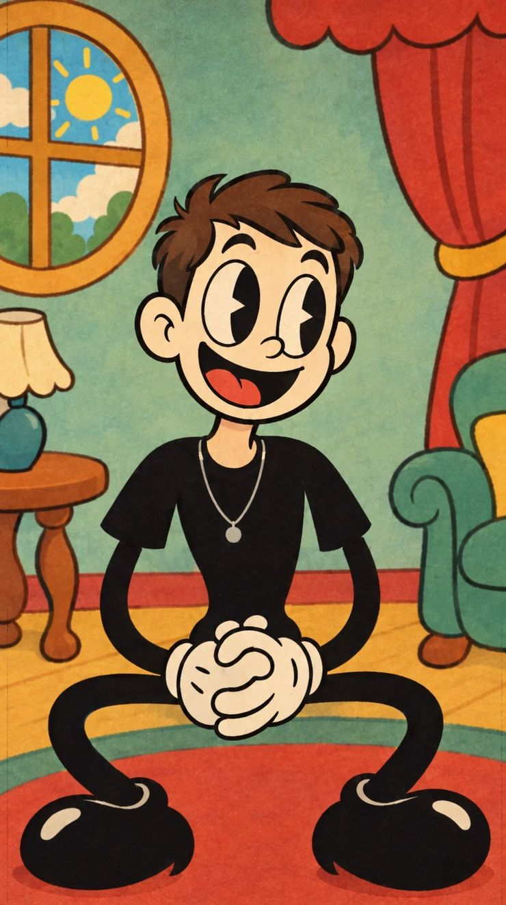
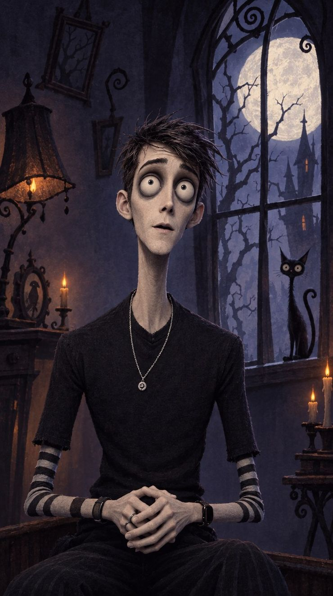
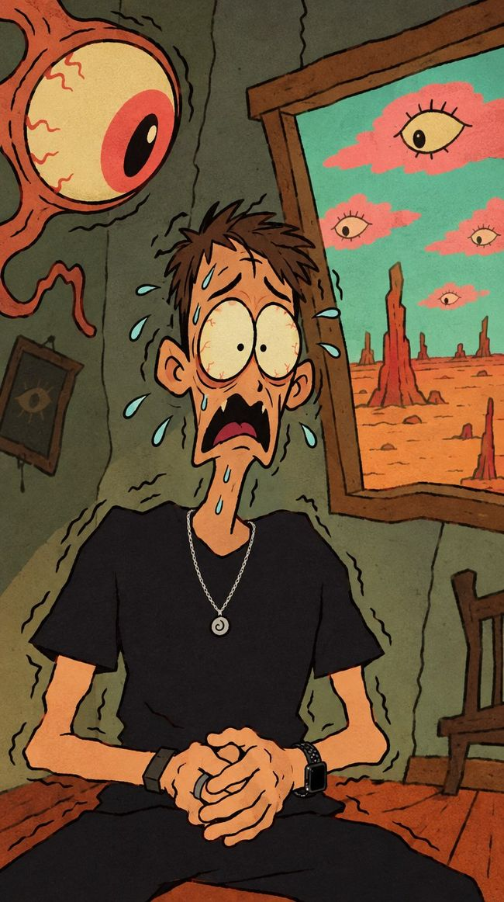
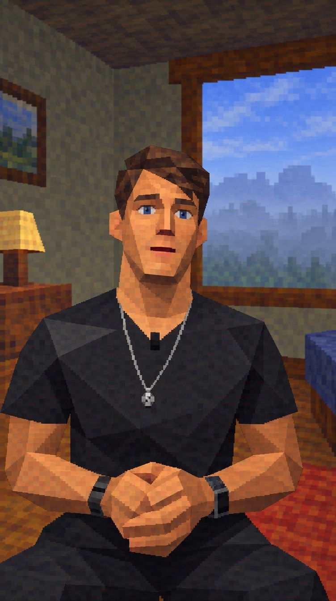

# Five animation looks

For each look: the recipe for the style frame, a ready animation paragraph, how things should move, and sound ideas. Everything keeps the photo's framing, pose, gaze, expression and hands, and redesigns the rest.

Banned in every look: realistic portrait, photographic textures, text, logos. Keep the source aspect ratio.

## 1. German Expressionism (1920s silent horror, in colour)

- **Character:** tall, angular figure; sharp cheekbones; long face; dark-ringed eyes; pale theatrical skin; simple dark clothes with crisp angular folds.
- **Set:** a painted stage: steeply slanted walls, crooked windows, a tilted door, zigzag stairs, jagged shadows painted onto walls and floor.
- **Palette and light:** acid green, blood red, deep violet, bone white. Flat painted surfaces, hard stage light, distorted tilted perspective, light film grain.
- **Also ban:** soft gradients, natural perspective, 3D rendering.
- **Animation paragraph:** "The same colour 1920s German Expressionist look: flat painted sets, violently slanted walls, jagged painted shadows, hard theatrical light, acid green, blood red, violet and bone white, with the same tall angular character."
- **Motion:** slow, eerie, deliberate. Slow camera push-in. Shadows stretch and crawl.
- **Sound:** footsteps on cobblestones, low wind, a creaking door. No music.

## 2. Rubber hose (1930s cartoon)

- **Character:** round head, big pie-cut eyes, a huge grin, noodle arms and legs, white four-fingered gloves, big round black shoes. Keep hair and clothing colours.
- **Set:** a cheerful rounded room: wobbly furniture, a round window with a sunny sky and puffy clouds, squash and stretch in every shape.
- **Palette and line:** soft saturated red, yellow, teal and green with cream highlights; thick black ink outlines, flat cel shading, painted watercolour background, light film grain, early three-strip colour feel.
- **Also ban:** normal anatomy, detailed shading, gradients.
- **Animation paragraph:** "The same 1930s full colour rubber hose cartoon look: thick black ink outlines, flat cel colours, painted watercolour backgrounds, light film grain, and the same character with noodle limbs, white gloves and pie-cut eyes."
- **Motion:** bouncy, loopy, everything pulses to a rhythm, big squash and stretch on jumps and landings. Camera tracks sideways.
- **Sound:** boings, a slide whistle on a jump, splashy landings. No music.

## 3. Gothic toon (whimsical gothic fairy tale)

- **Character:** tall, spindly; long thin limbs and fingers; pale skin; huge round eyes with dark circles; slightly messy hair; dark simple clothes with a few black and white stripes.
- **Set:** a crooked room at night: a tall narrow window with an enormous full moon, curling iron details, a lopsided lamp, bare twisted branches, a skinny black cat.
- **Palette and light:** slate blue, violet, grey, bone white, with small warm orange candle accents. Smooth stylised forms, soft moonlit shading, crisp silhouettes, a gentle painterly texture.
- **Also ban:** gore, photographic lighting, 3D rendering.
- **Animation paragraph:** "The same whimsical gothic 2D animated look: smooth stylised forms, soft moonlit shading, crisp silhouettes, slate blue, violet, grey and bone white with small orange candlelight, and the same tall spindly character with huge round eyes."
- **Motion:** slow and whimsical with a stop-motion feel. Slow sideways tracking camera.
- **Sound:** crickets, soft wind, a lantern creak, a small meow. No music.

## 4. Surreal spooky (early 2000s TV cartoon)

- **Character:** wobbly and nervous; huge bulging eyes with tiny pupils; trembling outlines; flying sweat drops; a worried gaping mouth; clothing simplified into flat shapes with bold uneven outlines.
- **Set:** an eerie lonely place: a crooked window onto a flat empty desert with odd rock spires, a mint-turquoise sky with salmon-pink clouds that have big blinking eyes, and one oversized creepy detail that stares.
- **Palette and line:** flat muted colours with rust orange, mint and pink accents; bold uneven black outlines; wobbly hand-drawn lines; light grain. Unsettling but funny.
- **Also ban:** gore, smooth gradients, 3D rendering.
- **Animation paragraph:** "The same early 2000s surreal spooky TV cartoon look: bold uneven black outlines, wobbly hand-drawn lines, flat muted colours with rust orange, mint and pink, light grain, and the same nervous character with bulging eyes and tiny pupils."
- **Motion:** nervous and jittery with boiling, trembling outlines. Static camera.
- **Sound:** frantic footsteps, a wet eyelid squelch, a low eerie hum. No music.

## 5. Low poly PS1 (1990s console cutscene)

- **Character:** a very low-poly 3D model of a few hundred flat triangles; faceted head; visible polygon edges; mitten-like blocky hands; tiny painted textures for eyes and mouth; hair as a few hard chunks. Keep hair and clothing colours.
- **Set:** a simple low-poly room of boxy furniture, a window showing a flat painted skybox, thick draw-distance fog.
- **Look:** tiny blurry low-resolution textures with visible pixels, flat vertex lighting, warped wobbly textures, jagged aliased edges, ordered dithering, saturated 1990s colours; it must look like an old game at very low resolution.
- **Also ban:** smooth high-poly 3D, modern lighting, game interface, text.
- **Animation paragraph:** "The same mid 1990s 32-bit console game look: very low-poly models of flat triangles, visible polygon edges, tiny blurry pixelated textures, flat vertex lighting, dithering and thick fog, and the same faceted character with blocky hands."
- **Motion:** stiff, slightly jerky walk cycle, stepped head turns, low frame rate, slow orbiting camera like a cutscene.
- **Sound:** hollow game footsteps, a soft synth blip, distant city hum. No music.

## Tips that apply to all five

- Keep the first paragraph of every animation prompt and rewrite only the scene below it.
- Describe motion that fits the style. Bouncy for rubber hose, slow and eerie for Expressionism, stiff and stepped for low poly.
- Test at five seconds and a low resolution first. Upscale or extend only the winners.
