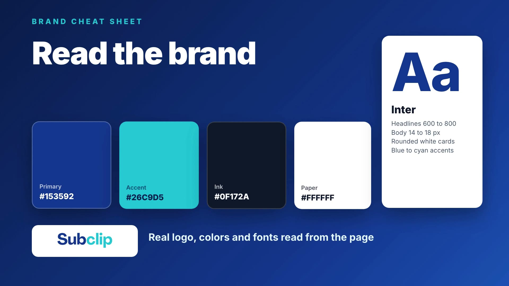
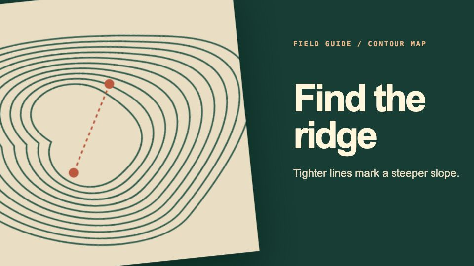

Adapted for Subclip from [OpenMontageInc/OpenMontage](https://github.com/OpenMontageInc/OpenMontage) by OpenMontageInc, AGPL-3.0

# website-to-video (Subclip edition)

Paste a URL and get a video made from that site's own brand: its colors, fonts, copy, logo and imagery. The agent captures the page, writes a short brand sheet, agrees the message with you, storyboards concept-first, voices it, designs sound, builds every beat as an editable motion layer and checks the result frame by frame.

The original used a command line capture tool, a hosted image describer and several voice API keys. This version uses Subclip's own site inspector, voices, music and sound effects, motion layers and export. No outside API keys, no Python, no ffmpeg, no scripts to run.

## Install

In Subclip: **Skills > Add skill**, paste `https://github.com/subclip-app/community-video-editing-skills/tree/main/skills/website-to-video`.

## Use

> Make a 20 second vertical clip for Instagram from https://example.com. Fast and punchy, no voice, music only.

## Reference

[examples/subclip-site-tour.mp4](examples/subclip-site-tour.mp4) is a site tour of subclip.app made with this skill: page capture, brand cheat sheet, the site's own headline, its templates and a call to action, all as editable HyperFrames layers. SKILL.md explains each beat.

## What's inside

| File | What it covers |
|---|---|
| `SKILL.md` | The seven steps, routing, quick reference |
| `references/brand-and-brief.md` | Capture, brand sheet, message and arc questions |
| `references/storyboard.md` | Concept, pacing, technique pick, asset audit, shot grammar, sound design |
| `references/build-and-verify.md` | Voiceover timing, building beats, motion rules, the verification checklist |

## Limits

Subclip captures up to 3 page screenshots plus logo and image candidates. It does not export every SVG or Lottie file on the page. Sound effects are generated or found, not bundled. The original `w2h-verify` script is replaced by a manual checklist.

<!-- examples:start -->

## Examples

 1. Site tour: subclip.app captured, brand sheet, its own headline, 200+ templates, call to action. Rendered in code, no video model. <a href="examples/subclip-site-tour.mp4">Play with sound</a>

 2. Brand sheet: colors, font and logo read from the captured page. Rendered in code, no image model.

 3. Trail tour: a field guide's captured map pushes in behind a two-line opener. <a href="examples/trail-tour.mp4">Play with sound</a>

 4. Trail close-up: the site's own contour map shows how to spot the ridge.

Test outputs made with this skill in Subclip. Rendered in code (HyperFrames layers): no image, video or audio model. Site tour music: Angel-techno pop music loop by frankum, CC BY 4.0.

<!-- examples:end -->

## License

AGPL-3.0, same as the original project. See `LICENSE`.
